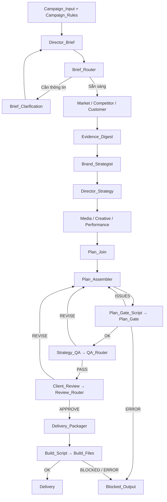

# Hướng dẫn cài đặt và sử dụng AI Advertising Strategy Team

Áp dụng cho dự án tại `D:\Project\chatdev`, đối chiếu với source và YAML ngày **13/11/2026**. Đây là hướng dẫn vận hành cấu hình hiện tại, không phải lịch sử các lần sửa lỗi. Nếu chuyển dự án sang thư mục khác, thay đường dẫn trong các lệnh tương ứng.

## Mục lục

1. [Hệ thống làm gì và chọn workflow nào](#1-he-thong)
2. [Cài đặt lần đầu](#2-cai-dat)
3. [Cấu hình môi trường và model](#3-cau-hinh)
4. [Mở giao diện và chạy lần đầu](#4-chay)
5. [Thêm và kiểm tra tools](#5-tools)
6. [Thêm và sử dụng skills](#6-skills)
7. [Luồng xử lý tổng thể](#7-luong)
8. [Giải thích 13 node Agent](#8-agents)
9. [Giải thích 16 node điều phối](#9-dieu-phoi)
10. [Edge: kết nối, điều kiện và truyền dữ liệu](#10-edges)
11. [Trạng thái, Router và thao tác duyệt](#11-trang-thai)
12. [File, schema dữ liệu và phiên bản](#12-du-lieu)
13. [Sửa kế hoạch và khôi phục phiên dở](#13-khoi-phuc)
14. [Kết quả cuối cùng và cách đọc](#14-ket-qua)
15. [Xử lý lỗi và tiết kiệm token](#15-su-co)
16. [Danh sách kiểm tra trước khi chạy](#16-checklist)
17. [Phụ lục cấu hình lấy từ YAML](#17-phu-luc)

<a id="1-he-thong"></a>
## 1. Hệ thống làm gì và chọn workflow nào

Bạn nhập một brief chiến dịch: sản phẩm, khách hàng, mục tiêu, ngân sách, thời gian và ràng buộc. Các Agent lần lượt nghiên cứu, lập chiến lược, phân bổ ngân sách, đề xuất nội dung, thiết kế đo lường rồi tổng hợp thành hồ sơ để QA và bạn duyệt.

Kết quả là **tài liệu lập kế hoạch quảng cáo**, không phải chiến dịch đã được tạo trong Meta/Google Ads. Hệ thống hiện không tự chi tiền, đăng quảng cáo, tạo ảnh/video hoàn chỉnh hoặc lấy số liệu tài khoản quảng cáo theo thời gian thực.

| Workflow trong `D:\Project\chatdev\yaml_instance` | Mục đích | Lưu ý |
|---|---|---|
| `ad_agency_v2.yaml` | Luồng đầy đủ dùng hằng ngày; 29 node, 71 edge, 13 Agent | Có người trả lời brief và duyệt trước bàn giao; dùng file này cho chiến dịch mới |
| `ad_agency_v2_auto.yaml` | Luồng đầy đủ để thử nghiệm/so sánh tự động | Hai bước Human được thay bằng literal: tự đề nghị dùng giả định và tự gửi lệnh duyệt. Không tương đương đã được khách hàng duyệt |
| `ad_agency_v2_phase1.yaml` | Bản rút gọn để quan sát các bước đầu | Không có toàn bộ cơ chế kiểm tra và bàn giao của v2; đừng dùng làm tiêu chuẩn nghiệm thu bản đầy đủ |

Các YAML là đồ thị chạy. Source Python trong dự án cung cấp runtime, tool, Router và bộ kiểm tra dữ liệu. Chép riêng YAML sang một bản ChatDev chưa có các hàm tùy chỉnh sẽ không đủ để chạy giống dự án này.

<a id="2-cai-dat"></a>
## 2. Cài đặt lần đầu

### 2.1. Chuẩn bị

| Thành phần | Yêu cầu và vai trò |
|---|---|
| Python | **3.12**; `pyproject.toml` giới hạn `>=3.12,<3.13` |
| uv | Cài dependency Python và chạy backend |
| Node.js/npm | Node **20.19+ trong nhánh 20, hoặc 22.12+** theo yêu cầu Vite hiện tại; dùng bản 22.12+ hoặc 24 phù hợp nếu đã có |
| Model endpoint | 9Router hoặc gateway tương thích mà bạn đang sử dụng; cần model hỗ trợ gọi tool |
| Trình duyệt | Chrome/Edge để mở frontend |

Docker không phải điều kiện bắt buộc cho cách chạy local dưới đây. Hai node Python của workflow này chạy trên máy backend khi đã bật quyền; chúng không tự được đưa vào Docker sandbox.

Kiểm tra công cụ trong PowerShell:

```powershell
uv --version
node --version
npm --version
```

Nếu lệnh chưa có, cài công cụ tương ứng rồi mở terminal mới. Không cần cài lại nếu dự án hiện tại đã chạy được.

Nếu đã có Python nhưng chưa có uv, có thể cài bằng `python -m pip install uv`. Sau đó kiểm tra lại `uv --version`. Cài Python/Node.js trước nếu máy chưa có các công cụ nền này; không dùng Python 3.13 cho môi trường dự án hiện tại.

### 2.2. Cài dependency backend

```powershell
cd D:\Project\chatdev
uv python install 3.12
uv sync
```

`uv sync` tạo/cập nhật `.venv` theo dependency của dự án. `openpyxl` phục vụ Excel; package `python-pptx` được import bằng tên `pptx` để tạo PowerPoint. Cả hai đã có trong dependency hiện tại.

### 2.3. Cài dependency frontend

Mở PowerShell thứ hai:

```powershell
cd D:\Project\chatdev\frontend
npm ci
```

`npm ci` dùng lockfile và cài lại `node_modules`; dừng frontend đang chạy trước khi thực hiện. Nếu đang sử dụng dự án bình thường và thư viện đã đủ, bỏ qua bước này. Không cần chạy lệnh cài dependency trước mỗi chiến dịch.

### 2.4. Tạo file môi trường khi chưa có

```powershell
cd D:\Project\chatdev
if (-not (Test-Path -LiteralPath .env)) {
    Copy-Item -LiteralPath .env.example -Destination .env
}
```

Sửa `D:\Project\chatdev\.env` bằng editor. Giữ file này riêng tư; không đưa API key vào System Prompt, skill, đề bài hoặc ảnh chụp chia sẻ.

<a id="3-cau-hinh"></a>
## 3. Cấu hình môi trường và model

### 3.1. Những biến cần biết

Ví dụ cấu trúc `.env` — thay các giá trị minh họa bằng cấu hình dịch vụ của bạn:

```dotenv
BASE_URL=http://127.0.0.1:PORT_CUA_9ROUTER/v1
API_KEY=KHOA_MODEL_CUA_BAN
MAC_ALLOW_UNSAFE_CODE_EXECUTION=1

# Chỉ thêm nếu sử dụng công cụ web tương ứng:
# SERPER_DEV_API_KEY=KHOA_SERPER
# JINA_API_KEY=KHOA_JINA
```

`PORT_CUA_9ROUTER` là chỗ giữ chỗ, không phải địa chỉ chạy thật. Dùng đúng địa chỉ và đường dẫn API mà gateway cung cấp. Backend ChatDev cổng 6400 và cổng model gateway là hai dịch vụ khác nhau.

| Biến | Cần khi nào? | Giải thích |
|---|---|---|
| `BASE_URL` | Cấu hình Agent dùng `${BASE_URL}` | Địa chỉ model endpoint; không điền địa chỉ frontend |
| `API_KEY` | Cấu hình Agent dùng `${API_KEY}` | Khóa xác thực model/gateway |
| `MAC_ALLOW_UNSAFE_CODE_EXECUTION=1` | Luồng đầy đủ có `Plan_Gate`, `Build_Files` | Cho phép thực thi Python từ workflow tin cậy trên backend; không phải bật sandbox |
| `SERPER_DEV_API_KEY` | Dùng `web_search` | Khóa Serper để tìm kiếm; khác khóa model |
| `JINA_API_KEY` | Tùy chọn cho `read_webpage_content` | Khóa dịch vụ đọc trang; source hiện cho phép gọi không key nhưng có giới hạn/tốc độ phụ thuộc dịch vụ |
| `MODEL_STRONG`, `MODEL_CHEAP`, `MODEL_REVIEW` | Chạy bản auto có placeholder tương ứng | Tên model thực mà gateway nhận, không phải tên vai trò Agent |

Backend nạp `.env` khi khởi động. Biến đã có trong môi trường PowerShell được ưu tiên, vì loader không ghi đè chúng. Nếu `.env` đã đặt `1` nhưng terminal vẫn giữ `0`, kiểm tra bằng `$env:MAC_ALLOW_UNSAFE_CODE_EXECUTION`; sửa hoặc bỏ giá trị cũ của biến đó rồi khởi động lại backend.

Lệnh `$env:MAC_ALLOW_UNSAFE_CODE_EXECUTION = "1"` chỉ đặt biến cho PowerShell hiện tại và các tiến trình khởi chạy từ nó. Đặt trong `.env` giúp không phải nhập lại mỗi lần. Thay đổi `.env` không cập nhật tiến trình backend đang chạy; cần dừng bằng `Ctrl+C` rồi mở lại khi không còn phiên đang xử lý.

### 3.2. Tránh vòng placeholder

Trong Agent, `Base URL = ${BASE_URL}` và `API Key = ${API_KEY}` là tham chiếu tới giá trị môi trường. Không tạo biến workflow có tên `BASE_URL` rồi lại đặt giá trị `${BASE_URL}` cho chính nó. Cấu hình tự tham chiếu này gây `Detected placeholder cycle`.

### 3.3. Cấu hình một Agent trên giao diện

Mở workflow trong editor, chọn node Agent, mở Advanced Settings nếu cần:

| Trường | Cách đặt |
|---|---|
| ID | Giữ nguyên ID đang có, ví dụ `Creative_Director`; đổi ID cần sửa mọi cạnh/tham chiếu liên quan |
| Type | `agent` |
| Name | Tên model/alias đúng với gateway, không phải tên hiển thị của nhân viên |
| Provider | `OpenAI` nếu endpoint đang cung cấp API tương thích OpenAI, kể cả model gốc thuộc hãng khác |
| System Prompt | Vai trò, nhiệm vụ, file phải ghi, schema và dòng trạng thái; giữ các quy tắc đã có |
| Base URL / API Key | `${BASE_URL}` / `${API_KEY}`, hoặc cấu hình riêng nếu bạn chủ động dùng dịch vụ khác |
| Parameters | Với gateway của workflow hiện tại, có `protocol: chat`; giữ tham số khác phù hợp model |
| Context Window | Là giới hạn lịch sử message mà node giữ, không phải số token tối đa của model; Brief hiện dùng 8, các Agent còn lại 0 theo cấu hình |
| Tooling / Agent Skills | Gắn theo mục 5–6 |

Provider ở đây là **adapter giao thức**, không khẳng định hãng tạo model. Một model Gemini qua gateway OpenAI-compatible vẫn có thể dùng Provider OpenAI. Điều này không bảo đảm mọi gateway chuyển đổi tool calling giống nhau.

`protocol: chat` là lựa chọn giao thức trong adapter dự án, không phải tham số chuẩn gửi nguyên sang SDK. Nếu xuất hiện lỗi `unexpected keyword argument 'protocol'`, kiểm tra đúng source adapter của dự án đang chạy; không chỉ đổi prompt.

Trong YAML chính hiện tại, `Creative_Director` dùng `cx/gpt-6.1-sol`; bảng model đầy đủ ở phụ lục. Tên trong bảng chỉ phản ánh cấu hình đã lưu, không bảo đảm gateway của bạn luôn có model đó. Không đổi đồng loạt model chỉ để xử lý lỗi của một Agent.

<a id="4-chay"></a>
## 4. Mở giao diện và chạy lần đầu

### 4.1. Kiểm tra trước khi gọi model

```powershell
cd D:\Project\chatdev
uv run python tools/preflight_ad_agency.py
```

Mong đợi dòng `PREFLIGHT: OK`. Công cụ kiểm schema/graph của workflow chính, tool có tồn tại, skill có tìm và kích hoạt được, dependency, quyền Python và việc đưa nội dung file text vào Chat tool response. Công cụ không gọi model, không kiểm API key thực sự còn tiền hay model có hoạt động.

Thêm `--auto` nếu chuẩn bị chạy bản auto. `--all-yamls` kiểm cả các mẫu khác trong repository; lỗi của một mẫu không dùng không đồng nghĩa workflow quảng cáo bị lỗi. Không cần sửa mọi mẫu chỉ để chạy v2.

### 4.2. Chạy hai terminal

**Terminal backend**, chạy từ thư mục gốc để `.env` và đường dẫn được nạp đúng:

```powershell
cd D:\Project\chatdev
uv run python server_main.py --port 6400
```

Khi đang phát triển source có thể thêm `--reload`. Để phiên chạy ổn định, tránh sửa source hoặc chủ động restart backend trong lúc Agent đang xử lý.

**Terminal frontend**:

```powershell
cd D:\Project\chatdev\frontend
$env:VITE_API_BASE_URL = "http://127.0.0.1:6400"
npm run dev
```

Mở địa chỉ Vite in trong terminal, thường là `http://127.0.0.1:5173`. Nếu cổng bận, Vite có thể chọn cổng khác. Giữ cả hai terminal hoạt động. Không mở thêm backend thứ hai trên cùng cổng 6400.

### 4.3. Chọn, chỉnh và lưu workflow

1. Vào khu vực Workflows/editor, chọn `ad_agency_v2.yaml`.
2. Kiểm tra model, tools, skills và các cạnh; mở Advanced Settings khi trường đang ẩn.
3. Submit hộp cấu hình để áp dụng thay đổi vào node/edge, sau đó lưu workflow bằng chức năng Save của editor. Submit hộp thoại không nên được coi là đã lưu file hoàn chỉnh.
4. Mở lại workflow để xác nhận cấu hình đã lưu. Nếu đổi bằng file YAML ngoài editor, tải lại workflow để tránh canvas còn giữ cấu hình cũ.
5. Vào Launch, chọn đúng workflow trong Workflow Selection rồi nhập đề bài.

Để kiểm tra frontend mới, tải lại trang khi phù hợp; không bấm Relaunch chỉ để nhìn thay đổi CSS. Relaunch có thể tạo lượt chạy và gọi lại model.

### 4.4. Prompt thử ngắn

```text
Lập kế hoạch Facebook cho quán cà phê Mây tại Cầu Giấy, Hà Nội, từ 01/12/2026 đến 07/12/2026. Tổng ngân sách 1.200.000 VND, gồm quảng cáo 1.000.000 và nội dung 200.000. Giá đồ uống 40.000 VND. Mục tiêu tăng khách đến quán, ghi nhận mã MAY01 tại quầy. Chỉ 1 phân khúc và 1 concept. Không tìm web; thông tin chưa kiểm chứng ghi giả thuyết, không bịa CPM/CPC/CPA. Xuất đủ file theo schema nhưng viết ngắn.
```

Đây là dữ liệu minh họa, không phải thông tin đã xác minh về một doanh nghiệp. Viết ngắn giúp giảm phần trình bày; một luồng đầy đủ vẫn gọi nhiều Agent nên không đồng nghĩa chỉ tốn một request.

### 4.5. Đọc màn hình Launch

| Thành phần | Cách dùng |
|---|---|
| Chat | Xem kết quả, file đính kèm, lỗi và phản hồi Human theo thời gian |
| Graph | Xem node đang chạy và quan hệ kết nối; panel chat bên trái có thể thu gọn |
| Show More / Show Less | Mở/thu nội dung dài; code và bảng rộng cuộn ngang bên trong tin nhắn |
| Download trên thẻ file | Tải thêm một bản về thư mục tải xuống của trình duyệt |
| Status | Phân biệt đang chạy, chờ bạn, hoàn thành hoặc thất bại |
| Download Logs | Lấy thông tin để chẩn đoán thay vì chạy lại ngay |

Chỉ nhìn thấy một file hoặc một node hoàn thành chưa chứng minh bộ bàn giao đã đủ. Cần xem `Build_Files`, `Delivery` và thư mục đầu ra của đúng phiên.

<a id="5-tools"></a>
## 5. Thêm và kiểm tra tools

### 5.1. Tool khác skill thế nào?

**Tool thực hiện thao tác**, ví dụ đọc/ghi file hoặc tìm web. **Skill hướng dẫn cách làm nghiệp vụ**, ví dụ kiểm tra claim hay phân bổ ngân sách. Gắn skill không tự cấp khả năng ghi file hoặc tìm kiếm.

### 5.2. Ba tool file cho cả 13 Agent

| Tool | Làm gì? | Ví dụ tham số khi model gọi |
|---|---|---|
| `list_directory` | Xem file đang tồn tại trong workspace phiên | Xem thư mục `artifacts` |
| `load_file` | Đọc file nguồn/kiểm lại file vừa ghi | `path_or_id: artifacts/campaign_brief.json` |
| `save_file` | Ghi file thật và trả thông tin file | `path`, `content`, tùy chọn `encoding`, `mode` |

Ví dụ yêu cầu ghi CSV: `path=artifacts/media_plan.csv`, `encoding=utf-8-sig`, `mode=overwrite`. Nội dung truyền vào phải là CSV thật; không chèn hàng rào Markdown vào file.

Không cần cấp `file:All` hoặc công cụ xóa/chạy lệnh cho mọi Agent. Các tool file được giới hạn trong workspace của phiên; vai trò và danh sách file phải ghi vẫn cần nêu rõ trong prompt. Có `save_file` không đồng nghĩa đã có cơ chế phân quyền ghi riêng từng Agent ở cấp hệ điều hành.

### 5.3. Thao tác trên giao diện

1. Chọn node Agent → Advanced Settings → **Tooling** → **Add Entry**.
2. Chọn **Tool Type = function**.
3. Trong cấu hình danh sách **Tools**, thêm mục, chọn Name `list_directory`, `load_file`, `save_file`; mỗi tool là một mục riêng.
4. Submit các hộp cấu hình lồng nhau rồi Save workflow. Nếu đã có tool, kiểm danh sách trước, không thêm trùng.
5. Mở lại node để kiểm tra. Nếu danh sách không cho chọn tool mới, tải lại editor hoặc restart backend sau khi thay đổi module tool; đừng thay bằng một tên không tồn tại.

Với tool file đã có, bạn không phải tạo Python tool mới. Trường tham số cụ thể được model điền khi gọi tool, không cần nhập sẵn nội dung campaign vào cấu hình tool của node.

Ví dụ tương đương trong cấu hình Agent, không phải một workflow độc lập:

```yaml
tooling:
  - type: function
    config:
      tools:
        - name: list_directory
        - name: load_file
        - name: save_file
```

### 5.4. Tool web: gắn ở đâu?

| Agent | Tool web đang được cấu hình trong YAML chính |
|---|---|
| `Market_Researcher` | `web_search`, `read_webpage_content` |
| `Competitor_Analyst` | `web_search`, `read_webpage_content` |
| `Customer_Insight` | `web_search`, `read_webpage_content` |
| `Evidence_Digest` | `read_webpage_content` để đối chiếu nguồn |
| Các Agent khác | Không cần tool web trong cấu hình hiện tại |

`web_search` dùng Serper theo source hiện tại. `read_webpage_content` đọc qua Jina Reader. Khi chưa cấu hình dịch vụ tìm kiếm, dùng đề bài ghi rõ **không tìm web**; bootstrap sẽ loại tool web khỏi các Agent của phiên. Khi đó vẫn cần tạo `sources.csv`, nhưng phân loại nguồn tài liệu/giả thuyết trung thực, không tạo URL giả.

### 5.5. Xác nhận tool có chạy thật

Trong Chat có dòng Tool `save_file`, thẻ Download và file xuất hiện trong workspace là những bằng chứng hữu ích. Một câu “đã lưu” do model viết chưa đủ. Nếu có hai file bắt buộc, kiểm cả hai; một tool gọi thành công không tự có nghĩa cả bộ file đã được tạo.

`Plan_Gate` và `Build_Files` là **node Python**, không phải Agent cần được thêm `execute_code` vào Tooling. Code của chúng đến từ node literal tương ứng.

<a id="6-skills"></a>
## 6. Thêm và sử dụng skills

### 6.1. Skill nằm ở đâu?

Skill nghiệp vụ của dự án nằm trong `D:\Project\chatdev\.agents\skills`. Có **18 skill quảng cáo**: 13 skill vai trò và 5 skill bổ sung. Thư mục còn có thể có skill mẫu khác; không cần gắn tất cả.

Ví dụ cấu trúc:

```text
D:\Project\chatdev\.agents\skills\ad-data-contracts\
  SKILL.md
  references\
    current-schema.md
```

`SKILL.md` chứa tên, mô tả và quy trình. Tài liệu trong `references` được đọc khi cần. Phần tên thư mục/name phải khớp với skill đã được hệ thống nhận diện.

### 6.2. Gắn skill trên giao diện

1. Chọn Agent → Advanced Settings → **Agent Skills** → **Configure AgentSkillsConfig**.
2. Bật **Enabled**.
3. Thêm skill vào **Allowed Skills / Allow**, chọn đúng tên từ danh sách. Gắn skill vai trò chính trước, rồi skill bổ sung cần thiết theo bảng ở phụ lục.
4. Submit và Save workflow. Mở lại Agent để xác nhận.
5. Chạy preflight để kiểm discovery/activation offline trước khi chạy chiến dịch.

Ví dụ cấu hình dưới `config` của Agent:

```yaml
skills:
  enabled: true
  allow:
    - ad-media-planning
    - ad-data-contracts
    - ad-budget-feasibility
```

Runtime tự cung cấp tool skill như `activate_skill` và `read_skill_file` khi cấu hình skills bật. Không cần tự thêm chúng như tool file trong Tooling. Được phép dùng skill không bảo đảm model đã kích hoạt; xem timeline để biết nó có gọi `activate_skill` hay không.

### 6.3. Năm skill bổ sung dùng để làm gì?

| Skill | Giá trị | Gắn cho Agent |
|---|---|---|
| `ad-data-contracts` | Định dạng số, CSV/JSON, ID và sửa schema không đổi ý nghĩa | `Media_Planner`, `Performance_Analyst`, `Plan_Assembler` |
| `ad-budget-feasibility` | Kiểm ngân sách có đủ cho số kênh, thử nghiệm và mục tiêu | `Director_Strategy`, `Media_Planner`, `Strategy_QA` |
| `ad-tracking-readiness` | Phân biệt tracking đang có và tracking phải chuẩn bị | `Performance_Analyst`, `Strategy_QA` |
| `ad-claims-review` | Kiểm claim, bằng chứng và giới hạn cách diễn đạt | `Evidence_Digest`, `Creative_Director`, `Strategy_QA` |
| `ad-campaign-learning` | Đọc kết quả thực tế, so sánh giả định, đề xuất điều chỉnh | `Director_Strategy`, `Media_Planner`, `Performance_Analyst`; chỉ áp dụng nghiệp vụ này khi có dữ liệu thực |

Skill học từ chiến dịch không tự kết nối tài khoản quảng cáo hoặc tự tạo dữ liệu kết quả. Nếu chưa có dữ liệu, Agent phải ghi thiếu, không dựng thành tích giả.

### 6.4. Khi sửa hoặc thêm một skill mới

Tạo thư mục riêng dưới `.agents\skills`, có `SKILL.md` mở đầu bằng frontmatter:

```markdown
---
name: ten-skill-moi
description: Khi nào dùng kỹ năng này và kết quả nó hỗ trợ tạo ra.
---

# Quy trình nghiệp vụ

Nêu đầu vào cần đọc, các bước xử lý, tiêu chí chất lượng và giới hạn.
```

Chỉ tạo skill mới khi nhiệm vụ chưa được skill hiện có bao phủ. Sau khi thêm, kiểm tra discovery bằng preflight và tải lại editor; backend có thể cần restart để schema lựa chọn phản ánh danh sách mới. Không tạo đường dẫn tài liệu tham chiếu chưa tồn tại.

Quy tắc file được ghi, trạng thái cuối và không tự khai thành công vẫn giữ trong System Prompt. Skill bổ sung quy trình; không thay thế Gate bằng code, không tự mở rộng quyền tool.

<a id="7-luong"></a>
## 7. Luồng xử lý tổng thể



Đây là sơ đồ rút gọn: các đường dự phòng, cạnh truyền ngữ cảnh và `Revision_Limit` có trong bảng cạnh ở phụ lục. Ba Agent nghiên cứu có thể chạy song song; ba Agent Media/Creative/Performance cũng có thể chạy song song. Cách xếp lịch không thay thế việc kiểm đủ file bàn giao.

Không cần thêm một Agent PM để chọn từng bước: đồ thị và Router đang đảm nhiệm điều phối; `Strategy_QA` kiểm chuyên môn, còn bạn duyệt tại `Client_Review`.

<a id="8-agents"></a>
## 8. Giải thích 13 node Agent

Mọi đường dẫn dưới đây bắt đầu từ `artifacts/` trong **workspace phiên chạy**, không phải thư mục `yaml_instance` hoặc thư mục skill. Cột “Đầu vào” là nguồn phải sử dụng; không phải mọi file đều được edge chép nguyên văn vào Chat. Agent có thể phải dùng `load_file` để đọc.

| Agent | Đầu vào chính | Nhiệm vụ | File bắt buộc |
|---|---|---|---|
| `Director_Brief` | Đề bài gốc, Campaign_Rules, trả lời bổ sung | Hợp nhất brief, xác định thông tin còn thiếu, giữ ngân sách/ngày/ràng buộc | `campaign_brief.json` khi READY |
| `Market_Researcher` | Brief, nguồn được cấp, web nếu được phép | Mô tả thị trường, bối cảnh, cơ hội và giới hạn nguồn | `market_research.md` |
| `Competitor_Analyst` | Brief, thị trường mục tiêu, nguồn | Phân tích đối thủ và lựa chọn thay thế; tách quan sát khỏi suy luận | `competitor_analysis.md` |
| `Customer_Insight` | Brief, nguồn và giả thuyết khách hàng | Phân khúc, nhu cầu, rào cản và hành trình | `audience_segments.json`, `customer_journey.md` |
| `Evidence_Digest` | Ba nhánh nghiên cứu và nguồn liên quan | Tổng hợp bằng chứng, đánh dấu mâu thuẫn/claim chưa được hỗ trợ | `evidence_digest.md`, `sources.csv` |
| `Brand_Strategist` | Brief, khách hàng, đối thủ, bằng chứng | Chọn định vị và lý do khác biệt có thể bảo vệ | `brand_positioning.md` |
| `Director_Strategy` | Brief, định vị, khách hàng, bằng chứng | Chốt mục tiêu, phân khúc, offer, funnel và bộ ID thống nhất | `campaign_strategy.md`, `strategy_ids.json` |
| `Media_Planner` | Chiến lược, ID, ngân sách, thời gian | Chọn kênh, phân bổ tiền và kịch bản định lượng khi có cơ sở | `media_plan.csv`, `budget_scenarios.csv` |
| `Creative_Director` | Chiến lược, định vị, insight, bằng chứng | Concept, thông điệp, hook, CTA, yêu cầu asset và biến thể | `creative_brief.md`, `creative_matrix.csv` |
| `Performance_Analyst` | Chiến lược, mục tiêu, ràng buộc đo lường | KPI, tracking, thử nghiệm và quy tắc ra quyết định | `measurement_plan.md`, `experiment_plan.csv` |
| `Plan_Assembler` | Các kế hoạch hiện hành, brief/chiến lược, lỗi/góp ý | Tổng hợp kế hoạch; trong rework sửa cả file bảng và thuyết minh thuộc phạm vi | `advertising_strategy_draft.md`, `execution_calendar.csv` |
| `Strategy_QA` | Bản nháp, file nguồn, kết quả Plan_Gate và plan_version | Đánh giá nhất quán, bằng chứng, ngân sách khả thi, tracking, tính triển khai | `qa_report.json` và quyết định cuối `QA: PASS` hoặc `QA: REVISE` |
| `Delivery_Packager` | Bản được duyệt, QA PASS, lệnh duyệt của bạn | Ghi chú bàn giao, hạn chế còn mở, cách sử dụng | `handoff_notes.md` |

### 8.1. Các điểm hay nhầm

- **Brief:** khi thiếu đầu vào thiết yếu, hỏi qua `BRIEF: NEED_INFO`; không tự gán ngân sách/ngày tùy ý rồi báo READY. Mỗi lần hỏi/đáp phải giữ brief đã hợp nhất.
- **Nghiên cứu:** không có web thì không gọi giả thuyết là “dữ liệu thị trường đã xác minh”. Ghi nhãn tài liệu, suy luận, giả thuyết cho rõ.
- **Evidence:** phải ghi đủ hai file. `sources.csv` là bảng liên kết claim–nguồn, không phải file chỉ có khi bật tìm web. Node này tổng hợp nghiệp vụ, không phải cổng Python có quyền quyết định thay QA.
- **Chiến lược:** ID như S1/O1 giúp bảng Media, Creative và lịch triển khai nói về cùng đối tượng/offer. Không tự tạo lại ID ở mỗi nhánh.
- **Media:** tiền quảng cáo khác tiền sản xuất nội dung. Không dự báo số khi không có dữ liệu/giả định được phép; dùng `NOT_ESTIMATED` đúng schema.
- **Creative:** đề xuất nội dung và yêu cầu asset; không được coi ảnh/video là đã được sản xuất chỉ từ mô tả.
- **Performance:** mẫu thử nhỏ có thể chỉ đủ quan sát vận hành, không tự chứng minh hiệu quả thống kê hoặc nhân quả.
- **Assembler:** sửa Markdown mà bỏ nguyên CSV sai sẽ khiến Gate tiếp tục từ chối. File hiện hành là nguồn đúng; message cũ chỉ là tham chiếu.
- **QA:** PASS nghĩa là bản kế hoạch đủ điều kiện theo tiêu chí kiểm tra, không bảo đảm quảng cáo sẽ sinh lời. JSON và dòng quyết định phải thống nhất và cùng phiên bản.
- **Packager:** không chép lại/viết lại toàn bộ chiến lược đã duyệt. Script chịu trách nhiệm sao chép và manifest.

<a id="9-dieu-phoi"></a>
## 9. Giải thích 16 node điều phối

Các node sau không gọi LLM. Đừng gắn model, skill hoặc tool ghi file cho chúng chỉ vì tên có chữ “Plan” hay “Review”.

| Node | Loại | Nhận gì và xử lý gì? | Kết quả/đường đi |
|---|---|---|---|
| `Campaign_Input` | passthrough | Nhận đề bài người dùng; cấu hình lấy message cuối | Truyền yêu cầu sang Rules và giữ bản gốc cho Brief |
| `Campaign_Rules` | literal | Phát bộ quy tắc cố định cho chiến dịch | Hướng dẫn cho Brief, đồng thời gửi ngữ cảnh tới QA |
| `Brief_Router` | passthrough | Nhận brief đã được hàm `ad_brief_route` kiểm dòng trạng thái và thêm token | READY mở nghiên cứu; NEED_INFO mở Human; sai định dạng sang Blocked |
| `Brief_Clarification` | human | Hiển thị câu hỏi thiếu thông tin | Chờ bạn trả lời rồi chuyển lại Brief |
| `Plan_Join` | passthrough | Gom bàn giao Media/Creative/Performance; không chỉ lấy message cuối | Truyền tới Assembler; không tự chứng nhận đủ file/hợp lệ |
| `Plan_Gate_Script` | literal | Phát Python code kiểm tra đã lưu trong YAML | Gửi code cho Plan_Gate; thấy code trong Chat ở đây là bình thường |
| `Plan_Gate` | python | Đọc file thật, kiểm bảng/ngân sách/ID/ngày; chụp snapshot khi đạt | `PLAN: OK`, `PLAN: ISSUES` hoặc `PLAN: ERROR`; timeout hiện 60 giây |
| `QA_Router` | passthrough | Nhận quyết định QA đã qua `ad_qa_route` | PASS tới Human; REVISE về sửa; sai/mất trạng thái tới Blocked |
| `Client_Review` | human | Cho bạn xem bản nháp, kết quả Gate/QA và phiên bản | Chờ lệnh `HUMAN: APPROVE` hoặc `HUMAN: REVISE` kèm góp ý |
| `Review_Router` | passthrough | Kiểm lệnh Human bằng `ad_review_route` | APPROVE tới Packager; REVISE về sửa; INVALID tới thông báo lỗi |
| `Invalid_Review_Notice` | literal | Giải thích cú pháp duyệt không hợp lệ | Chuyển thông báo tới Blocked_Output |
| `Revision_Limit` | loop_counter | Đếm chung yêu cầu sửa từ Gate/QA/Human | Cho phép 3 lượt sửa; chạm yêu cầu thứ 4 phát giới hạn và kết thúc vòng |
| `Build_Script` | literal | Phát Python code đóng gói | Gửi code sang Build_Files; đây chưa phải bằng chứng build đã chạy |
| `Build_Files` | python | Kiểm hash/QA phiên bản, sao chép danh sách trắng, tạo Excel/PPTX/manifest | `BUILD: OK`, `BUILD: BLOCKED` hoặc `BUILD: ERROR`; timeout hiện 180 giây |
| `Delivery` | passthrough | Nhận kết quả build hợp lệ | Node kết thúc thành công của workflow |
| `Blocked_Output` | passthrough | Tập hợp lý do chặn từ các nhánh | Node kết thúc bị chặn; không đồng nghĩa đã bàn giao |

`passthrough` chuyển dữ liệu, không tự suy luận. `literal` phát nội dung cố định. `human` chờ người. `python` chạy code. `loop_counter` theo dõi lượt vòng. Nhìn tên node chưa đủ để suy ra loại; kiểm trường Type.

Lỗi provider hoặc runtime có thể ném exception và kết thúc workflow trước khi đi tới `Blocked_Output`. Vì vậy không phải mọi lần thất bại đều có một tin nhắn từ node Blocked.

<a id="10-edges"></a>
## 10. Edge: kết nối, điều kiện và truyền dữ liệu

### 10.1. Đọc một cạnh như thế nào?

Một edge có hai công việc có thể tách nhau: **gửi dữ liệu** và **cho phép node đích được kích hoạt**. Ngoài ra nó có thể lọc/đổi payload trước khi chuyển. Node không tự chọn người nhận việc chỉ bằng cách viết tên Agent khác trong Chat.

| Trường giao diện | YAML | Ý nghĩa |
|---|---|---|
| From / To | `from` / `to` | ID node nguồn và đích |
| Trigger | `trigger` | Cho phép cạnh này kích hoạt đích; mặc định true. Tắt thì vẫn có thể truyền ngữ cảnh |
| Pass Data to Target | `carry_data` | Có chuyển payload hay không; mặc định true |
| Condition | `condition` | Điều kiện lọc trên output nguồn trước bước xử lý payload |
| Keep Message Input | `keep_message` | Giữ message làm ngữ cảnh ở đích; mặc định false |
| Clear Context | `clear_context` | Dọn ngữ cảnh đến không được đánh dấu giữ trước khi nhận payload mới |
| Clear Kept Context | `clear_kept_context` | Dọn cả phần được đánh dấu giữ khi chủ động cấu hình |
| Payload Processor | `process` | Hàm xử lý/kiểm payload; trả `None` thì payload bị bỏ và cạnh không kích hoạt |
| Dynamic Expansion | `dynamic` | Tính năng mở rộng động; workflow quảng cáo hiện không cần bật thêm |

Không bật/tắt hàng loạt Trigger chỉ vì thấy nhiều đường nối. Một cạnh nét phụ có thể dùng để cung cấp brief cho Agent phía sau mà không cho nó chạy quá sớm.

### 10.2. Ba ví dụ thực tế

**Cạnh mở công việc:** `Director_Strategy → Media_Planner`. Trigger bật, dữ liệu được chuyển; sau khi chiến lược xong, Media nhận công việc.

**Cạnh chỉ bổ sung ngữ cảnh:** `Brief_Router → Media_Planner`. Trigger tắt, Keep Message bật. Media biết brief gốc nhưng không chạy ngay từ lúc brief vừa READY; còn chờ luồng chiến lược.

**Cạnh kiểm điều kiện:** `Plan_Gate → Strategy_QA`. Chỉ mở khi có `[[PLAN_OK]]`, không có marker lỗi thực thi và payload qua hàm kiểm tra. Gate ISSUES/ERROR không được mở QA theo cạnh này.

### 10.3. Contains keywords, Exclude keywords và regex

Trong Type `keyword`:

- Contains keywords (`any`): chỉ cần có một mục khớp. Đây là tìm chuỗi, không phải kiểm dòng cuối hay hiểu ngữ nghĩa.
- Exclude keywords (`none`): nếu có bất kỳ mục nào trong danh sách thì cạnh bị chặn; loại trừ được xét trước.
- Regular expressions (`regex`): cũng là đường khớp cho phép, **OR** với Contains, không phải kiểm tra bổ sung AND. Điền cả hai không làm cạnh chặt hơn như thường nghĩ.
- Case sensitive: cấu hình hiện dùng true, cần đúng chữ hoa/thường.

Workflow hiện dùng token ngắn trên cạnh để canvas dễ đọc. Quy tắc kiểm lệnh/dòng trạng thái chặt nằm trong hàm Router; không còn cần trải regex dài lên từng edge.

Không cần Exclude ở mọi cạnh. Giữ nguyên các loại trừ đang có vì chúng phục vụ các trường hợp khác nhau:

| Exclude | Tác dụng |
|---|---|
| `[[EXEC_FAIL]]` | Chặn marker lỗi chạy code; runtime vẫn nhận marker dài cũ để tương thích |
| `[[` | Trên một số cạnh trước Router: chặn đầu ra tự chèn token dành riêng, tránh giả mạo quyết định |

Nếu UI ghi `Excludes: [[, [[EXEC_FAIL]]`, đó là **hai chuỗi** được ngăn bằng dấu phẩy, không phải cú pháp ngoặc sai. Không rút gọn thành `FAIL`: chữ thông thường có thể xuất hiện trong giải thích hoặc tên phép kiểm.

### 10.4. Vì sao giữ đúng ba cạnh Clear Context?

Hiện bật ở `Plan_Assembler → Strategy_QA`, `Plan_Assembler → Client_Review`, `Plan_Assembler → Delivery_Packager`, đều là cạnh chỉ gửi dữ liệu. Mục đích là đưa bản nháp mới thay cho ngữ cảnh tạm của vòng trước.

Không bật thêm ở `Plan_Gate → Client_Review` hoặc `QA_Router → Delivery_Packager` một cách máy móc: thông báo tới sau có thể xóa bản nháp vừa gửi. `keep_message: false` cũng không có nghĩa xóa ngay message cũ trên tất cả các cạnh.

### 10.5. Các cạnh bổ sung so với một chuỗi Agent đơn giản

| Nhóm cạnh | Vì sao cần? |
|---|---|
| Input → Rules có `ad_agency_bootstrap` | Kiểm điều kiện chạy, cài bộ kiểm file và giữ ràng buộc đề bài trước Agent đầu tiên |
| Brief/QA/Human → Router | Chuyển quyết định dạng văn bản thành token đã được kiểm tra |
| Brief/Customer/Evidence/Brand/Strategy → Agent phía sau với Trigger tắt | Truyền brief và căn cứ, không mở Agent sai thời điểm |
| Gate/QA/Human → Assembler và Revision_Limit | Chuyển lỗi/góp ý về chỗ sửa và đếm chung số lượt |
| Assembler/Gate/QA → người duyệt hoặc Packager | Đưa đúng bản nháp, kết quả máy kiểm và QA hiện hành đến nơi sử dụng |
| Router/Gate/Build → nhánh fallback | Bắt trạng thái thiếu, sai, xung đột; tránh kết thúc im lặng hoặc giao nhầm |

Bảng 71 cạnh ở phụ lục cho biết chính xác cạnh nào bật Trigger, giữ message, dọn context và gọi hàm gì. Đây là bản mô tả để hiểu cấu hình; không cần tự nối lại các cạnh đã có.

<a id="11-trang-thai"></a>
## 11. Trạng thái, Router và thao tác duyệt

### 11.1. Văn bản cho người đọc và token cho máy

| Nguồn | Dòng trạng thái/lệnh | Token tương ứng |
|---|---|---|
| Director_Brief | `BRIEF: READY` / `BRIEF: NEED_INFO` | `[[BRIEF_READY]]` / `[[BRIEF_NEED_INFO]]` |
| Strategy_QA | `QA: PASS` / `QA: REVISE` | `[[QA_PASS]]` / `[[QA_REVISE]]` |
| Plan_Gate | `PLAN: OK` / `PLAN: ISSUES` / `PLAN: ERROR` | `[[PLAN_OK]]` / `[[PLAN_ISSUES]]` / `[[PLAN_ERROR]]` |
| Người duyệt | `HUMAN: APPROVE` / `HUMAN: REVISE` kèm góp ý | `[[REVIEW_APPROVE]]` / `[[REVIEW_REVISE]]` |
| Build_Files | `BUILD: OK` / `BUILD: BLOCKED` / `BUILD: ERROR` | `[[BUILD_OK]]` / `[[BUILD_BLOCKED]]` / `[[BUILD_ERROR]]` |

Brief và QA phải có **đúng một dòng quyết định riêng ở cuối message**, ngoài code fence. Các câu “Ví dụ lệnh là QA: PASS” hoặc “Không được kết luận QA: PASS” không phải quyết định hợp lệ. Sau dòng cuối không viết thêm phần giải thích. Agent không tự phát token hai ngoặc; Router phát token sau khi kiểm tra. Với Plan/Build, script phát token theo kết quả code.

Các trạng thái như `QA: BLOCKED`, `BRIEF: BLOCKED` không thuộc bộ trạng thái hợp lệ của Router này. Nếu xuất hiện, luồng sẽ đi hướng không hợp lệ/bị chặn; đừng thêm chúng vào cạnh thành công để cố cho chạy tiếp.

### 11.2. Khi Brief hỏi lại

Đọc câu hỏi trong `Brief_Clarification`, nhập thông tin còn thiếu vào ô chat. Ví dụ:

```text
Tiền quảng cáo là 1.000.000 VND, không gồm 200.000 tiền nội dung. Thời gian 01/12/2026–07/12/2026. Chỉ dùng Facebook và ghi nhận mã MAY01 tại quầy. Không tìm web.
```

Câu trả lời quay lại Director_Brief để hợp nhất. Không cần viết lệnh duyệt ở bước này. Nếu bạn cho phép dùng giả định, nêu rõ phạm vi; thông tin quyết định như ngân sách/ngày vẫn phải đủ hợp lệ để chuyển READY.

### 11.3. Khi đến Client_Review

Kiểm tra bản nháp, ngân sách, giới hạn bằng chứng, QA và `plan_version`. Chỉ dùng một trong hai cú pháp:

**Duyệt:** đúng một dòng, không thêm “ok”, dấu chấm, code fence hoặc lời giải thích:

```text
HUMAN: APPROVE
```

**Yêu cầu sửa:** phải có góp ý cụ thể:

```text
HUMAN: REVISE
Giữ nguyên tổng ngân sách và phân khúc S1. Sửa creative_matrix.csv để CTA dùng mã MAY01 thống nhất với kế hoạch đo lường; cập nhật bản nháp tương ứng.
```

`HUMAN: REVISE` đứng một mình không đủ. Token `[[REVIEW_APPROVE]]` không phải lệnh để bạn nhập. Lệnh sai đi tới `Invalid_Review_Notice` rồi `Blocked_Output`; không tự coi im lặng là duyệt.

<a id="12-du-lieu"></a>
## 12. File, schema dữ liệu và phiên bản

### 12.1. File có tự lưu trên máy không?

Có, khi tool ghi thành công: file nằm trên **máy chạy backend**, trong workspace riêng của phiên. Nếu backend ở máy bạn, ví dụ:

```text
D:\Project\chatdev\WareHouse\<session>\
  code_workspace\
    artifacts\                  File làm việc của các Agent
    review\
      review_manifest.json      Manifest của phiên bản đang xét
      <plan_version>\           Snapshot bộ nguồn được kiểm tra
    output\                     Bộ bàn giao sau build thành công
    diagnostics\                Chẩn đoán provider nếu có
```

`<session>` thường có dạng `session_...`; lấy đúng thư mục của phiên đang xem. Nút Download tạo thêm bản ở thư mục tải xuống; không phải thao tác bắt buộc để file xuất hiện trong workspace.

Nếu backend đặt trên server/Docker, đường dẫn nằm trên máy/container đó; không tự xuất hiện trong Downloads của Windows. Tin nhắn Chat là kênh trình bày, file trong workspace là dữ liệu làm việc, snapshot là bản dùng để đối chiếu.

### 12.2. Hợp đồng CSV

Giữ đúng tên cột. Mỗi dòng phải có đủ số ô; không có cột trùng, không chỉ có header. Quote ô chứa dấu phẩy, dấu nháy hoặc xuống dòng. CSV xuất cho Excel dùng UTF-8 BOM (`utf-8-sig`).

```csv
# media_plan.csv
channel,role,objective,segment_id,offer_id,budget_pct,budget_amount,currency,start,end,landing_page,assumption

# budget_scenarios.csv
scenario,channel,budget_amount,metric,metric_value,formula,assumption,estimate_status

# creative_matrix.csv
concept_id,segment_id,insight,hook,benefit,proof,cta,format,asset_requirement,test_variant

# experiment_plan.csv
test_id,hypothesis,variant_a,variant_b,primary_metric,min_sample,duration_days,decision_rule

# execution_calendar.csv
week,start,end,channel,activity,owner,deliverable

# sources.csv
id,claim,source_url,access_date,scope,evidence_type
```

Các dòng bắt đầu bằng `#` và dòng trống ở khối trên chỉ để phân biệt ví dụ trong tài liệu; **không chép chúng vào CSV thật**. Mỗi file thật có đúng header của chính nó.

Quy tắc dữ liệu quan trọng:

- Số dùng `1000000` hoặc `12.5`, không dùng `1.000.000 VND`, `12,5%`, `NaN`, `Infinity`. Không xóa dấu phẩy rồi âm thầm đổi nghĩa giá trị.
- `budget_pct=25` là 25%, không phải 0.25. Tiền Media phải thống nhất với `budget.ad_spend` và currency trong brief; không gộp production vào tiền quảng cáo.
- `start`, `end` dùng YYYY-MM-DD, ngày thật và trong khoảng chiến dịch. `week`, `duration_days`, `min_sample` là số nguyên dương theo quy tắc Gate.
- ID phân khúc/offer phải tồn tại trong `strategy_ids.json`; không đổi ID chỉ để qua kiểm tra.
- Một cặp `(scenario, channel)` có thể có nhiều metric nhưng lặp **cùng ngân sách**. Ví dụ leads và CPA cùng mô tả phân bổ 100 thì chi tiêu vẫn là 100, không phải 200. Giá trị lặp mâu thuẫn và metric trùng bị từ chối.
- `sources.csv.evidence_type` dùng `document`, `external`, `inference`, `hypothesis`. Không có nguồn ngoài thì dùng tài liệu/giả thuyết trung thực, để URL/ngày truy cập trống khi không áp dụng, giải thích trong claim/scope.

### 12.3. Dự báo chưa đủ dữ liệu

| Trạng thái | `metric_value` | `formula` và `assumption` |
|---|---|---|
| `ESTIMATED` | Số hữu hạn không âm | Cần công thức và giả định/cơ sở rõ |
| `NOT_ESTIMATED` | Để trống | Assumption bắt buộc giải thích dữ liệu thiếu; formula có thể trống hoặc ghi công thức chưa đủ đầu vào |

Không ghi “Thiếu dữ liệu” vào cột số; không thay unknown bằng 0. `budget_amount` vẫn là số hợp lệ ở cả hai trạng thái. Bảng cũ bảy cột chưa có `estimate_status` được hiểu là ESTIMATED nên vẫn cần giá trị số.

Gate ghi các dòng chưa ước lượng trong `info.unestimated_metrics`; Excel để ô giá trị trống và giữ cột trạng thái. Điều này giúp biểu diễn trung thực việc thiếu dự báo, không phải xác nhận kế hoạch đã đủ khả thi cho triển khai.

### 12.4. Hai lớp kiểm tra

**Ngay sau mỗi Agent:** runtime kiểm file bắt buộc tồn tại, không rỗng, JSON/CSV đọc được, header và số ô hợp lệ. Brief READY còn phải đủ ngân sách/ngày; báo cáo QA phải khớp quyết định và phiên bản. Vì vậy có thể dừng ở Creative/Evidence trước khi đến Plan_Gate.

**Tại Plan_Gate:** kiểm dữ liệu liên quan giữa các file, số học, ngân sách, ID và ngày. `ISSUES` là dữ liệu có thể yêu cầu sửa; `ERROR` dành cho thiếu đầu vào bắt buộc hoặc lỗi khiến không thể kiểm tiếp. Gate không thay thế đánh giá chất lượng chuyên môn của QA.

### 12.5. Snapshot, hash và plan_version

1. Khi Gate đạt, tính SHA-256 cho bộ 18 file nguồn và tạo `plan_version` từ các hash.
2. Lưu manifest hiện hành và snapshot trong `review/<plan_version>/`.
3. QA phải đọc đúng phiên bản, ghi `plan_version`, `verdict`, `plan_gate_status: OK` và `issues` trong `qa_report.json`.
4. Người dùng duyệt bản kế hoạch hiện hành.
5. Build kiểm file đang làm việc, snapshot và QA có khớp phiên bản không; sao chép bộ nguồn theo snapshot đã kiểm, thay vì nhờ LLM viết lại.

Đổi file sau review làm hash lệch; cần quay lại kiểm và duyệt. Không sửa manifest hoặc báo cáo QA để ép qua Build. Phiên bản là dấu vết byte dữ liệu, không phải bằng chứng mọi claim đều đúng.

<a id="13-khoi-phuc"></a>
## 13. Sửa kế hoạch và khôi phục phiên dở

### 13.1. Vòng sửa nghiệp vụ

Ba nguồn yêu cầu sửa là Gate ISSUES, QA REVISE và Human REVISE. Chúng chuyển lỗi/góp ý về `Plan_Assembler` và tăng chung `Revision_Limit`. Cấu hình hiện cho phép **3 lượt sửa** sau lần tổng hợp đầu; yêu cầu sửa thứ 4 kết thúc theo giới hạn.

Assembler đọc file hiện hành, sửa đúng bảng/thuyết minh rồi Gate kiểm lại. Nếu Gate OK thì QA chạy lại; nếu QA PASS thì bạn duyệt lại. Các planner không tự được chạy lại chỉ vì Assembler nhận lỗi. Nếu phải nghiên cứu lại căn bản hoặc đổi chiến lược, đó có thể là một phiên kế hoạch mới.

`Revision_Limit` không phải cổng duy nhất mà mọi cạnh sửa phải đi xuyên qua: đồ thị còn có cạnh trực tiếp về Assembler, và bộ đếm kết thúc vòng theo cơ chế runtime. Không tự xóa một cạnh ra của bộ đếm vì nghĩ bị trùng; sửa vòng cần kiểm hành vi engine riêng.

Vòng hỏi brief và retry request model khác với vòng sửa kế hoạch. Retry hiện cấu hình tối đa 2 attempt cho Agent và không tự retry `ProviderResponseError`; không nên tăng retry vô hạn để che lỗi định dạng provider.

### 13.2. Muốn bổ sung khi workflow đang chạy

- Nếu chỉ góp ý cho kế hoạch: chờ `Client_Review`, gửi HUMAN REVISE cụ thể.
- Nếu đang ở `Brief_Clarification`: trả lời ngay phần thiếu của brief.
- Nếu thay đổi mục tiêu, model, tools, skills hoặc cấu trúc graph: lưu cấu hình cho lần chạy tiếp theo. Không kỳ vọng đồ thị đang chạy tự nhận cấu hình mới trên canvas.
- Nếu cần dừng để sửa: Cancel và giữ session ID; kiểm file nào đã có trước khi chọn chạy lại hoặc tạo recovery.

Không mặc định sửa file trực tiếp trong workspace khi Agent đang ghi nó. Điều đó có thể gây xung đột, trộn phiên bản hoặc làm hash không còn khớp.

### 13.3. Tạo recovery để tránh chạy lại mọi Agent

Ví dụ lệnh dưới đây: thay `session_ID_CUA_PHIEN` bằng session thật, tên output phải mới và nằm trong `yaml_instance`:

```powershell
cd D:\Project\chatdev
uv run python tools/prepare_ad_recovery.py --session session_ID_CUA_PHIEN --output D:/Project/chatdev/yaml_instance/ad_agency_recovery_campaign_moi.yaml
```

Công cụ đọc log và file phiên cũ, tạo YAML recovery cùng `.recovery.json`, **không gọi model và chưa chạy workflow**. Nó giữ đề bài gốc, đóng gói các file có sẵn bằng hash và thay các Agent đã hoàn thành/đủ file bằng receipt literal. Assembler, QA và Packager vẫn phải thực hiện lại để nghiệm thu bản hiện hành.

Đọc `cached_agents`, `pending_agents`, danh sách file và thay đổi trong manifest trước khi mở YAML recovery trên giao diện. Sau Launch recovery, các Agent còn lại vẫn tốn token. File nguồn phiên cũ được giữ nguyên; dữ liệu được phục hồi vào workspace phiên mới.

Tùy chọn nâng cao:

- `--creative-model TEN_MODEL`: đổi riêng model Creative trong YAML recovery; không tự đổi model ở workflow chính.
- `--normalize-missing-estimates`: chỉ chuyển đúng chuỗi thiếu dữ liệu đã được công cụ nhận diện sang ô trống + NOT_ESTIMATED trong bản sao, ghi lại chuyển đổi và hash. Không sửa mọi chuỗi số mơ hồ, không bịa dự báo.

Recovery không bảo đảm dùng lại được mọi phiên lỗi; thiếu log gốc, file sai hoặc file bắt buộc chưa có có thể khiến Agent tương ứng phải chạy lại. Đừng chép vài file thủ công vào một session bất kỳ rồi coi là đã khôi phục đúng trạng thái.

<a id="14-ket-qua"></a>
## 14. Kết quả cuối cùng và cách đọc

Build thành công tạo **23 file** trong `code_workspace/output/`: 18 file nguồn đã qua kiểm tra, 2 file QA/ghi chú và 3 file tạo thêm. Trong bộ giao, `advertising_strategy_draft.md` được đổi tên thành `advertising_strategy.md`.

| Nhóm | File |
|---|---|
| Brief | `campaign_brief.json` |
| Nghiên cứu | `market_research.md`, `competitor_analysis.md`, `audience_segments.json`, `customer_journey.md` |
| Bằng chứng | `evidence_digest.md`, `sources.csv` |
| Chiến lược | `brand_positioning.md`, `campaign_strategy.md`, `strategy_ids.json`, `advertising_strategy.md` |
| Media | `media_plan.csv`, `budget_scenarios.csv` |
| Sáng tạo | `creative_brief.md`, `creative_matrix.csv` |
| Đo lường | `measurement_plan.md`, `experiment_plan.csv` |
| Lịch | `execution_calendar.csv` |
| QA và ghi chú | `qa_report.json`, `handoff_notes.md` |
| File sinh bởi script | `Campaign_Plan.xlsx`, `Campaign_Presentation.pptx`, `manifest.json` |

Excel có 6 sheet: Media_Plan, Budget_Scenarios, Creative_Matrix, Experiments, Calendar, Sources. PowerPoint là bản tóm tắt theo mục `##`, giới hạn nội dung mỗi mục; chưa phải slide được thiết kế đầy đủ về thương hiệu và trình bày.

Thứ tự đọc đề xuất: **handoff_notes → advertising_strategy → media/budget → creative → measurement/experiments → calendar → evidence/sources**. Khi cần xác minh phiên bản, đọc QA và manifest.

Một thư mục `output/` tồn tại chưa đủ chứng minh lần build mới thành công: có thể là đầu ra trước hoặc build dở. Kiểm trạng thái Build, manifest và đúng session. `provider_*.json` trong diagnostics là file chẩn đoán, không phải hồ sơ quảng cáo để giao khách hàng.

<a id="15-su-co"></a>
## 15. Xử lý lỗi và tiết kiệm token

| Dấu hiệu | Hiểu đúng và bước xử lý |
|---|---|
| `Detected placeholder cycle referencing BASE_URL` | Bỏ biến workflow tự tham chiếu; để Agent dùng biến môi trường đã có giá trị thật |
| `Python node is disabled` | Đặt quyền ở môi trường backend, kiểm terminal có ghi đè `.env` không, restart đúng backend; không đặt biến này trong prompt/vars để cố mở quyền |
| WinError 10013 / lỗi bind cổng | Kiểm dịch vụ đang nghe bằng `Get-NetTCPConnection -LocalPort 6400 -State Listen`; nếu chưa có thì kiểm cổng dành riêng/quyền hệ thống. Không tự kill mọi Python hoặc mở nhiều backend |
| `response_format_mismatch`, yêu cầu Responses JSON | Kiểm `protocol: chat` ở đúng Agent và đúng YAML đang chạy; xác nhận endpoint tương thích Chat |
| `unexpected keyword argument 'protocol'` | Kiểm adapter đang chạy đúng bản của dự án và xử lý tham số nội bộ; không phải lỗi đề bài quảng cáo |
| `malformed_function_call` | Provider/gateway trả lời gọi hàm không hợp lệ. Đọc node/model/finish_reason trong diagnostic; đừng kết luận ngay do CSV hoặc do mọi model của một hãng đều lỗi |
| `each tool_use must have a single result` | Liên quan lịch sử tool và lớp chuyển đổi provider; giữ log/request diagnostic để đối chiếu, không sửa nội dung skill một cách ngẫu nhiên |
| Thiếu `sources.csv` hoặc file khác | Kiểm đúng Agent sở hữu, tool save_file thực sự được gọi và đường dẫn. Không bỏ kiểm tra file để cho luồng đi tiếp |
| CSV chỉ có header / sai số ô | Sửa nội dung CSV theo schema, không chỉ sửa lời bàn giao. Ô có dấu phẩy/xuống dòng cần quote đúng |
| `PLAN: ISSUES` | Đọc danh sách lỗi; vòng sửa có thể xử lý. Kiểm số, ID, ngày, ngân sách và trạng thái dự báo |
| `PLAN: ERROR` | Kiểm thiếu đầu vào bắt buộc hoặc lỗi kiểm tra; không nhất thiết model có thể tự sửa được |
| `BUILD: BLOCKED` / hash lệch | File đổi sau kiểm/duyệt hoặc QA sai phiên bản; quay lại quy trình kiểm, không chỉnh hash thủ công |
| Tiếng Việt CSV sai trong Excel | Lưu bằng utf-8-sig; file cũ có thể dùng Data → From Text/CSV và chọn UTF-8. Nếu dữ liệu đã bị hỏng trước khi lưu thì đổi encoding không tự khôi phục chữ |
| Node skipped | Có thể nhánh điều kiện không được chọn, chưa chắc là lỗi. Delivery skipped do nhánh lỗi là hành vi chặn bàn giao đúng |
| Show More/khung chat vẫn hiển thị như cũ | Tải lại frontend và xác nhận đang xem đúng server; không cần chạy lại Agent để kiểm CSS |

### Quy trình xử lý một lần lỗi

1. Ghi lại session ID, node thất bại và thông báo đầu tiên; lỗi phía sau có thể chỉ là hệ quả.
2. Xem file đã lưu trong đúng workspace và diagnostic nếu có. Không gửi API key khi chia sẻ log.
3. Phân loại: cấu hình/môi trường, provider/tool call, hợp đồng file, dữ liệu nghiệp vụ hay quyết định Human.
4. Sửa đúng lớp, chạy preflight/kiểm tra local phù hợp. Preflight OK chưa chứng minh model đã hoạt động.
5. Nếu còn file tốt, cân nhắc recovery; đừng Relaunch cả chiến dịch chỉ vì một node dừng ở cuối.

### Giảm chi phí mà vẫn kiểm tra đủ

- Brief đủ ngân sách, ngày, kênh và giới hạn giúp giảm hỏi lại.
- Khi chỉ thử lưu file, yêu cầu nội dung ngắn, một kênh, một phân khúc/concept, không web; vẫn phải ghi đủ file bắt buộc.
- Không in toàn bộ nhiều file vào Chat nếu bản tóm tắt và file đã đủ để đọc tiếp.
- Chỉ gắn skill cần thiết cho từng vai trò; kích hoạt nhiều skill có thể tăng context.
- Không retry vô hạn và không bịa số để tránh một lượt sửa.
- Bản auto tự duyệt giúp thử điều phối nhưng không thay người nghiệm thu chất lượng chiến lược.

<a id="16-checklist"></a>
## 16. Danh sách kiểm tra trước khi chạy

- [ ] Backend chạy từ đúng thư mục dự án; frontend proxy tới đúng cổng.
- [ ] Model gateway hoạt động, tên model hợp lệ và có khả năng gọi tool.
- [ ] `.env` đã có giá trị thật; không có biến tự tham chiếu; backend đã restart sau khi đổi môi trường.
- [ ] Hiểu và chủ động bật quyền Python cho workflow tin cậy; dependency Excel/PPTX có đủ.
- [ ] Cả 13 Agent có ba tool file; web tool và key chỉ dùng khi cần.
- [ ] Skills bật và Allow đúng vai trò; không coi skill là quyền ghi file.
- [ ] Workflow đã Save; Launch chọn đúng bản chính/auto/recovery.
- [ ] `PREFLIGHT: OK`; biết đây chỉ là kiểm tra local, không kiểm chất lượng model.
- [ ] Đề bài có mục tiêu, ngân sách tách khoản, ngày, kênh/ràng buộc và chính sách nguồn.
- [ ] Biết cách trả lời Brief, duyệt và yêu cầu sửa bằng đúng cú pháp.
- [ ] Biết session ID và vị trí artifacts/output để không phải chạy lại chỉ để tìm file.

<a id="17-phu-luc"></a>
## 17. Phụ lục cấu hình lấy từ YAML

Các bảng dưới được đối chiếu trực tiếp với `ad_agency_v2.yaml` khi cập nhật tài liệu. Khi thay YAML về sau, cần cập nhật bảng tương ứng. Đây không phải danh sách model bắt buộc mua hoặc cam kết model đang sẵn sàng.

### 17.1. Model, tools và skills của từng Agent

`File` ở cột tool nghĩa là cả `list_directory`, `load_file`, `save_file`. Các model dưới đây là alias đang lưu tại gateway.

| ID Agent | Model đang lưu | Tools | Skill vai trò chính | Skill bổ sung đang gắn |
|---|---|---|---|---|
| `Strategy_QA` | `ag/gemini-3.8-flash` | File | `ad-strategy-quality-review` | `ad-budget-feasibility`, `ad-tracking-readiness`, `ad-claims-review` |
| `Performance_Analyst` | `cx/gpt-6-luna` | File | `ad-measurement-experiments` | `ad-data-contracts`, `ad-tracking-readiness`, `ad-campaign-learning` |
| `Media_Planner` | `ag/gemini-3.8-flash` | File | `ad-media-planning` | `ad-data-contracts`, `ad-budget-feasibility`, `ad-campaign-learning` |
| `Creative_Director` | `cx/gpt-6.1-sol` | File | `ad-creative-direction` | `ad-claims-review` |
| `Delivery_Packager` | `cx/gpt-6-luna` | File | `ad-handoff-notes` | — |
| `Market_Researcher` | `ag/gemini-3.8-flash` | File; `web_search`, `read_webpage_content` | `ad-market-research` | — |
| `Competitor_Analyst` | `ag/gemini-3.8-flash` | File; `web_search`, `read_webpage_content` | `ad-competitor-analysis` | — |
| `Customer_Insight` | `ag/gemini-3.8-flash` | File; `read_webpage_content`, `web_search` | `ad-customer-insight` | — |
| `Evidence_Digest` | `cx/gpt-6.1-sol` | File; `read_webpage_content` | `ad-evidence-synthesis` | `ad-claims-review` |
| `Director_Brief` | `cx/gpt-6.1-sol` | File | `ad-brief-planning` | — |
| `Brand_Strategist` | `gemini/gemini-3.1-flash-lite-preview` | File | `ad-brand-positioning` | — |
| `Director_Strategy` | `gemini/gemini-3.5-flash-lite` | File | `ad-campaign-strategy` | `ad-budget-feasibility`, `ad-campaign-learning` |
| `Plan_Assembler` | `ag/gemini-3.8-flash` | File | `ad-plan-assembly-rework` | `ad-data-contracts` |

Tham số chung hiện có `protocol: chat`. Bản auto dùng các biến model riêng; đổi model trong main không tự sửa auto hoặc recovery đã tạo. Tên model hiển thị là cấu hình tại thời điểm viết, không phải khuyến nghị thay model bạn đã chọn.

### 17.2. Toàn bộ 71 edge của workflow chính

Đọc cột: **Kích hoạt** tương ứng Trigger; **Giữ** tương ứng Keep Message Input; **Dọn** tương ứng Clear Context. Tất cả 71 cạnh hiện truyền dữ liệu (`carry_data=true` theo mặc định) và không bật `clear_kept_context`. Dấu “—” trong điều kiện nghĩa không khai báo bộ lọc riêng; vẫn có thể bị processor loại payload.

Bảng nhóm điều kiện theo tên trường gọn để dễ tra: `có` là Contains (any), `cấm` là Exclude (none). Các bộ lọc keyword hiện phân biệt chữ hoa/thường.

| # | Nguồn → Đích | Kích hoạt | Giữ | Dọn | Điều kiện | Payload Processor |
|---|---|---|---|---|---|---|
| 1 | `Director_Brief` → `Brief_Router` | Bật | — | — | cấm: `[[`, `[[EXEC_FAIL]]` | `ad_brief_route` |
| 2 | `Director_Brief` → `Blocked_Output` | Bật | — | — | có: `[[`, `[[EXEC_FAIL]]` | — |
| 3 | `Strategy_QA` → `QA_Router` | Bật | — | — | cấm: `[[`, `[[EXEC_FAIL]]` | `ad_qa_route` |
| 4 | `Strategy_QA` → `Blocked_Output` | Bật | — | — | có: `[[`, `[[EXEC_FAIL]]` | — |
| 5 | `Campaign_Input` → `Campaign_Rules` | Bật | — | — | — | `ad_agency_bootstrap` |
| 6 | `Campaign_Rules` → `Director_Brief` | Bật | — | — | — | — |
| 7 | `Campaign_Input` → `Director_Brief` | Tắt | Có | — | — | — |
| 8 | `Brief_Router` → `Market_Researcher` | Bật | — | — | có: `[[BRIEF_READY]]` | `ad_checked_payload` |
| 9 | `Market_Researcher` → `Evidence_Digest` | Bật | — | — | — | — |
| 10 | `Brief_Router` → `Competitor_Analyst` | Bật | — | — | có: `[[BRIEF_READY]]` | `ad_checked_payload` |
| 11 | `Competitor_Analyst` → `Evidence_Digest` | Bật | — | — | — | — |
| 12 | `Brief_Router` → `Customer_Insight` | Bật | — | — | có: `[[BRIEF_READY]]` | `ad_checked_payload` |
| 13 | `Customer_Insight` → `Evidence_Digest` | Bật | — | — | — | — |
| 14 | `Brief_Router` → `Brief_Clarification` | Bật | — | — | có: `[[BRIEF_NEED_INFO]]` | `ad_checked_payload` |
| 15 | `Brief_Router` → `Blocked_Output` | Bật | — | — | — | `ad_brief_fallback` |
| 16 | `Brief_Clarification` → `Director_Brief` | Bật | — | — | — | — |
| 17 | `Evidence_Digest` → `Brand_Strategist` | Bật | — | — | — | — |
| 18 | `Brand_Strategist` → `Director_Strategy` | Bật | — | — | — | — |
| 19 | `Director_Strategy` → `Media_Planner` | Bật | — | — | — | — |
| 20 | `Media_Planner` → `Plan_Join` | Bật | — | — | — | — |
| 21 | `Director_Strategy` → `Creative_Director` | Bật | — | — | — | — |
| 22 | `Creative_Director` → `Plan_Join` | Bật | — | — | — | — |
| 23 | `Director_Strategy` → `Performance_Analyst` | Bật | — | — | — | — |
| 24 | `Performance_Analyst` → `Plan_Join` | Bật | — | — | — | — |
| 25 | `Plan_Join` → `Plan_Assembler` | Bật | Có | — | — | — |
| 26 | `Brief_Router` → `Brand_Strategist` | Tắt | Có | — | có: `[[BRIEF_READY]]` | `ad_checked_payload` |
| 27 | `Brief_Router` → `Director_Strategy` | Tắt | Có | — | có: `[[BRIEF_READY]]` | `ad_checked_payload` |
| 28 | `Brief_Router` → `Media_Planner` | Tắt | Có | — | có: `[[BRIEF_READY]]` | `ad_checked_payload` |
| 29 | `Brief_Router` → `Performance_Analyst` | Tắt | Có | — | có: `[[BRIEF_READY]]` | `ad_checked_payload` |
| 30 | `Brief_Router` → `Plan_Assembler` | Tắt | Có | — | có: `[[BRIEF_READY]]` | `ad_checked_payload` |
| 31 | `Brief_Router` → `Strategy_QA` | Tắt | Có | — | có: `[[BRIEF_READY]]` | `ad_checked_payload` |
| 32 | `Customer_Insight` → `Brand_Strategist` | Tắt | Có | — | — | — |
| 33 | `Customer_Insight` → `Director_Strategy` | Tắt | Có | — | — | — |
| 34 | `Customer_Insight` → `Creative_Director` | Tắt | Có | — | — | — |
| 35 | `Competitor_Analyst` → `Brand_Strategist` | Tắt | Có | — | — | — |
| 36 | `Evidence_Digest` → `Director_Strategy` | Tắt | Có | — | — | — |
| 37 | `Evidence_Digest` → `Creative_Director` | Tắt | Có | — | — | — |
| 38 | `Evidence_Digest` → `Plan_Assembler` | Tắt | Có | — | — | — |
| 39 | `Brand_Strategist` → `Creative_Director` | Tắt | Có | — | — | — |
| 40 | `Brand_Strategist` → `Plan_Assembler` | Tắt | Có | — | — | — |
| 41 | `Director_Strategy` → `Plan_Assembler` | Tắt | Có | — | — | — |
| 42 | `Director_Strategy` → `Strategy_QA` | Tắt | Có | — | — | — |
| 43 | `Campaign_Rules` → `Strategy_QA` | Tắt | Có | — | — | — |
| 44 | `Plan_Assembler` → `Plan_Gate_Script` | Bật | — | — | — | — |
| 45 | `Plan_Gate_Script` → `Plan_Gate` | Bật | — | — | — | — |
| 46 | `Plan_Gate` → `Strategy_QA` | Bật | — | — | có: `[[PLAN_OK]]`; cấm: `[[EXEC_FAIL]]` | `ad_checked_payload` |
| 47 | `Plan_Gate` → `Plan_Assembler` | Bật | — | — | có: `[[PLAN_ISSUES]]`; cấm: `[[EXEC_FAIL]]` | `ad_checked_payload` |
| 48 | `Plan_Gate` → `Revision_Limit` | Bật | — | — | có: `[[PLAN_ISSUES]]`; cấm: `[[EXEC_FAIL]]` | `ad_checked_payload` |
| 49 | `Plan_Gate` → `Blocked_Output` | Bật | — | — | — | `ad_plan_fallback` |
| 50 | `Plan_Gate` → `Client_Review` | Tắt | — | — | có: `[[PLAN_OK]]`; cấm: `[[EXEC_FAIL]]` | `ad_checked_payload` |
| 51 | `Plan_Assembler` → `Strategy_QA` | Tắt | — | Có | — | — |
| 52 | `QA_Router` → `Plan_Assembler` | Bật | — | — | có: `[[QA_REVISE]]` | `ad_checked_payload` |
| 53 | `QA_Router` → `Revision_Limit` | Bật | — | — | có: `[[QA_REVISE]]` | `ad_checked_payload` |
| 54 | `QA_Router` → `Client_Review` | Bật | — | — | có: `[[QA_PASS]]` | `ad_checked_payload` |
| 55 | `QA_Router` → `Blocked_Output` | Bật | — | — | — | `ad_qa_fallback` |
| 56 | `Plan_Assembler` → `Client_Review` | Tắt | — | Có | — | — |
| 57 | `Client_Review` → `Review_Router` | Bật | — | — | cấm: `[[`, `[[EXEC_FAIL]]` | `ad_review_route` |
| 58 | `Client_Review` → `Invalid_Review_Notice` | Bật | — | — | có: `[[`, `[[EXEC_FAIL]]` | — |
| 59 | `Review_Router` → `Plan_Assembler` | Bật | — | — | có: `[[REVIEW_REVISE]]` | `ad_checked_payload` |
| 60 | `Review_Router` → `Revision_Limit` | Bật | — | — | có: `[[REVIEW_REVISE]]` | `ad_checked_payload` |
| 61 | `Review_Router` → `Delivery_Packager` | Bật | — | — | có: `[[REVIEW_APPROVE]]` | `ad_checked_payload` |
| 62 | `Review_Router` → `Invalid_Review_Notice` | Bật | — | — | — | `ad_review_fallback` |
| 63 | `Invalid_Review_Notice` → `Blocked_Output` | Bật | — | — | — | — |
| 64 | `Revision_Limit` → `Plan_Assembler` | Bật | — | — | — | — |
| 65 | `Revision_Limit` → `Blocked_Output` | Bật | — | — | — | — |
| 66 | `Plan_Assembler` → `Delivery_Packager` | Tắt | — | Có | — | — |
| 67 | `QA_Router` → `Delivery_Packager` | Tắt | — | — | có: `[[QA_PASS]]` | `ad_checked_payload` |
| 68 | `Delivery_Packager` → `Build_Script` | Bật | — | — | — | — |
| 69 | `Build_Script` → `Build_Files` | Bật | — | — | — | — |
| 70 | `Build_Files` → `Delivery` | Bật | — | — | có: `[[BUILD_OK]]`; cấm: `[[EXEC_FAIL]]` | `ad_checked_payload` |
| 71 | `Build_Files` → `Blocked_Output` | Bật | — | — | — | `ad_build_fallback` |

### 17.3. Các hàm xử lý payload để tra cứu

| Hàm | Được dùng ở đâu và để làm gì? |
|---|---|
| `ad_agency_bootstrap` | Input → Rules: kiểm quyền/dependency, cài kiểm kết quả Agent và ràng buộc đề bài |
| `ad_brief_route` | Brief → Brief_Router: kiểm dòng quyết định, giữ nội dung rồi thêm token Brief |
| `ad_qa_route` | QA → QA_Router: kiểm dòng quyết định rồi thêm token QA |
| `ad_review_route` | Human → Review_Router: kiểm lệnh duyệt/sửa đúng cú pháp |
| `ad_checked_payload` | Nhiều cạnh thành công/sửa: chỉ chuyển envelope có token hợp lệ, không mâu thuẫn |
| `ad_brief_fallback`, `ad_qa_fallback`, `ad_plan_fallback`, `ad_build_fallback`, `ad_review_fallback` | Đường dự phòng: output hợp lệ thì trả None để không mở nhánh lỗi; output không hợp lệ thì chuyển lý do chặn |

Các hàm này xử lý ở runtime, không phải tool nghiệp vụ cần thêm vào Tooling của Agent. Đừng cấu hình cạnh fallback thành cạnh vô điều kiện không processor: khi đó output thành công cũng có thể chạy nhánh lỗi.

### 17.4. Nguồn kỹ thuật trong dự án

Các liên kết dưới đây dành cho người muốn đối chiếu, không cần sửa source để sử dụng giao diện:

- [Workflow chính](yaml_instance/ad_agency_v2.yaml), [bản auto](yaml_instance/ad_agency_v2_auto.yaml).
- [Router trạng thái](functions/edge_processor/ad_agency_routes.py) và [hợp đồng file/brief/QA](functions/edge_processor/ad_agency_contracts.py).
- [Schema edge](entity/configs/edge/edge.py), [bộ khớp keyword](runtime/edge/conditions/keyword_manager.py), [schema skills](entity/configs/node/skills.py).
- [Tool file](functions/function_calling/file.py), [tool web](functions/function_calling/web.py).
- [Kiểm tra trước khi chạy](tools/preflight_ad_agency.py), [chuẩn bị recovery](tools/prepare_ad_recovery.py).
- [Dependency Python](pyproject.toml), [dependency frontend](frontend/package.json), [mẫu môi trường](.env.example).

### 17.5. Phần hiện chưa có

Không coi các hướng phát triển sau là tính năng đã triển khai: tự tối ưu từ dữ liệu tài khoản quảng cáo, tự đăng/chạy chiến dịch, tự sản xuất toàn bộ asset, đầu ra tách thành `output/<plan_version>/`, schema chuyên sâu cho mọi loại claim, hoặc chữ ký QA độc lập thay thế hoàn toàn báo cáo model. Hiện output vẫn nằm trong `code_workspace/output/`; nội dung chiến lược và chất lượng trình bày cần người sử dụng xem lại trước triển khai.
