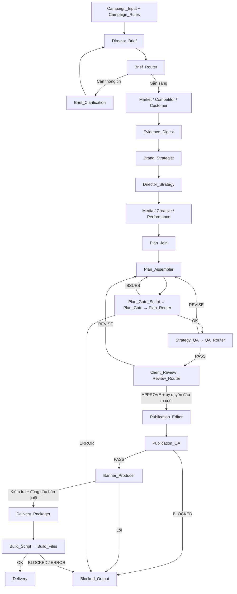

# Hướng dẫn cài đặt và sử dụng AI Advertising Strategy Team

Áp dụng cho dự án tại `D:\Project\chatdev`, đối chiếu với source và YAML ngày **15/11/2026**. Đây là hướng dẫn vận hành cấu hình hiện tại, không phải lịch sử các lần sửa lỗi. Nếu chuyển dự án sang thư mục khác, thay đường dẫn trong các lệnh tương ứng.

## Mục lục

1. [Hệ thống làm gì và chọn workflow nào](#1-he-thong)
2. [Cài đặt lần đầu](#2-cai-dat)
3. [Cấu hình môi trường và model](#3-cau-hinh)
4. [Mở giao diện và chạy lần đầu](#4-chay)
5. [Thêm và kiểm tra tools](#5-tools)
6. [Thêm và sử dụng skills](#6-skills)
7. [Luồng xử lý tổng thể](#7-luong)
8. [Giải thích 15 node Agent](#8-agents)
9. [Giải thích 18 node điều phối](#9-dieu-phoi)
10. [Edge: kết nối, điều kiện và truyền dữ liệu](#10-edges)
11. [Trạng thái, Router và thao tác duyệt](#11-trang-thai)
12. [File, schema dữ liệu và phiên bản](#12-du-lieu)
13. [Sửa kế hoạch và khôi phục phiên dở](#13-khoi-phuc)
14. [Kết quả cuối cùng và cách đọc](#14-ket-qua)
15. [Xử lý lỗi và tiết kiệm token](#15-su-co)
16. [Danh sách kiểm tra trước khi chạy](#16-checklist)
17. [Phụ lục cấu hình lấy từ YAML](#17-phu-luc)
18. [Bộ đầu ra cuối và một lần duyệt](#18-xuat-ban)
19. [Chuẩn bị đưa dự án lên Git](#19-git)

<a id="1-he-thong"></a>
## 1. Hệ thống làm gì và chọn workflow nào

Bạn nhập một brief chiến dịch: sản phẩm, khách hàng, mục tiêu, ngân sách, thời gian và ràng buộc. Các Agent lần lượt nghiên cứu, lập chiến lược, phân bổ ngân sách, đề xuất nội dung, thiết kế đo lường rồi tổng hợp thành hồ sơ để QA và bạn duyệt.

Kết quả gồm **hồ sơ kế hoạch và bộ nội dung cuối theo kế hoạch đã duyệt**: bài đăng, kịch bản video, lịch đăng và banner PNG khi bật tạo ảnh. Hệ thống không tự chi tiền, đăng quảng cáo, quay/dựng video hoặc lấy số liệu tài khoản quảng cáo theo thời gian thực. Kịch bản là đầu vào sản xuất video, không phải file video thành phẩm.

| Workflow trong `D:\Project\chatdev\yaml_instance` | Mục đích | Lưu ý |
|---|---|---|
| `ad_agency_v2.yaml` | Luồng đầy đủ dùng hằng ngày; 33 node, 77 edge, 15 Agent | Có người trả lời brief, duyệt kế hoạch và node Python Banner_Producer; dùng file này cho chiến dịch mới |
| `ad_agency_v2_auto.yaml` | Luồng đầy đủ để thử nghiệm/so sánh tự động | Brief_Clarification dùng literal; Client_Review vẫn là Human. Ảnh tắt mặc định; không tự phê duyệt đầu ra cuối |

Các YAML là đồ thị chạy. Source Python trong dự án cung cấp runtime, tool, Router và bộ kiểm tra dữ liệu. Chép riêng YAML sang một bản ChatDev chưa có các hàm tùy chỉnh sẽ không đủ để chạy giống dự án này.

<a id="2-cai-dat"></a>
## 2. Cài đặt lần đầu

### 2.1. Chuẩn bị

| Thành phần | Yêu cầu và vai trò |
|---|---|
| Python | **3.12**; `pyproject.toml` giới hạn `>=3.12,<3.13` |
| uv | Cài dependency Python và chạy backend |
| Node.js/npm | Node **20.19+ trong nhánh 20, hoặc 22.12+** theo yêu cầu Vite hiện tại; dùng bản 22.12+ hoặc 24 phù hợp nếu đã có |
| Model endpoint | 9Router hoặc gateway tương thích mà bạn đang sử dụng; cần model hỗ trợ gọi tool |
| Trình duyệt | Chrome/Edge để mở frontend |

Docker không phải điều kiện bắt buộc cho cách chạy local dưới đây. Ba node Python (`Plan_Gate`, `Banner_Producer`, `Build_Files`) của workflow này chạy trên máy backend khi đã bật quyền; chúng không tự được đưa vào Docker sandbox.

Kiểm tra công cụ trong PowerShell:

```powershell
uv --version
node --version
npm --version
```

Nếu lệnh chưa có, cài công cụ tương ứng rồi mở terminal mới. Không cần cài lại nếu dự án hiện tại đã chạy được.

Nếu đã có Python nhưng chưa có uv, có thể cài bằng `python -m pip install uv`. Sau đó kiểm tra lại `uv --version`. Cài Python/Node.js trước nếu máy chưa có các công cụ nền này; không dùng Python 3.13 cho môi trường dự án hiện tại.

### 2.2. Cài dependency backend

```powershell
cd D:\Project\chatdev
uv python install 3.12
uv sync
```

`uv sync` tạo/cập nhật `.venv` theo dependency của dự án. `openpyxl` phục vụ Excel; package `python-pptx` được import bằng tên `pptx` để tạo PowerPoint. Cả hai đã có trong dependency hiện tại.

### 2.3. Cài dependency frontend

Mở PowerShell thứ hai:

```powershell
cd D:\Project\chatdev\frontend
npm ci
```

`npm ci` dùng lockfile và cài lại `node_modules`; dừng frontend đang chạy trước khi thực hiện. Nếu đang sử dụng dự án bình thường và thư viện đã đủ, bỏ qua bước này. Không cần chạy lệnh cài dependency trước mỗi chiến dịch.

### 2.4. Tạo file môi trường khi chưa có

```powershell
cd D:\Project\chatdev
if (-not (Test-Path -LiteralPath .env)) {
    Copy-Item -LiteralPath .env.example -Destination .env
}
```

Sửa `D:\Project\chatdev\.env` bằng editor. Giữ file này riêng tư; không đưa API key vào System Prompt, skill, đề bài hoặc ảnh chụp chia sẻ.

<a id="3-cau-hinh"></a>
## 3. Cấu hình môi trường và model

### 3.1. Những biến cần biết

Ví dụ cấu trúc `.env` — thay các giá trị minh họa bằng cấu hình dịch vụ của bạn:

```dotenv
BASE_URL=http://127.0.0.1:PORT_CUA_9ROUTER/v1
API_KEY=KHOA_MODEL_CUA_BAN
MAC_ALLOW_UNSAFE_CODE_EXECUTION=1

# Chỉ thêm nếu sử dụng công cụ web tương ứng:
# SERPER_DEV_API_KEY=KHOA_SERPER
# JINA_API_KEY=KHOA_JINA
```

`PORT_CUA_9ROUTER` là chỗ giữ chỗ, không phải địa chỉ chạy thật. Dùng đúng địa chỉ và đường dẫn API mà gateway cung cấp. Backend ChatDev cổng 6400 và cổng model gateway là hai dịch vụ khác nhau.

| Biến | Cần khi nào? | Giải thích |
|---|---|---|
| `BASE_URL` | Cấu hình Agent dùng `${BASE_URL}` | Địa chỉ model endpoint; không điền địa chỉ frontend |
| `API_KEY` | Cấu hình Agent dùng `${API_KEY}` | Khóa xác thực model/gateway |
| `MAC_ALLOW_UNSAFE_CODE_EXECUTION=1` | Luồng đầy đủ có `Plan_Gate`, `Build_Files` | Cho phép thực thi Python từ workflow tin cậy trên backend; không phải bật sandbox |
| `SERPER_DEV_API_KEY` | Dùng `web_search` | Khóa Serper để tìm kiếm; khác khóa model |
| `JINA_API_KEY` | Tùy chọn cho `read_webpage_content` | Khóa dịch vụ đọc trang; source hiện cho phép gọi không key nhưng có giới hạn/tốc độ phụ thuộc dịch vụ |
| `MODEL_STRONG`, `MODEL_CHEAP`, `MODEL_REVIEW` | Chạy bản auto có placeholder tương ứng | Tên model thực mà gateway nhận, không phải tên vai trò Agent |

Backend nạp `.env` khi khởi động. Biến đã có trong môi trường PowerShell được ưu tiên, vì loader không ghi đè chúng. Nếu `.env` đã đặt `1` nhưng terminal vẫn giữ `0`, kiểm tra bằng `$env:MAC_ALLOW_UNSAFE_CODE_EXECUTION`; sửa hoặc bỏ giá trị cũ của biến đó rồi khởi động lại backend.

Lệnh `$env:MAC_ALLOW_UNSAFE_CODE_EXECUTION = "1"` chỉ đặt biến cho PowerShell hiện tại và các tiến trình khởi chạy từ nó. Đặt trong `.env` giúp không phải nhập lại mỗi lần. Thay đổi `.env` không cập nhật tiến trình backend đang chạy; cần dừng bằng `Ctrl+C` rồi mở lại khi không còn phiên đang xử lý.

### 3.2. Tránh vòng placeholder

Trong Agent, `Base URL = ${BASE_URL}` và `API Key = ${API_KEY}` là tham chiếu tới giá trị môi trường. Không tạo biến workflow có tên `BASE_URL` rồi lại đặt giá trị `${BASE_URL}` cho chính nó. Cấu hình tự tham chiếu này gây `Detected placeholder cycle`.

### 3.3. Cấu hình một Agent trên giao diện

Mở workflow trong editor, chọn node Agent, mở Advanced Settings nếu cần:

| Trường | Cách đặt |
|---|---|
| ID | Giữ nguyên ID đang có, ví dụ `Creative_Director`; đổi ID cần sửa mọi cạnh/tham chiếu liên quan |
| Type | `agent` |
| Name | Tên model/alias đúng với gateway, không phải tên hiển thị của nhân viên |
| Provider | `OpenAI` nếu endpoint đang cung cấp API tương thích OpenAI, kể cả model gốc thuộc hãng khác |
| System Prompt | Vai trò, nhiệm vụ, file phải ghi, schema và dòng trạng thái; giữ các quy tắc đã có |
| Base URL / API Key | `${BASE_URL}` / `${API_KEY}`, hoặc cấu hình riêng nếu bạn chủ động dùng dịch vụ khác |
| Parameters | Với gateway của workflow hiện tại, có `protocol: chat`; giữ tham số khác phù hợp model |
| Context Window | Là giới hạn lịch sử message mà node giữ, không phải số token tối đa của model; Brief hiện dùng 8, các Agent còn lại 0 theo cấu hình |
| Tooling / Agent Skills | Gắn theo mục 5–6 |

Provider ở đây là **adapter giao thức**, không khẳng định hãng tạo model. Một model Gemini qua gateway OpenAI-compatible vẫn có thể dùng Provider OpenAI. Điều này không bảo đảm mọi gateway chuyển đổi tool calling giống nhau.

`protocol: chat` là lựa chọn giao thức trong adapter dự án, không phải tham số chuẩn gửi nguyên sang SDK. Nếu xuất hiện lỗi `unexpected keyword argument 'protocol'`, kiểm tra đúng source adapter của dự án đang chạy; không chỉ đổi prompt.

Trong YAML chính hiện tại, `Creative_Director` dùng `cx/gpt-6.1-sol`; bảng model đầy đủ ở phụ lục. Tên trong bảng chỉ phản ánh cấu hình đã lưu, không bảo đảm gateway của bạn luôn có model đó. Không đổi đồng loạt model chỉ để xử lý lỗi của một Agent.

<a id="4-chay"></a>
## 4. Mở giao diện và chạy lần đầu

### 4.1. Kiểm tra trước khi gọi model

```powershell
cd D:\Project\chatdev
uv run python tools/preflight_ad_agency.py
```

Mong đợi dòng `PREFLIGHT: OK`. Công cụ kiểm schema/graph của workflow chính, tool có tồn tại, skill có tìm và kích hoạt được, dependency, quyền Python và việc đưa nội dung file text vào Chat tool response. Công cụ không gọi model, không kiểm API key thực sự còn tiền hay model có hoạt động.

Thêm `--auto` nếu chuẩn bị chạy bản auto. `--all-yamls` kiểm cả các mẫu khác trong repository; lỗi của một mẫu không dùng không đồng nghĩa workflow quảng cáo bị lỗi. Không cần sửa mọi mẫu chỉ để chạy v2.

### 4.2. Chạy hai terminal

**Terminal backend**, chạy từ thư mục gốc để `.env` và đường dẫn được nạp đúng:

```powershell
cd D:\Project\chatdev
uv run python server_main.py --port 6400
```

Khi đang phát triển source có thể thêm `--reload`. Để phiên chạy ổn định, tránh sửa source hoặc chủ động restart backend trong lúc Agent đang xử lý.

**Terminal frontend**:

```powershell
cd D:\Project\chatdev\frontend
$env:VITE_API_BASE_URL = "http://127.0.0.1:6400"
npm run dev
```

Mở địa chỉ Vite in trong terminal, thường là `http://127.0.0.1:5173`. Nếu cổng bận, Vite có thể chọn cổng khác. Giữ cả hai terminal hoạt động. Không mở thêm backend thứ hai trên cùng cổng 6400.

### 4.3. Chọn, chỉnh và lưu workflow

1. Vào khu vực Workflows/editor, chọn `ad_agency_v2.yaml`.
2. Kiểm tra model, tools, skills và các cạnh; mở Advanced Settings khi trường đang ẩn.
3. Submit hộp cấu hình để áp dụng thay đổi vào node/edge, sau đó lưu workflow bằng chức năng Save của editor. Submit hộp thoại không nên được coi là đã lưu file hoàn chỉnh.
4. Mở lại workflow để xác nhận cấu hình đã lưu. Nếu đổi bằng file YAML ngoài editor, tải lại workflow để tránh canvas còn giữ cấu hình cũ.
5. Vào Launch, chọn đúng workflow trong Workflow Selection rồi nhập đề bài.

Để kiểm tra frontend mới, tải lại trang khi phù hợp; không bấm Relaunch chỉ để nhìn thay đổi CSS. Relaunch có thể tạo lượt chạy và gọi lại model.

### 4.3A. Cấu hình YAML khác bố cục canvas như thế nào?

Editor lưu hai phần riêng:

| Phần | Nơi lưu mặc định | Có đi theo Git hiện tại? |
|---|---|---|
| Node, model, prompt, tools, skills, cạnh và điều kiện chạy | `yaml_instance/<workflow>.yaml` | Có, khi add/commit file YAML |
| Tọa độ node, viewport/zoom của canvas | SQLite `data/vuegraphs.db` | Không, `data/` đang bị `.gitignore` loại |

Backend có thể dùng database khác qua `VUEGRAPHS_DB_PATH`. Editor đọc bố cục bằng `GET /api/vuegraphs/<tên_workflow_không_đuôi_yaml>`, sau đó đồng bộ dữ liệu node/edge từ YAML. Khi chưa có bố cục đã lưu, frontend sinh bố cục tự động.

**Đổi thứ tự node trong YAML không di chuyển các node đã có tọa độ trong database.** Để sửa hình vẽ, kéo node trên canvas rồi Save; để lấy lại bố cục vừa cập nhật từ server, F5 hoặc mở lại workflow. Lưu bản editor cũ sau khi sửa bên ngoài có thể ghi đè thay đổi mới. Đổi bố cục không cần Relaunch chiến dịch.

Bố cục v2 hiện dùng tọa độ của 27 node chung trong bản v2-auto đã lưu. Con số 27 gồm node bắt đầu ảo `__start` của canvas; YAML có 33 node nghiệp vụ, canvas có thể hiển thị 34 node. Bảy node bổ sung (`Brief_Router`, `QA_Router`, `Review_Router`, `Plan_Router`, `Publication_Editor`, `Publication_QA`, `Banner_Producer`) được xếp vào khoảng trống; khác biệt về node/nhánh vẫn được giữ. Khi clone repo sang máy khác, database local không tự đi theo; mục 19.3 hướng dẫn mang riêng tọa độ lên Git mà không chép cấu hình node.

### 4.4. Prompt thử ngắn

```text
Lập kế hoạch Facebook cho quán cà phê Mây tại Cầu Giấy, Hà Nội, từ 01/12/2026 đến 07/12/2026. Tổng ngân sách 1.200.000 VND, gồm quảng cáo 1.000.000 và nội dung 200.000. Giá đồ uống 40.000 VND. Mục tiêu tăng khách đến quán, ghi nhận mã MAY01 tại quầy. Chỉ 1 phân khúc và 1 concept. Không tìm web; thông tin chưa kiểm chứng ghi giả thuyết, không bịa CPM/CPC/CPA. Xuất đủ file theo schema nhưng viết ngắn.
```

Đây là dữ liệu minh họa, không phải thông tin đã xác minh về một doanh nghiệp. Viết ngắn giúp giảm phần trình bày; một luồng đầy đủ vẫn gọi nhiều Agent nên không đồng nghĩa chỉ tốn một request.

### 4.5. Đọc màn hình Launch

| Thành phần | Cách dùng |
|---|---|
| Chat | Xem kết quả, file đính kèm, lỗi và phản hồi Human theo thời gian |
| Graph | Xem node đang chạy; kéo mép phải panel chat để đổi chiều rộng, hoặc thu gọn panel |
| Show More / Show Less | Mở/thu nội dung dài; code và bảng rộng cuộn ngang bên trong tin nhắn |
| Download trên thẻ file | Tải thêm một bản về thư mục tải xuống của trình duyệt |
| Status | Phân biệt đang chạy, chờ bạn, hoàn thành hoặc thất bại |
| Download Logs | Lấy thông tin để chẩn đoán thay vì chạy lại ngay |

Chỉ nhìn thấy một file hoặc một node hoàn thành chưa chứng minh bộ bàn giao đã đủ. Cần xem `Build_Files`, `Delivery` và thư mục đầu ra của đúng phiên.

<a id="5-tools"></a>
## 5. Thêm và kiểm tra tools

### 5.1. Tool khác skill thế nào?

**Tool thực hiện thao tác**, ví dụ đọc/ghi file hoặc tìm web. **Skill hướng dẫn cách làm nghiệp vụ**, ví dụ kiểm tra claim hay phân bổ ngân sách. Gắn skill không tự cấp khả năng ghi file hoặc tìm kiếm.

### 5.2. Ba tool file cho cả 15 Agent

| Tool | Làm gì? | Ví dụ tham số khi model gọi |
|---|---|---|
| `list_directory` | Xem file đang tồn tại trong workspace phiên | Xem thư mục `artifacts` |
| `load_file` | Đọc file nguồn/kiểm lại file vừa ghi | `path_or_id: artifacts/campaign_brief.json` |
| `save_file` | Ghi file thật và trả thông tin file | `path`, `content`, tùy chọn `encoding`, `mode` |

Ví dụ yêu cầu ghi CSV: `path=artifacts/media_plan.csv`, `encoding=utf-8-sig`, `mode=overwrite`. Ưu tiên truyền `content` là chuỗi JSON chứa `columns` và `rows` để Python xuất CSV đúng quote/BOM (mục 18.6). CSV văn bản vẫn được hỗ trợ; không chèn hàng rào Markdown vào file.

Không cần cấp `file:All` hoặc công cụ xóa/chạy lệnh cho mọi Agent. Các tool file được giới hạn trong workspace của phiên; vai trò và danh sách file phải ghi vẫn cần nêu rõ trong prompt. Có `save_file` không đồng nghĩa đã có cơ chế phân quyền ghi riêng từng Agent ở cấp hệ điều hành.

### 5.3. Thao tác trên giao diện

1. Chọn node Agent → Advanced Settings → **Tooling** → **Add Entry**.
2. Chọn **Tool Type = function**.
3. Trong cấu hình danh sách **Tools**, thêm mục, chọn Name `list_directory`, `load_file`, `save_file`; mỗi tool là một mục riêng.
4. Submit các hộp cấu hình lồng nhau rồi Save workflow. Nếu đã có tool, kiểm danh sách trước, không thêm trùng.
5. Mở lại node để kiểm tra. Nếu danh sách không cho chọn tool mới, tải lại editor hoặc restart backend sau khi thay đổi module tool; đừng thay bằng một tên không tồn tại.

Với tool file đã có, bạn không phải tạo Python tool mới. Trường tham số cụ thể được model điền khi gọi tool, không cần nhập sẵn nội dung campaign vào cấu hình tool của node.

Ví dụ tương đương trong cấu hình Agent, không phải một workflow độc lập:

```yaml
tooling:
  - type: function
    config:
      tools:
        - name: list_directory
        - name: load_file
        - name: save_file
```

### 5.4. Tool web: gắn ở đâu?

| Agent | Tool web đang được cấu hình trong YAML chính |
|---|---|
| `Market_Researcher` | `web_search`, `read_webpage_content` |
| `Competitor_Analyst` | `web_search`, `read_webpage_content` |
| `Customer_Insight` | `web_search`, `read_webpage_content` |
| `Evidence_Digest` | `read_webpage_content` để đối chiếu nguồn |
| Các Agent khác | Không cần tool web trong cấu hình hiện tại |

`web_search` dùng Serper theo source hiện tại. `read_webpage_content` đọc qua Jina Reader. Khi chưa cấu hình dịch vụ tìm kiếm, dùng đề bài ghi rõ **không tìm web**; bootstrap sẽ loại tool web khỏi các Agent của phiên. Khi đó vẫn cần tạo `sources.csv`, nhưng phân loại nguồn tài liệu/giả thuyết trung thực, không tạo URL giả.

### 5.5. Xác nhận tool có chạy thật

Trong Chat có dòng Tool `save_file`, thẻ Download và file xuất hiện trong workspace là những bằng chứng hữu ích. Một câu “đã lưu” do model viết chưa đủ. Nếu có hai file bắt buộc, kiểm cả hai; một tool gọi thành công không tự có nghĩa cả bộ file đã được tạo.

`Plan_Gate` và `Build_Files` là **node Python**, không phải Agent cần được thêm `execute_code` vào Tooling. Code của chúng đến từ node literal tương ứng.

<a id="6-skills"></a>
## 6. Thêm và sử dụng skills

### 6.1. Skill nằm ở đâu?

Skill nghiệp vụ của dự án nằm trong `D:\Project\chatdev\.agents\skills`. Có **19 skill quảng cáo**: 13 skill vai trò ban đầu, 5 skill bổ sung và `ad-publication-quality-review` dành riêng cho QA nội dung công khai. Thư mục còn có thể có skill mẫu khác; không cần gắn tất cả.

Ví dụ cấu trúc:

```text
D:\Project\chatdev\.agents\skills\ad-data-contracts\
  SKILL.md
  references\
    current-schema.md
```

`SKILL.md` chứa tên, mô tả và quy trình. Tài liệu trong `references` được đọc khi cần. Phần tên thư mục/name phải khớp với skill đã được hệ thống nhận diện.

### 6.2. Gắn skill trên giao diện

1. Chọn Agent → Advanced Settings → **Agent Skills** → **Configure AgentSkillsConfig**.
2. Bật **Enabled**.
3. Thêm skill vào **Allowed Skills / Allow**, chọn đúng tên từ danh sách. Gắn skill vai trò chính trước, rồi skill bổ sung cần thiết theo bảng ở phụ lục.
4. Submit và Save workflow. Mở lại Agent để xác nhận.
5. Chạy preflight để kiểm discovery/activation offline trước khi chạy chiến dịch.

Ví dụ cấu hình dưới `config` của Agent:

```yaml
skills:
  enabled: true
  allow:
    - ad-media-planning
    - ad-data-contracts
    - ad-budget-feasibility
```

Runtime tự cung cấp tool skill như `activate_skill` và `read_skill_file` khi cấu hình skills bật. Không cần tự thêm chúng như tool file trong Tooling. Được phép dùng skill không bảo đảm model đã kích hoạt; xem timeline để biết nó có gọi `activate_skill` hay không.

### 6.3. Năm skill bổ sung dùng để làm gì?

| Skill | Giá trị | Gắn cho Agent |
|---|---|---|
| `ad-data-contracts` | Định dạng số, CSV/JSON, ID và sửa schema không đổi ý nghĩa | `Media_Planner`, `Performance_Analyst`, `Plan_Assembler` |
| `ad-budget-feasibility` | Kiểm ngân sách có đủ cho số kênh, thử nghiệm và mục tiêu | `Director_Strategy`, `Media_Planner`, `Strategy_QA` |
| `ad-tracking-readiness` | Phân biệt tracking đang có và tracking phải chuẩn bị | `Performance_Analyst`, `Strategy_QA` |
| `ad-claims-review` | Kiểm claim, bằng chứng và giới hạn cách diễn đạt | `Evidence_Digest`, `Creative_Director`, `Strategy_QA` |
| `ad-campaign-learning` | Đọc kết quả thực tế, so sánh giả định, đề xuất điều chỉnh | `Director_Strategy`, `Media_Planner`, `Performance_Analyst`; chỉ áp dụng nghiệp vụ này khi có dữ liệu thực |

Skill học từ chiến dịch không tự kết nối tài khoản quảng cáo hoặc tự tạo dữ liệu kết quả. Nếu chưa có dữ liệu, Agent phải ghi thiếu, không dựng thành tích giả.

### 6.4. Khi sửa hoặc thêm một skill mới

Tạo thư mục riêng dưới `.agents\skills`, có `SKILL.md` mở đầu bằng frontmatter:

```markdown
---
name: ten-skill-moi
description: Khi nào dùng kỹ năng này và kết quả nó hỗ trợ tạo ra.
---

# Quy trình nghiệp vụ

Nêu đầu vào cần đọc, các bước xử lý, tiêu chí chất lượng và giới hạn.
```

Chỉ tạo skill mới khi nhiệm vụ chưa được skill hiện có bao phủ. Sau khi thêm, kiểm tra discovery bằng preflight và tải lại editor; backend có thể cần restart để schema lựa chọn phản ánh danh sách mới. Không tạo đường dẫn tài liệu tham chiếu chưa tồn tại.

Quy tắc file được ghi, trạng thái cuối và không tự khai thành công vẫn giữ trong System Prompt. Skill bổ sung quy trình; không thay thế Gate bằng code, không tự mở rộng quyền tool.

<a id="7-luong"></a>
## 7. Luồng xử lý tổng thể



Đây là sơ đồ rút gọn: các đường dự phòng, cạnh truyền ngữ cảnh và `Revision_Limit` có trong bảng cạnh ở phụ lục. Ba Agent nghiên cứu có thể chạy song song; ba Agent Media/Creative/Performance cũng có thể chạy song song. Cách xếp lịch không thay thế việc kiểm đủ file bàn giao.

Không cần thêm một Agent PM để chọn từng bước: đồ thị và Router đang đảm nhiệm điều phối; `Strategy_QA` kiểm chuyên môn, còn bạn duyệt tại `Client_Review`.

<a id="8-agents"></a>
## 8. Giải thích 15 node Agent

Mọi đường dẫn dưới đây bắt đầu từ `artifacts/` trong **workspace phiên chạy**, không phải thư mục `yaml_instance` hoặc thư mục skill. Cột “Đầu vào” là nguồn phải sử dụng; không phải mọi file đều được edge chép nguyên văn vào Chat. Agent có thể phải dùng `load_file` để đọc.

| Agent | Đầu vào chính | Nhiệm vụ | File bắt buộc |
|---|---|---|---|
| `Director_Brief` | Đề bài gốc, Campaign_Rules, trả lời bổ sung | Hợp nhất brief, xác định thông tin còn thiếu, giữ ngân sách/ngày/ràng buộc | `campaign_brief.json` khi READY |
| `Market_Researcher` | Brief, nguồn được cấp, web nếu được phép | Mô tả thị trường, bối cảnh, cơ hội và giới hạn nguồn | `market_research.md` |
| `Competitor_Analyst` | Brief, thị trường mục tiêu, nguồn | Phân tích đối thủ và lựa chọn thay thế; tách quan sát khỏi suy luận | `competitor_analysis.md` |
| `Customer_Insight` | Brief, nguồn và giả thuyết khách hàng | Phân khúc, nhu cầu, rào cản và hành trình | `audience_segments.json`, `customer_journey.md` |
| `Evidence_Digest` | Ba nhánh nghiên cứu và nguồn liên quan | Tổng hợp bằng chứng, đánh dấu mâu thuẫn/claim chưa được hỗ trợ | `evidence_digest.md`, `sources.csv` |
| `Brand_Strategist` | Brief, khách hàng, đối thủ, bằng chứng | Chọn định vị và lý do khác biệt có thể bảo vệ | `brand_positioning.md` |
| `Director_Strategy` | Brief, định vị, khách hàng, bằng chứng | Chốt mục tiêu, phân khúc, offer, funnel và bộ ID thống nhất | `campaign_strategy.md`, `strategy_ids.json` |
| `Media_Planner` | Chiến lược, ID, ngân sách, thời gian | Chọn kênh, phân bổ tiền và kịch bản định lượng khi có cơ sở | `media_plan.csv`, `budget_scenarios.csv` |
| `Creative_Director` | Chiến lược, định vị, insight, bằng chứng | Concept, thông điệp, hook, CTA, yêu cầu asset và biến thể | `creative_brief.md`, `creative_matrix.csv` |
| `Performance_Analyst` | Chiến lược, mục tiêu, ràng buộc đo lường | KPI, tracking, thử nghiệm và quy tắc ra quyết định | `measurement_plan.md`, `experiment_plan.csv` |
| `Plan_Assembler` | Các kế hoạch hiện hành, brief/chiến lược, lỗi/góp ý | Tổng hợp kế hoạch; trong rework sửa cả file bảng và thuyết minh thuộc phạm vi | `advertising_strategy_draft.md`, `execution_calendar.csv` |
| `Strategy_QA` | Bản nháp, file nguồn, kết quả Plan_Gate và plan_version | Đánh giá nhất quán, bằng chứng, ngân sách khả thi, tracking, tính triển khai | `qa_report.json`; code tạo quyết định điều phối từ verdict đã kiểm tra |
| `Publication_Editor` | Kế hoạch/snapshot đã duyệt, bộ ID, nguồn và ủy quyền Human | Biên tập copy công khai, kịch bản, brief banner và lịch đăng | `publication_content.json` |
| `Publication_QA` | Bộ copy hiện hành, nguồn snapshot và JSON mẫu đúng phiên bản | Kiểm đủ tám tiêu chí nội dung công khai, gắn hash đúng bộ copy | `publication_qa.json` |
| `Delivery_Packager` | Kế hoạch được duyệt, bộ xuất bản đã QA và đóng dấu bản cuối | Ghi chú bàn giao, hạn chế còn mở, cách sử dụng | `handoff_notes.md` |

### 8.1. Các điểm hay nhầm

- **Brief:** khi thiếu đầu vào thiết yếu, hỏi qua `BRIEF: NEED_INFO`; không tự gán ngân sách/ngày tùy ý rồi báo READY. Mỗi lần hỏi/đáp phải giữ brief đã hợp nhất.
- **Nghiên cứu:** không có web thì không gọi giả thuyết là “dữ liệu thị trường đã xác minh”. Ghi nhãn tài liệu, suy luận, giả thuyết cho rõ.
- **Evidence:** phải ghi đủ hai file. `sources.csv` là bảng liên kết claim–nguồn, không phải file chỉ có khi bật tìm web. Node này tổng hợp nghiệp vụ, không phải cổng Python có quyền quyết định thay QA.
- **Chiến lược:** ID như S1/O1 giúp bảng Media, Creative và lịch triển khai nói về cùng đối tượng/offer. Không tự tạo lại ID ở mỗi nhánh.
- **Media:** tiền quảng cáo khác tiền sản xuất nội dung. Không dự báo số khi không có dữ liệu/giả định được phép; dùng `NOT_ESTIMATED` đúng schema.
- **Creative:** đề xuất nội dung và yêu cầu asset; không được coi ảnh/video là đã được sản xuất chỉ từ mô tả.
- **Performance:** mẫu thử nhỏ có thể chỉ đủ quan sát vận hành, không tự chứng minh hiệu quả thống kê hoặc nhân quả.
- **Assembler:** sửa Markdown mà bỏ nguyên CSV sai sẽ khiến Gate tiếp tục từ chối. File hiện hành là nguồn đúng; message cũ chỉ là tham chiếu.
- **QA:** PASS nghĩa là bản kế hoạch đủ điều kiện theo tiêu chí kiểm tra, không bảo đảm quảng cáo sẽ sinh lời. Quyết định lấy từ `verdict` trong JSON đã kiểm schema, phiên bản và hash file; chat không phải nguồn quyết định.
- **Packager:** không chép lại/viết lại toàn bộ chiến lược đã duyệt. Script chịu trách nhiệm sao chép và manifest.

<a id="9-dieu-phoi"></a>
## 9. Giải thích 18 node điều phối

Các node sau không gọi LLM. Đừng gắn model, skill hoặc tool ghi file cho chúng chỉ vì tên có chữ “Plan” hay “Review”.

| Node | Loại | Nhận gì và xử lý gì? | Kết quả/đường đi |
|---|---|---|---|
| `Campaign_Input` | passthrough | Nhận đề bài người dùng; cấu hình lấy message cuối | Truyền yêu cầu sang Rules và giữ bản gốc cho Brief |
| `Campaign_Rules` | literal | Phát bộ quy tắc cố định cho chiến dịch | Hướng dẫn cho Brief, đồng thời gửi ngữ cảnh tới QA |
| `Brief_Router` | passthrough | Nhận brief đã được hàm `ad_brief_route` kiểm dòng trạng thái và thêm token | READY mở nghiên cứu; NEED_INFO mở Human; sai định dạng sang Blocked |
| `Brief_Clarification` | human | Hiển thị câu hỏi thiếu thông tin | Chờ bạn trả lời rồi chuyển lại Brief |
| `Plan_Join` | passthrough | Gom bàn giao Media/Creative/Performance; không chỉ lấy message cuối | Truyền tới Assembler; không tự chứng nhận đủ file/hợp lệ |
| `Plan_Gate_Script` | literal | Phát Python code kiểm tra đã lưu trong YAML | Gửi code cho Plan_Gate; thấy code trong Chat ở đây là bình thường |
| `Plan_Gate` | python | Đọc file thật, kiểm bảng/ngân sách/ID/ngày; chụp snapshot khi đạt | `PLAN: OK`, `PLAN: ISSUES` hoặc `PLAN: ERROR`; timeout hiện 60 giây |
| `Plan_Router` | passthrough | Phân loại kết quả Gate bằng `ad_plan_classify` đúng một lần | OK tới QA; lỗi sửa được đi rework; lỗi nguồn hoặc lặp nguyên lỗi tới Blocked |
| `QA_Router` | passthrough | Nhận quyết định QA đã qua `ad_qa_route` | PASS tới Human; REVISE về sửa; sai/mất trạng thái tới Blocked |
| `Client_Review` | human | Cho bạn xem bản nháp, kết quả Gate/QA và phiên bản | Chờ lệnh `HUMAN: APPROVE` hoặc `HUMAN: REVISE` kèm góp ý |
| `Review_Router` | passthrough | Kiểm lệnh Human bằng `ad_review_route` | APPROVE tới Publication_Editor; REVISE về sửa; INVALID tới thông báo lỗi |
| `Invalid_Review_Notice` | literal | Giải thích cú pháp duyệt không hợp lệ | Chuyển thông báo tới Blocked_Output |
| `Revision_Limit` | loop_counter | Đếm chung yêu cầu sửa từ Gate/QA/Human | Cho phép 1 lượt sửa; chạm yêu cầu thứ 2 phát giới hạn và kết thúc vòng |
| `Banner_Producer` | python | Tạo banner qua 9Router khi bật, kiểm PNG/kích thước và lưu manifest | Tắt thì không gọi ảnh; lỗi ảnh đi Blocked, hợp lệ mới đóng dấu bản cuối |
| `Build_Script` | literal | Phát Python code đóng gói | Gửi code sang Build_Files; đây chưa phải bằng chứng build đã chạy |
| `Build_Files` | python | Kiểm hash/QA phiên bản, sao chép danh sách trắng, tạo Excel/PPTX/manifest | `BUILD: OK`, `BUILD: BLOCKED` hoặc `BUILD: ERROR`; timeout hiện 180 giây |
| `Delivery` | passthrough | Nhận kết quả build hợp lệ | Node kết thúc thành công của workflow |
| `Blocked_Output` | passthrough | Tập hợp lý do chặn từ các nhánh | Node kết thúc bị chặn; không đồng nghĩa đã bàn giao |

`passthrough` chuyển dữ liệu, không tự suy luận. `literal` phát nội dung cố định. `human` chờ người. `python` chạy code. `loop_counter` theo dõi lượt vòng. Nhìn tên node chưa đủ để suy ra loại; kiểm trường Type.

Lỗi provider hoặc runtime có thể ném exception và kết thúc workflow trước khi đi tới `Blocked_Output`. Vì vậy không phải mọi lần thất bại đều có một tin nhắn từ node Blocked.

<a id="10-edges"></a>
## 10. Edge: kết nối, điều kiện và truyền dữ liệu

### 10.1. Đọc một cạnh như thế nào?

Một edge có hai công việc có thể tách nhau: **gửi dữ liệu** và **cho phép node đích được kích hoạt**. Ngoài ra nó có thể lọc/đổi payload trước khi chuyển. Node không tự chọn người nhận việc chỉ bằng cách viết tên Agent khác trong Chat.

| Trường giao diện | YAML | Ý nghĩa |
|---|---|---|
| From / To | `from` / `to` | ID node nguồn và đích |
| Trigger | `trigger` | Cho phép cạnh này kích hoạt đích; mặc định true. Tắt thì vẫn có thể truyền ngữ cảnh |
| Pass Data to Target | `carry_data` | Có chuyển payload hay không; mặc định true |
| Condition | `condition` | Điều kiện lọc trên output nguồn trước bước xử lý payload |
| Keep Message Input | `keep_message` | Giữ message làm ngữ cảnh ở đích; mặc định false |
| Clear Context | `clear_context` | Dọn ngữ cảnh đến không được đánh dấu giữ trước khi nhận payload mới |
| Clear Kept Context | `clear_kept_context` | Dọn cả phần được đánh dấu giữ khi chủ động cấu hình |
| Payload Processor | `process` | Hàm xử lý/kiểm payload; trả `None` thì payload bị bỏ và cạnh không kích hoạt |
| Dynamic Expansion | `dynamic` | Tính năng mở rộng động; workflow quảng cáo hiện không cần bật thêm |

Không bật/tắt hàng loạt Trigger chỉ vì thấy nhiều đường nối. Một cạnh nét phụ có thể dùng để cung cấp brief cho Agent phía sau mà không cho nó chạy quá sớm.

### 10.2. Ba ví dụ thực tế

**Cạnh mở công việc:** `Director_Strategy → Media_Planner`. Trigger bật, dữ liệu được chuyển; sau khi chiến lược xong, Media nhận công việc.

**Cạnh chỉ bổ sung ngữ cảnh:** `Brief_Router → Media_Planner`. Trigger tắt, Keep Message bật. Media biết brief gốc nhưng không chạy ngay từ lúc brief vừa READY; còn chờ luồng chiến lược.

**Cạnh kiểm điều kiện:** `Plan_Gate → Strategy_QA`. Chỉ mở khi có `[[PLAN_OK]]`, không có marker lỗi thực thi và payload qua hàm kiểm tra. Gate ISSUES/ERROR không được mở QA theo cạnh này.

### 10.3. Contains keywords, Exclude keywords và regex

Trong Type `keyword`:

- Contains keywords (`any`): chỉ cần có một mục khớp. Đây là tìm chuỗi, không phải kiểm dòng cuối hay hiểu ngữ nghĩa.
- Exclude keywords (`none`): nếu có bất kỳ mục nào trong danh sách thì cạnh bị chặn; loại trừ được xét trước.
- Regular expressions (`regex`): cũng là đường khớp cho phép, **OR** với Contains, không phải kiểm tra bổ sung AND. Điền cả hai không làm cạnh chặt hơn như thường nghĩ.
- Case sensitive: cấu hình hiện dùng true, cần đúng chữ hoa/thường.

Workflow hiện dùng token ngắn trên cạnh để canvas dễ đọc. Quy tắc kiểm lệnh/dòng trạng thái chặt nằm trong hàm Router; không còn cần trải regex dài lên từng edge.

Không cần Exclude ở mọi cạnh. Giữ nguyên các loại trừ đang có vì chúng phục vụ các trường hợp khác nhau:

| Exclude | Tác dụng |
|---|---|
| `[[EXEC_FAIL]]` | Chặn marker lỗi chạy code; runtime vẫn nhận marker dài cũ để tương thích |
| `[[` | Trên một số cạnh trước Router: chặn đầu ra tự chèn token dành riêng, tránh giả mạo quyết định |

Nếu UI ghi `Excludes: [[, [[EXEC_FAIL]]`, đó là **hai chuỗi** được ngăn bằng dấu phẩy, không phải cú pháp ngoặc sai. Không rút gọn thành `FAIL`: chữ thông thường có thể xuất hiện trong giải thích hoặc tên phép kiểm.

### 10.4. Vì sao giữ đúng ba cạnh Clear Context?

Hiện bật ở `Plan_Assembler → Strategy_QA`, `Plan_Assembler → Client_Review`, `Plan_Assembler → Delivery_Packager`, đều là cạnh chỉ gửi dữ liệu. Mục đích là đưa bản nháp mới thay cho ngữ cảnh tạm của vòng trước.

Không bật thêm ở `Plan_Gate → Client_Review` hoặc `QA_Router → Delivery_Packager` một cách máy móc: thông báo tới sau có thể xóa bản nháp vừa gửi. `keep_message: false` cũng không có nghĩa xóa ngay message cũ trên tất cả các cạnh.

### 10.5. Các cạnh bổ sung so với một chuỗi Agent đơn giản

| Nhóm cạnh | Vì sao cần? |
|---|---|
| Input → Rules có `ad_agency_bootstrap` | Kiểm điều kiện chạy, cài bộ kiểm file và giữ ràng buộc đề bài trước Agent đầu tiên |
| Brief/QA/Human → Router | Chuyển quyết định dạng văn bản thành token đã được kiểm tra |
| Brief/Customer/Evidence/Brand/Strategy → Agent phía sau với Trigger tắt | Truyền brief và căn cứ, không mở Agent sai thời điểm |
| Gate/QA/Human → Assembler và Revision_Limit | Chuyển lỗi/góp ý về chỗ sửa và đếm chung số lượt |
| Assembler/Gate/QA → người duyệt hoặc Packager | Đưa đúng bản nháp, kết quả máy kiểm và QA hiện hành đến nơi sử dụng |
| Router/Gate/Build → nhánh fallback | Bắt trạng thái thiếu, sai, xung đột; tránh kết thúc im lặng hoặc giao nhầm |

Bảng cạnh ở phụ lục cùng phần Banner_Producer bên dưới cho biết Trigger và processor. Workflow hiện có 77 cạnh; không cần tự nối lại các cạnh đã có.

<a id="11-trang-thai"></a>
## 11. Trạng thái, Router và thao tác duyệt

### 11.1. Văn bản cho người đọc và token cho máy

| Nguồn | Dòng trạng thái/lệnh | Token tương ứng |
|---|---|---|
| Director_Brief | `BRIEF: READY` / `BRIEF: NEED_INFO` | `[[BRIEF_READY]]` / `[[BRIEF_NEED_INFO]]` |
| Strategy_QA | `QA: PASS` / `QA: REVISE` | `[[QA_PASS]]` / `[[QA_REVISE]]` |
| Plan_Gate | `PLAN: OK` / `PLAN: ISSUES` / `PLAN: ERROR` | `[[PLAN_OK]]` / `[[PLAN_ISSUES]]` / `[[PLAN_ERROR]]` |
| Người duyệt | `HUMAN: APPROVE` / `HUMAN: REVISE` kèm góp ý | `[[REVIEW_APPROVE]]` / `[[REVIEW_REVISE]]` |
| Build_Files | `BUILD: OK` / `BUILD: BLOCKED` / `BUILD: ERROR` | `[[BUILD_OK]]` / `[[BUILD_BLOCKED]]` / `[[BUILD_ERROR]]` |

Brief phải có **đúng một dòng quyết định riêng ở cuối message**, ngoài code fence. Các câu “Ví dụ lệnh là QA: PASS” hoặc “Không được kết luận QA: PASS” không phải quyết định hợp lệ. Sau dòng cuối không viết thêm phần giải thích. Agent không tự phát token hai ngoặc; Router phát token sau khi kiểm tra. Với Plan/Build, script phát token theo kết quả code.

`QA: BLOCKED` được dùng khi báo cáo QA 2.0 kết luận không thể xử lý trong vòng tổng hợp. Runtime kiểm báo cáo/quyết định rồi Router đưa qua đường dự phòng `QA_INVALID` tới Blocked_Output; không coi đó là PASS hoặc REVISE. `BRIEF: BLOCKED` không thuộc trạng thái Brief hợp lệ. Đừng thêm các trạng thái dừng vào cạnh thành công để cố cho chạy tiếp.

### 11.2. Khi Brief hỏi lại

Đọc câu hỏi trong `Brief_Clarification`, nhập thông tin còn thiếu vào ô chat. Ví dụ:

```text
Tiền quảng cáo là 1.000.000 VND, không gồm 200.000 tiền nội dung. Thời gian 01/12/2026–07/12/2026. Chỉ dùng Facebook và ghi nhận mã MAY01 tại quầy. Không tìm web.
```

Câu trả lời quay lại Director_Brief để hợp nhất. Không cần viết lệnh duyệt ở bước này. Nếu bạn cho phép dùng giả định, nêu rõ phạm vi; thông tin quyết định như ngân sách/ngày vẫn phải đủ hợp lệ để chuyển READY.

### 11.3. Khi đến Client_Review

Kiểm tra kế hoạch, ngân sách, giới hạn bằng chứng, QA và `plan_version`. `HUMAN: APPROVE` duyệt kế hoạch và ủy quyền hoàn thiện toàn bộ bài đăng, kịch bản, banner và file cuối theo kế hoạch này. Không có bước hỏi duyệt thứ hai. Chỉ dùng một trong hai cú pháp:

**Duyệt:** đúng một dòng, không thêm “ok”, dấu chấm, code fence hoặc lời giải thích:

```text
HUMAN: APPROVE
```

**Yêu cầu sửa:** phải có góp ý cụ thể:

```text
HUMAN: REVISE
Giữ nguyên tổng ngân sách và phân khúc S1. Sửa creative_matrix.csv để CTA dùng mã MAY01 thống nhất với kế hoạch đo lường; cập nhật bản nháp tương ứng.
```

`HUMAN: REVISE` đứng một mình không đủ. Token `[[REVIEW_APPROVE]]` không phải lệnh để bạn nhập. Lệnh sai đi tới `Invalid_Review_Notice` rồi `Blocked_Output`; không tự coi im lặng là duyệt.

<a id="12-du-lieu"></a>
## 12. File, schema dữ liệu và phiên bản

### 12.1. File có tự lưu trên máy không?

Có, khi tool ghi thành công: file nằm trên **máy chạy backend**, trong workspace riêng của phiên. Nếu backend ở máy bạn, ví dụ:

```text
D:\Project\chatdev\WareHouse\<session>\
  code_workspace\
    artifacts\                  File làm việc của các Agent
    review\
      review_manifest.json      Manifest của phiên bản đang xét
      <plan_version>\           Snapshot bộ nguồn được kiểm tra
    output\                     Bộ bàn giao sau build thành công
    diagnostics\                Chẩn đoán provider nếu có
```

`<session>` thường có dạng `session_...`; lấy đúng thư mục của phiên đang xem. Nút Download tạo thêm bản ở thư mục tải xuống; không phải thao tác bắt buộc để file xuất hiện trong workspace.

Nếu backend đặt trên server/Docker, đường dẫn nằm trên máy/container đó; không tự xuất hiện trong Downloads của Windows. Tin nhắn Chat là kênh trình bày, file trong workspace là dữ liệu làm việc, snapshot là bản dùng để đối chiếu.

### 12.2. Hợp đồng CSV

Giữ đúng tên cột. Mỗi dòng phải có đủ số ô; không có cột trùng, không chỉ có header. Quote ô chứa dấu phẩy, dấu nháy hoặc xuống dòng. CSV xuất cho Excel dùng UTF-8 BOM (`utf-8-sig`).

```csv
# media_plan.csv
channel,role,objective,segment_id,offer_id,budget_pct,budget_amount,currency,start,end,landing_page,assumption

# budget_scenarios.csv
scenario,channel,budget_amount,metric,metric_value,formula,assumption,estimate_status

# creative_matrix.csv
concept_id,segment_id,insight,hook,benefit,proof,cta,format,asset_requirement,test_variant

# experiment_plan.csv
test_id,hypothesis,variant_a,variant_b,primary_metric,min_sample,duration_days,decision_rule,test_type,sample_unit,sample_basis,data_source,business_kpi,decision_supported,decision_not_supported,decision_owner,prerequisites,missing_data_rule,start,end

# execution_calendar.csv
week,start,end,channel,activity,owner,deliverable

# sources.csv
id,claim,source_url,access_date,scope,evidence_type
```

Các dòng bắt đầu bằng `#` và dòng trống ở khối trên chỉ để phân biệt ví dụ trong tài liệu; **không chép chúng vào CSV thật**. Mỗi file thật có đúng header của chính nó.

Quy tắc dữ liệu quan trọng:

- Số dùng `1000000` hoặc `12.5`, không dùng `1.000.000 VND`, `12,5%`, `NaN`, `Infinity`. Không xóa dấu phẩy rồi âm thầm đổi nghĩa giá trị.
- `budget_pct=25` là 25%, không phải 0.25. Tiền Media phải thống nhất với `budget.ad_spend` và currency trong brief; không gộp production vào tiền quảng cáo.
- `start`, `end` dùng YYYY-MM-DD, ngày thật và trong khoảng chiến dịch. `week`, `duration_days`, `min_sample` là số nguyên dương theo quy tắc Gate.
- ID phân khúc/offer phải tồn tại trong `strategy_ids.json`; không đổi ID chỉ để qua kiểm tra.
- Một cặp `(scenario, channel)` có thể có nhiều metric nhưng lặp **cùng ngân sách**. Ví dụ leads và CPA cùng mô tả phân bổ 100 thì chi tiêu vẫn là 100, không phải 200. Giá trị lặp mâu thuẫn và metric trùng bị từ chối.
- `sources.csv.evidence_type` dùng `document`, `external`, `inference`, `hypothesis`. Không có nguồn ngoài thì dùng tài liệu/giả thuyết trung thực, để URL/ngày truy cập trống khi không áp dụng, giải thích trong claim/scope.

### 12.3. Dự báo chưa đủ dữ liệu

| Trạng thái | `metric_value` | `formula` và `assumption` |
|---|---|---|
| `ESTIMATED` | Số hữu hạn không âm | Cần công thức và giả định/cơ sở rõ |
| `NOT_ESTIMATED` | Để trống | Assumption bắt buộc giải thích dữ liệu thiếu; formula có thể trống hoặc ghi công thức chưa đủ đầu vào |

Không ghi “Thiếu dữ liệu” vào cột số; không thay unknown bằng 0. `budget_amount` vẫn là số hợp lệ ở cả hai trạng thái. Bảng cũ bảy cột chưa có `estimate_status` được hiểu là ESTIMATED nên vẫn cần giá trị số.

Gate ghi các dòng chưa ước lượng trong `info.unestimated_metrics`; Excel để ô giá trị trống và giữ cột trạng thái. Điều này giúp biểu diễn trung thực việc thiếu dự báo, không phải xác nhận kế hoạch đã đủ khả thi cho triển khai.

### 12.4. Hai lớp kiểm tra

**Ngay sau mỗi Agent:** runtime kiểm file bắt buộc tồn tại, không rỗng, JSON/CSV đọc được, header và số ô hợp lệ. Brief READY còn phải đủ ngân sách/ngày; báo cáo QA phải khớp quyết định và phiên bản. Vì vậy có thể dừng ở Creative/Evidence trước khi đến Plan_Gate.

**Tại Plan_Gate:** kiểm dữ liệu liên quan giữa các file, số học, ngân sách, ID và ngày. `ISSUES` là dữ liệu có thể yêu cầu sửa; `ERROR` dành cho thiếu đầu vào bắt buộc hoặc lỗi khiến không thể kiểm tiếp. Gate không thay thế đánh giá chất lượng chuyên môn của QA.

### 12.4A. Tiêu chuẩn tài liệu bàn giao và bằng chứng

- File làm việc vẫn mang tên `artifacts/advertising_strategy_draft.md`, nhưng dùng tiêu đề trung tính như “Kế hoạch quảng cáo — Mây”. Không chèn “bản nháp rework chờ QA” vào tên kế hoạch rồi mang nguyên sang bộ giao.
- Receipt bàn giao giữa Agent, `FILE ĐÃ ĐỔI` và nhật ký rework nằm trong `code_workspace/internal/assembly_notes.md`; không nằm trong bản kế hoạch khách hàng và không được đóng gói. Ghi chú nội bộ không thay thế nguồn bằng chứng hoặc manifest phiên bản.
- Trong nội dung dành cho người nhận dùng tên giao như `advertising_strategy.md`, `media_plan.csv`, không dùng đường dẫn máy chủ hoặc `artifacts/advertising_strategy_draft.md`. Khi gọi tool Agent vẫn phải dùng đường dẫn workspace thực tế.
- Gate đưa lỗi tiêu đề, ghi chú nội bộ lẫn vào kế hoạch, tham chiếu nội bộ/không có trong bộ giao, ID nguồn trùng và bản ghi external thiếu URL/ngày truy cập vào `PLAN: ISSUES`. Build kiểm lại kế hoạch và handoff trước sao chép, không sửa nội dung đã khóa hash để làm đẹp bản giao.
- Bộ kiểm bằng code chỉ kiểm được cấu trúc nguồn và tài liệu. Nó không xác minh URL đã thực sự được đọc hay claim có được nguồn chứng minh đúng nghĩa hay không. Không coi Gate OK là chứng nhận bằng chứng.
- QA phải đọc chéo brief, nghiên cứu, định vị, chiến lược, Evidence và các kế hoạch. Claim thiếu căn cứ vẫn còn trong tài liệu nguồn phải được báo lỗi ngay cả khi bản tổng hợp đã bỏ nó. Phân biệt giả thuyết được nêu trung thực với dữ kiện bị gắn nhãn sai.
- Brief giả định không chứng minh thực địa; lời người dùng cung cấp không tự chứng minh sức chi trả, lợi thế cạnh tranh hoặc chất lượng tiện ích. Với claim quan trọng cần chỉ ra nguồn/file/đoạn, phạm vi và giới hạn.
- Assembler sửa trong phạm vi đã giao; không viết lại brief/nghiên cứu/Evidence để che lỗi. Nếu phải có nguồn mới ngoài quyền sửa, báo cần chủ nguồn xử lý, không tự bịa để kết thúc vòng.

Preflight đối chiếu hàm chính sách trong `utils/ad_delivery_policy.py`, hợp đồng trong `utils/ad_review_contracts.py` và bộ xuất trong `utils/ad_delivery_assets.py` với bản nhúng của Gate/Build để phát hiện lệch bản trước Launch. Main được kiểm mặc định; thêm --auto khi cần kiểm cả bản auto.

### 12.4B. Hợp đồng thử nghiệm v2

`experiment_plan.csv` hiện có 20 cột. Tám cột cũ được giữ nguyên vị trí, 12 cột mới thể hiện mục đích, dữ liệu và giới hạn quyết định. Main/auto mới yêu cầu đủ schema này; không âm thầm biến bảng cũ thành thử nghiệm đã đủ căn cứ.

| Trường | Ý nghĩa |
|---|---|
| `test_type` | TECHNICAL_CHECK: kiểm phân phối/ghi nhận; CREATIVE_EXPLORATION: thăm dò nội dung; BUSINESS_EVALUATION: đánh giá kết quả kinh doanh |
| `sample_unit`, `sample_basis` | Mẫu đếm gì, cơ sở/ngữ cảnh của min_sample; không gọi ngưỡng kiểm phân phối là cỡ mẫu thống kê |
| `data_source`, `business_kpi` | Nguồn dữ liệu dự kiến/thực có và mối liên hệ với mục tiêu; click/tương tác không tự thành lượt ghé |
| `decision_supported`, `decision_not_supported` | Quyết định dữ liệu có thể hỗ trợ và những điều không thể kết luận |
| `decision_owner`, `prerequisites` | Người có quyền quyết định và điều kiện phải đạt trước khi chạy |
| `missing_data_rule` | Xử lý thiếu mẫu, lỗi tracking, dữ liệu mâu thuẫn/trễ lịch; không coi thiếu dữ liệu là không có khách |
| `start`, `end` | Ngày YYYY-MM-DD trong campaign, khớp duration_days theo số ngày bao gồm cả hai đầu |

Không bắt buộc tạo cả ba loại test hoặc tăng số test vượt brief. Kiểm tra tracking kỹ thuật có thể là checklist chuẩn bị. Khi chưa có baseline/cơ sở cỡ mẫu, giới hạn kết luận ở thăm dò và lập việc thu dữ liệu cho vòng tiếp theo; không thêm benchmark hoặc tỷ lệ chuyển đổi giả để điền cho đủ.

### 12.4C. QA 2.0: kế hoạch đạt khác với sẵn sàng chạy

Báo cáo `qa_report.json` mới bắt buộc `schema_version: "2.0"`, các trường phiên bản/verdict/Gate/issues cũ và:

- `review_summary`: kết luận và giới hạn quan trọng.
- `criteria_results`: đúng 8 tiêu chí BRIEF_ALIGNMENT, EVIDENCE, CROSS_FILE_CONSISTENCY, BUDGET, EXPERIMENTS, MEASUREMENT, DELIVERY, IMPLEMENTATION_CONDITIONS. Mỗi mục có status PASS/FAIL/NOT_REVIEWED, rationale, evidence_refs trỏ file nguồn snapshot cùng vị trí/mục/dòng.
- `open_assumptions`: các giả định còn mở, tác động, người phụ trách và căn cứ; danh sách có thể rỗng.
- `prelaunch_conditions`: đúng 5 nhóm TRACKING, ASSETS, ACCOUNT_SETUP, OFFER_CLAIMS, OPERATIONS. Mỗi nhóm có status PENDING/VERIFIED/BLOCKED/NOT_APPLICABLE, description, owner, verification và evidence_refs. Một bản hướng dẫn cài tracking không chứng minh tracking đã được cài.
- `implementation_readiness`: status và reason theo bảng dưới.

| Trường hợp | Mức sẵn sàng |
|---|---|
| Verdict chưa PASS hoặc có điều kiện BLOCKED | NOT_READY |
| Kế hoạch PASS, không có BLOCKED nhưng còn PENDING | CONDITIONAL |
| Kế hoạch PASS, mọi điều kiện VERIFIED/NOT_APPLICABLE có giải thích | READY |

PASS cần cả 8 tiêu chí PASS và không còn issue. REVISE/BLOCKED cần issue cụ thể cùng tiêu chí không đạt/chưa review. QA chỉ trỏ bằng chứng trong bộ nguồn đã được Gate chụp; không dùng nhật ký nội bộ làm chứng nhận. Code kiểm cấu trúc/nhất quán, không tự xác minh ý nghĩa claim hay thao tác thực địa.

Build vẫn có thể bàn giao kế hoạch PASS đang CONDITIONAL hoặc NOT_READY; đó là hồ sơ để chuẩn bị triển khai, không phải lệnh chạy quảng cáo. Manifest giữ thêm qa_schema_version, qa_verdict, implementation_readiness và prelaunch_conditions. Handoff phải nêu riêng chất lượng kế hoạch, mức sẵn sàng và người xử lý điều kiện còn mở. Build tạo thêm 3 mẫu vận hành; hồ sơ này nằm ở `output/internal/`, còn bài/ảnh cuối nằm ở `output/publish/`. Số file thay đổi theo bộ nội dung; đối chiếu manifest thay vì đếm cố định.

Output cũ không được sửa hoặc tự nâng hạng thành QA 2.0. Khi tiếp tục một phiên cũ, tạo lại recovery từ template main/auto mới; Agent có bảng thiếu schema sẽ cần tạo lại bàn giao tương ứng, QA phải review lại phiên bản mới. Không chạy nguyên YAML recovery cũ rồi kỳ vọng prompt/schema tự cập nhật.

### 12.5. Snapshot, hash và plan_version

1. Khi Gate đạt, tính SHA-256 cho bộ 18 file nguồn và tạo `plan_version` từ các hash.
2. Lưu manifest hiện hành và snapshot trong `review/<plan_version>/`.
3. QA phải đọc đúng phiên bản, ghi `plan_version`, `verdict`, `plan_gate_status: OK` và `issues` trong `qa_report.json`.
4. Người dùng duyệt bản kế hoạch hiện hành.
5. Build kiểm file đang làm việc, snapshot và QA có khớp phiên bản không; sao chép bộ nguồn theo snapshot đã kiểm, thay vì nhờ LLM viết lại.

Đổi file sau review làm hash lệch; cần quay lại kiểm và duyệt. Không sửa manifest hoặc báo cáo QA để ép qua Build. Phiên bản là dấu vết byte dữ liệu, không phải bằng chứng mọi claim đều đúng.

<a id="13-khoi-phuc"></a>
## 13. Sửa kế hoạch và khôi phục phiên dở

### 13.1. Vòng sửa nghiệp vụ

Ba nguồn yêu cầu sửa là Gate ISSUES, QA REVISE và Human REVISE. Chúng chuyển lỗi/góp ý về `Plan_Assembler` và tăng chung `Revision_Limit`. Cấu hình hiện cho phép **1 lượt sửa** sau lần tổng hợp đầu (`max_iterations: 2`); yêu cầu sửa thứ 2 kết thúc theo giới hạn. Như vậy `Plan_Assembler` có tối đa 2 lượt nghiệp vụ: tổng hợp lần đầu và sửa một lần. Giới hạn này đếm chung Gate/QA/Human; không phải số lần gọi model hoặc retry tool trong mỗi lượt. Thay đổi YAML chỉ áp dụng khi nạp cấu hình cho phiên mới, không cập nhật phiên đang chạy.

Assembler đọc file hiện hành, sửa đúng bảng/thuyết minh rồi Gate kiểm lại. Nếu Gate OK thì QA chạy lại; nếu QA PASS thì bạn duyệt lại. Các planner không tự được chạy lại chỉ vì Assembler nhận lỗi. Nếu phải nghiên cứu lại căn bản hoặc đổi chiến lược, đó có thể là một phiên kế hoạch mới.

`Revision_Limit` không phải cổng duy nhất mà mọi cạnh sửa phải đi xuyên qua: đồ thị còn có cạnh trực tiếp về Assembler, và bộ đếm kết thúc vòng theo cơ chế runtime. Không tự xóa một cạnh ra của bộ đếm vì nghĩ bị trùng; sửa vòng cần kiểm hành vi engine riêng.

Vòng hỏi brief và retry request model khác với vòng sửa kế hoạch. Retry model hiện tối đa 2 attempt cho Agent. Bootstrap cho phép thử lại riêng `malformed_function_call` tối đa một lần khi retry đang bật; các `ProviderResponseError` khác vẫn theo danh sách loại trừ. Đây không phải lượt sửa kế hoạch; xem mục 15.

### 13.2. Muốn bổ sung khi workflow đang chạy

- Nếu chỉ góp ý cho kế hoạch: chờ `Client_Review`, gửi HUMAN REVISE cụ thể.
- Nếu đang ở `Brief_Clarification`: trả lời ngay phần thiếu của brief.
- Nếu thay đổi mục tiêu, model, tools, skills hoặc cấu trúc graph: lưu cấu hình cho lần chạy tiếp theo. Không kỳ vọng đồ thị đang chạy tự nhận cấu hình mới trên canvas.
- Nếu cần dừng để sửa: Cancel và giữ session ID; kiểm file nào đã có trước khi chọn chạy lại hoặc tạo recovery.

Không mặc định sửa file trực tiếp trong workspace khi Agent đang ghi nó. Điều đó có thể gây xung đột, trộn phiên bản hoặc làm hash không còn khớp.

### 13.3. Tạo recovery để tránh chạy lại mọi Agent

Ví dụ lệnh dưới đây: thay `session_ID_CUA_PHIEN` bằng session thật, tên output phải mới và nằm trong `yaml_instance`:

```powershell
cd D:\Project\chatdev
uv run python tools/prepare_ad_recovery.py --session session_ID_CUA_PHIEN --output D:/Project/chatdev/yaml_instance/ad_agency_recovery_campaign_moi.yaml
```

Công cụ đọc log và file phiên cũ, tạo YAML recovery cùng `.recovery.json`, **không gọi model và chưa chạy workflow**. Nó giữ đề bài gốc, đóng gói các file có sẵn bằng hash và thay các Agent đã hoàn thành/đủ file bằng receipt literal. Assembler, QA và Packager vẫn phải thực hiện lại để nghiệm thu bản hiện hành.

Đọc `cached_agents`, `pending_agents`, danh sách file và thay đổi trong manifest trước khi mở YAML recovery trên giao diện. Sau Launch recovery, các Agent còn lại vẫn tốn token. File nguồn phiên cũ được giữ nguyên; dữ liệu được phục hồi vào workspace phiên mới.

Tùy chọn nâng cao:

- `--creative-model TEN_MODEL`: đổi riêng model Creative trong YAML recovery; không tự đổi model ở workflow chính.
- `--normalize-missing-estimates`: chỉ chuyển đúng chuỗi thiếu dữ liệu đã được công cụ nhận diện sang ô trống + NOT_ESTIMATED trong bản sao, ghi lại chuyển đổi và hash. Không sửa mọi chuỗi số mơ hồ, không bịa dự báo.

Recovery không bảo đảm dùng lại được mọi phiên lỗi; thiếu log gốc, file sai hoặc file bắt buộc chưa có có thể khiến Agent tương ứng phải chạy lại. Đừng chép vài file thủ công vào một session bất kỳ rồi coi là đã khôi phục đúng trạng thái.

<a id="14-ket-qua"></a>
## 14. Kết quả cuối cùng và cách đọc

Build thành công tạo bộ bàn giao trong `WareHouse/session_<id>/code_workspace/output/`. Đọc `output/README.md` trước: **`publish/` chứa nội dung dùng để đăng, `production/` chứa kịch bản để sản xuất, `internal/` chứa hồ sơ kế hoạch và kiểm tra**. Bản `advertising_strategy_draft.md` được xuất thành `internal/advertising_strategy.md`. Không suy ra trạng thái bộ xuất bản cuối từ tên bản nháp trong artifacts.

Số file phụ thuộc số bài, kịch bản và việc bật ảnh; không áp con số 26/29 file của luồng cũ. Đối chiếu `output/manifest.json` và `output/internal/publication_manifest.json` của đúng phiên. Bảng dưới liệt kê hồ sơ **nội bộ** trong `output/internal/`; file công khai xem mục 18.1.

| Nhóm | File |
|---|---|
| Brief | `campaign_brief.json` |
| Nghiên cứu | `market_research.md`, `competitor_analysis.md`, `audience_segments.json`, `customer_journey.md` |
| Bằng chứng | `evidence_digest.md`, `sources.csv` |
| Chiến lược | `brand_positioning.md`, `campaign_strategy.md`, `strategy_ids.json`, `advertising_strategy.md` |
| Media | `media_plan.csv`, `budget_scenarios.csv` |
| Sáng tạo | `creative_brief.md`, `creative_matrix.csv` |
| Đo lường | `measurement_plan.md`, `experiment_plan.csv` |
| Lịch | `execution_calendar.csv` |
| QA và ghi chú | `qa_report.json`, `handoff_notes.md` |
| File sinh bởi script | `Campaign_Plan.xlsx`, `Campaign_Presentation.pptx`, `manifest.json` |
| Mẫu vận hành sinh bởi script | `visit_log_template.csv`, `daily_report_template.csv`, `prelaunch_checklist.csv` |

Excel có **10 sheet**: Overview, Media_Plan, Budget_Scenarios, Creative_Matrix, Experiments, Calendar, Sources, Visit_Log, Daily_Report, Prelaunch_Checklist. Overview nêu phiên bản, QA, mức sẵn sàng và cách đọc. Các bảng có bộ lọc, cố định hàng tiêu đề, xuống dòng và định dạng số/ngày/phần trăm; dự báo chưa có dữ liệu vẫn để trống. Visit_Log và Daily_Report có các hàng trống để nhập liệu, không chứa kết quả chiến dịch giả.

`visit_log_template.csv` và `daily_report_template.csv` chỉ có tiêu đề: đây là mẫu nhập số liệu thực tế, được phép trống khác với CSV kế hoạch của Agent. Chọn đơn vị ghi nhận phù hợp chiến dịch trước khi dùng; không cộng các nhóm nguồn chồng lấp hoặc thu thập thông tin cá nhân không cần thiết. `prelaunch_checklist.csv` giữ nguyên 5 điều kiện QA cùng người phụ trách, cách xác minh và trạng thái hiện hành; xuất file không đồng nghĩa điều kiện đã hoàn thành. Sao chép workbook/mẫu sang bản làm việc trước khi nhập thực tế để giữ nguyên bộ bàn giao được đóng hash.

PowerPoint dùng khổ 16:9, chữ và bảng có thể sửa trực tiếp. Nội dung theo mục `##` được phân trang theo độ dài, bảng Markdown chuyển thành bảng slide; không còn cắt tùy ý ở 6 dòng hoặc 140 ký tự. Đây là bản trình bày kế hoạch, chưa tự tạo bộ nhận diện thương hiệu, hình quảng cáo hay biểu đồ từ dữ liệu không có. Kiểm tra lại trong PowerPoint/Excel trên máy dùng thực tế vì font và cách dàn trang có thể khác môi trường kiểm thử.

Manifest ghi hash file bàn giao và thông tin các mẫu vận hành. Đối chiếu thêm `internal/publication_manifest.json` để kiểm trạng thái bản cuối và hash nội dung công khai. Các mẫu sinh thêm không thay thế 18 file nguồn bắt buộc hoặc bằng chứng nghiệm thu.

Để dùng nội dung: **README → publish/content_calendar.csv → publish/posts và publish/banners → production/video_scripts**. Để xem cơ sở kế hoạch: **internal/handoff_notes → advertising_strategy → media/budget → creative → measurement/experiments → calendar → evidence/sources**. Khi cần xác minh phiên bản, đọc QA và manifest.

Một thư mục `output/` tồn tại chưa đủ chứng minh lần build mới thành công: có thể là đầu ra trước hoặc build dở. Kiểm trạng thái Build, manifest và đúng session. `provider_*.json` trong diagnostics là file chẩn đoán, không phải hồ sơ quảng cáo để giao khách hàng.

<a id="15-su-co"></a>
## 15. Xử lý lỗi và tiết kiệm token

| Dấu hiệu | Hiểu đúng và bước xử lý |
|---|---|
| `Detected placeholder cycle referencing BASE_URL` | Bỏ biến workflow tự tham chiếu; để Agent dùng biến môi trường đã có giá trị thật |
| `Python node is disabled` | Đặt quyền ở môi trường backend, kiểm terminal có ghi đè `.env` không, restart đúng backend; không đặt biến này trong prompt/vars để cố mở quyền |
| WinError 10013 / lỗi bind cổng | Kiểm dịch vụ đang nghe bằng `Get-NetTCPConnection -LocalPort 6400 -State Listen`; nếu chưa có thì kiểm cổng dành riêng/quyền hệ thống. Không tự kill mọi Python hoặc mở nhiều backend |
| `response_format_mismatch`, yêu cầu Responses JSON | Kiểm `protocol: chat` ở đúng Agent và đúng YAML đang chạy; xác nhận endpoint tương thích Chat |
| `unexpected keyword argument 'protocol'` | Kiểm adapter đang chạy đúng bản của dự án và xử lý tham số nội bộ; không phải lỗi đề bài quảng cáo |
| `malformed_function_call` | Provider/gateway trả lời gọi hàm không hợp lệ. Bootstrap quảng cáo bật thử lại tối đa 1 lần tại lượt gọi model lỗi, trong tổng max_attempts của node; không chạy lại node/tool đã hoàn thành. Nếu vẫn lỗi thì dừng, giữ diagnostic và cân nhắc recovery. Không phải mọi lỗi ProviderResponseError đều được retry |
| `each tool_use must have a single result` | Liên quan lịch sử tool và lớp chuyển đổi provider; giữ log/request diagnostic để đối chiếu, không sửa nội dung skill một cách ngẫu nhiên |
| Thiếu `sources.csv` hoặc file khác | Kiểm đúng Agent sở hữu, tool save_file thực sự được gọi và đường dẫn. Không bỏ kiểm tra file để cho luồng đi tiếp |
| CSV chỉ có header / sai số ô | save_file từ chối CSV hợp đồng trước khi ghi, báo dòng và số ô cần/có để Agent sửa trong cùng lượt. Giữ nguyên file cũ nếu có; sau hai lần sửa vẫn sai thì dừng. Ô có dấu phẩy/xuống dòng cần quote đúng |
| `PLAN: ISSUES` | Đọc danh sách lỗi; vòng sửa có thể xử lý. Kiểm số, ID, ngày, ngân sách và trạng thái dự báo |
| `PLAN: ERROR` | Kiểm thiếu đầu vào bắt buộc hoặc lỗi kiểm tra; không nhất thiết model có thể tự sửa được |
| `BUILD: BLOCKED` / hash lệch | File đổi sau kiểm/duyệt hoặc QA sai phiên bản; quay lại quy trình kiểm, không chỉnh hash thủ công |
| Tiếng Việt CSV sai trong Excel | Lưu bằng utf-8-sig; file cũ có thể dùng Data → From Text/CSV và chọn UTF-8. Nếu dữ liệu đã bị hỏng trước khi lưu thì đổi encoding không tự khôi phục chữ |
| Node skipped | Có thể nhánh điều kiện không được chọn, chưa chắc là lỗi. Delivery skipped do nhánh lỗi là hành vi chặn bàn giao đúng |
| Show More/khung chat vẫn hiển thị như cũ | Tải lại frontend và xác nhận đang xem đúng server; không cần chạy lại Agent để kiểm CSS |

### Quy trình xử lý một lần lỗi

1. Ghi lại session ID, node thất bại và thông báo đầu tiên; lỗi phía sau có thể chỉ là hệ quả.
2. Xem file đã lưu trong đúng workspace và diagnostic nếu có. Không gửi API key khi chia sẻ log.
3. Phân loại: cấu hình/môi trường, provider/tool call, hợp đồng file, dữ liệu nghiệp vụ hay quyết định Human.
4. Sửa đúng lớp, chạy preflight/kiểm tra local phù hợp. Preflight OK chưa chứng minh model đã hoạt động.
5. Nếu còn file tốt, cân nhắc recovery; đừng Relaunch cả chiến dịch chỉ vì một node dừng ở cuối.

**Phục hồi lỗi gọi hàm:** bootstrap đặt `ad_malformed_retry_limit: 1` trong trạng thái runtime cho workflow quảng cáo. Đây là ngoại lệ có giới hạn cho riêng `malformed_function_call`, dù YAML vẫn loại chung `ProviderResponseError` khỏi retry. Retry phải đang bật và `max_attempts` ít nhất 2; đặt 1 hoặc tắt retry thì không gửi thêm request. Các lỗi schema/đối số tool, sai protocol, kiểm tra artifact và lỗi xác thực không được mở retry bởi ngoại lệ này. Workflow khác không qua bootstrap giữ chính sách cũ.

Runtime gửi lại cùng lịch sử đã hoàn thành, không chèn tool result giả, không phát lại lệnh ghi file, không đổi model hoặc protocol. Phản hồi lỗi được lưu trong `diagnostics/` ngay cả khi thử lại thành công. Mỗi lượt retry có thể tốn token API; số token provider báo vẫn được tính. Đây là khả năng chịu lỗi, không chứng minh đã sửa nguyên nhân bên trong model/gateway. Sau cập nhật cần restart backend; phiên đã dừng không tự tiếp tục, và recovery YAML cũ cần được kiểm tra có gọi bootstrap hiện tại.

**Sửa CSV ngay trong lượt Agent:** bootstrap bật `ad_csv_write_validation` cho 6 CSV hợp đồng trong `artifacts/`: sources, media_plan, budget_scenarios, creative_matrix, experiment_plan và execution_calendar. Schema cột được dùng chung từ `utils/ad_csv.py` với bộ kiểm tra cuối. Tool kiểm UTF-8, header bắt buộc/không trùng, ít nhất một dòng dữ liệu, cú pháp quote và số ô ở từng bản ghi. Khi append, kiểm cả file dự kiến sau khi nối; lỗi không ghi đè hoặc nối vào file cũ. Các mẫu CSV vận hành trống và workflow khác không bật cơ chế này giữ hành vi cũ.

Lỗi được trả qua tool result, ví dụ `record 1, ending line 2: expected 8 cells, received 9`. Agent sửa nội dung rồi gọi lại save_file, không chỉ sửa lời bàn giao. Cho phép lần ghi đầu và tối đa 2 lần sửa bị từ chối cho mỗi file trong lượt Agent; lần bị từ chối thứ 3 dừng trước khi gọi model tiếp. Nếu Agent bỏ qua lỗi và kết thúc, kiểm tra cuối vẫn chặn, kể cả file cũ còn đúng cấu trúc. Ghi lại file hợp lệ mới gỡ trạng thái lỗi. Đây là sửa bằng model nên các lượt sửa có thể tốn token; không tự cắt ô thừa, ghép cột hay bịa dữ liệu. Tool chỉ kiểm cấu trúc CSV, không thay kiểm ngân sách, ID, ngày, ý nghĩa dữ liệu, QA hoặc phê duyệt Human.

### Giảm chi phí mà vẫn kiểm tra đủ

Workflow main/auto yêu cầu Agent bàn giao ngắn, ưu tiên file đã lưu thay vì dán lại toàn bộ nội dung. Ranh giới đầu vào Agent có tối ưu `file_first_v1`: chỉ thay phần nội dung file được chép nguyên văn bằng đường dẫn khi hash còn khớp bản đã xác nhận, hoặc bỏ message trùng hoàn toàn cùng metadata. Cảnh báo và yêu cầu bao quanh vẫn giữ; Brief, QA, Human, quyết định và lịch sử tool đang chạy không bị rút gọn. Nếu file đổi, mất hoặc không đọc được, giữ nội dung đầu vào. Đây không phải bộ nhớ cache bỏ qua việc đọc bản file mới.

`token_usage_*.json` bổ sung `model_call_count` và `context_optimizations`. Số ký tự trước/sau chỉ đo lượng văn bản ở đầu vào; số token sử dụng vẫn lấy từ provider, không quy đổi ký tự thành chi phí. Tổng độ dài role prompt giảm từ 64.272 xuống 54.349 ký tự trong lần chỉnh này; chưa chứng minh mức tiết kiệm token khi chạy thật. So sánh hai phiên có cùng brief, model, cấu hình và kết quả review bằng lệnh:

```powershell
uv run python tools/compare_ad_runs.py --before "duong-dan/token_usage-phien-cu.json" --after "duong-dan/token_usage-phien-moi.json"
```

Công cụ chỉ đọc JSON, không gọi model. Đánh giá chất lượng và số vòng sửa cùng với token; phiên bị dừng sớm không phải bằng chứng tiết kiệm cho một kết quả hoàn chỉnh.

- Brief đủ ngân sách, ngày, kênh và giới hạn giúp giảm hỏi lại.
- Khi chỉ thử lưu file, yêu cầu nội dung ngắn, một kênh, một phân khúc/concept, không web; vẫn phải ghi đủ file bắt buộc.
- Không in toàn bộ nhiều file vào Chat nếu bản tóm tắt và file đã đủ để đọc tiếp.
- Chỉ gắn skill cần thiết cho từng vai trò; kích hoạt nhiều skill có thể tăng context.
- Không retry vô hạn và không bịa số để tránh một lượt sửa.
- Bản auto tự duyệt giúp thử điều phối nhưng không thay người nghiệm thu chất lượng chiến lược.

<a id="16-checklist"></a>
## 16. Danh sách kiểm tra trước khi chạy

- [ ] Backend chạy từ đúng thư mục dự án; frontend proxy tới đúng cổng.
- [ ] Model gateway hoạt động, tên model hợp lệ và có khả năng gọi tool.
- [ ] `.env` đã có giá trị thật; không có biến tự tham chiếu; backend đã restart sau khi đổi môi trường.
- [ ] Hiểu và chủ động bật quyền Python cho workflow tin cậy; dependency Excel/PPTX có đủ.
- [ ] Cả 15 Agent có ba tool file; web tool và key chỉ dùng khi cần.
- [ ] Skills bật và Allow đúng vai trò; không coi skill là quyền ghi file.
- [ ] Workflow đã Save; Launch chọn đúng bản chính/auto/recovery.
- [ ] `PREFLIGHT: OK`; biết đây chỉ là kiểm tra local, không kiểm chất lượng model.
- [ ] Đề bài có mục tiêu, ngân sách tách khoản, ngày, kênh/ràng buộc và chính sách nguồn.
- [ ] Biết cách trả lời Brief, duyệt và yêu cầu sửa bằng đúng cú pháp.
- [ ] Biết session ID và vị trí artifacts/output để không phải chạy lại chỉ để tìm file.

<a id="17-phu-luc"></a>
## 17. Phụ lục cấu hình lấy từ YAML

Các bảng dưới được đối chiếu trực tiếp với `ad_agency_v2.yaml` khi cập nhật tài liệu. Khi thay YAML về sau, cần cập nhật bảng tương ứng. Đây không phải danh sách model bắt buộc mua hoặc cam kết model đang sẵn sàng.

### 17.1. Model, tools và skills của từng Agent

`File` ở cột tool nghĩa là cả `list_directory`, `load_file`, `save_file`. Các model dưới đây là alias đang lưu tại gateway.

| ID Agent | Model đang lưu | Tools | Skill vai trò chính | Skill bổ sung đang gắn |
|---|---|---|---|---|
| `Director_Brief` | `ag/gemini-3.8-flash` | File | `ad-brief-planning` | — |
| `Market_Researcher` | `ag/gemini-3.8-flash` | File; `web_search`, `read_webpage_content` | `ad-market-research` | — |
| `Competitor_Analyst` | `ag/gemini-3.8-flash` | File; `web_search`, `read_webpage_content` | `ad-competitor-analysis` | — |
| `Customer_Insight` | `ag/gemini-3.8-flash` | File; `read_webpage_content`, `web_search` | `ad-customer-insight` | — |
| `Evidence_Digest` | `ag/gemini-3.8-flash` | File; `read_webpage_content` | `ad-evidence-synthesis` | `ad-claims-review` |
| `Brand_Strategist` | `ag/gemini-3.8-flash` | File | `ad-brand-positioning` | — |
| `Director_Strategy` | `cx/gpt-6.1-sol` | File | `ad-campaign-strategy` | `ad-budget-feasibility`, `ad-campaign-learning` |
| `Media_Planner` | `ag/gemini-3.8-flash` | File | `ad-media-planning` | `ad-data-contracts`, `ad-budget-feasibility`, `ad-campaign-learning` |
| `Creative_Director` | `cx/gpt-6.1-sol` | File | `ad-creative-direction` | `ad-claims-review` |
| `Performance_Analyst` | `cx/gpt-6-luna` | File | `ad-measurement-experiments` | `ad-data-contracts`, `ad-tracking-readiness`, `ad-campaign-learning` |
| `Plan_Assembler` | `cx/gpt-6.1-sol` | File | `ad-plan-assembly-rework` | `ad-data-contracts` |
| `Strategy_QA` | `ag/gemini-3.8-flash` | File | `ad-strategy-quality-review` | `ad-budget-feasibility`, `ad-tracking-readiness`, `ad-claims-review` |
| `Publication_Editor` | `cx/gpt-6.1-sol` | File | `ad-creative-direction` | `ad-claims-review` |
| `Publication_QA` | `ag/gemini-3.8-flash` | File | `ad-publication-quality-review` | — |
| `Delivery_Packager` | `ag/gemini-3.8-flash` | File | `ad-handoff-notes` | — |

Tham số chung hiện có `protocol: chat`. Bản auto dùng các biến model riêng; đổi model trong main không tự sửa auto hoặc recovery đã tạo. Tên model hiển thị là cấu hình tại thời điểm viết, không phải khuyến nghị thay model bạn đã chọn.

### 17.2. Bảng cạnh và nhánh banner của workflow chính

Đọc cột: **Kích hoạt** tương ứng Trigger; **Giữ** tương ứng Keep Message Input; **Dọn** tương ứng Clear Context. Tất cả 77 cạnh truyền dữ liệu (`carry_data=true` theo mặc định) và không bật `clear_kept_context`. Bảng được đồng bộ từ YAML hiện hành, gồm cả các cạnh xuất bản mới. Dấu “—” trong điều kiện nghĩa không khai báo bộ lọc riêng; vẫn có thể bị processor loại payload.

Bảng nhóm điều kiện theo tên trường gọn để dễ tra: `có` là Contains (any), `cấm` là Exclude (none). Các bộ lọc keyword hiện phân biệt chữ hoa/thường.

| # | Nguồn → Đích | Kích hoạt | Giữ | Dọn | Điều kiện | Payload Processor |
|---|---|---|---|---|---|---|
| 1 | `Director_Brief` → `Brief_Router` | Bật | — | — | cấm: `[[`, `[[EXEC_FAIL]]` | `ad_brief_route` |
| 2 | `Director_Brief` → `Blocked_Output` | Bật | — | — | có: `[[`, `[[EXEC_FAIL]]` | — |
| 3 | `Strategy_QA` → `QA_Router` | Bật | — | — | cấm: `[[`, `[[EXEC_FAIL]]` | `ad_qa_route` |
| 4 | `Strategy_QA` → `Blocked_Output` | Bật | — | — | có: `[[`, `[[EXEC_FAIL]]` | — |
| 5 | `Campaign_Input` → `Campaign_Rules` | Bật | — | — | — | `ad_agency_bootstrap` |
| 6 | `Campaign_Rules` → `Director_Brief` | Bật | — | — | — | — |
| 7 | `Campaign_Input` → `Director_Brief` | Tắt | Có | — | — | — |
| 8 | `Brief_Router` → `Market_Researcher` | Bật | — | — | có: `[[BRIEF_READY]]` | `ad_checked_payload` |
| 9 | `Market_Researcher` → `Evidence_Digest` | Bật | — | — | — | — |
| 10 | `Brief_Router` → `Competitor_Analyst` | Bật | — | — | có: `[[BRIEF_READY]]` | `ad_checked_payload` |
| 11 | `Competitor_Analyst` → `Evidence_Digest` | Bật | — | — | — | — |
| 12 | `Brief_Router` → `Customer_Insight` | Bật | — | — | có: `[[BRIEF_READY]]` | `ad_checked_payload` |
| 13 | `Customer_Insight` → `Evidence_Digest` | Bật | — | — | — | — |
| 14 | `Brief_Router` → `Brief_Clarification` | Bật | — | — | có: `[[BRIEF_NEED_INFO]]` | `ad_checked_payload` |
| 15 | `Brief_Router` → `Blocked_Output` | Bật | — | — | — | `ad_brief_fallback` |
| 16 | `Brief_Clarification` → `Director_Brief` | Bật | — | — | — | — |
| 17 | `Evidence_Digest` → `Brand_Strategist` | Bật | — | — | — | — |
| 18 | `Brand_Strategist` → `Director_Strategy` | Bật | — | — | — | — |
| 19 | `Director_Strategy` → `Media_Planner` | Bật | — | — | — | — |
| 20 | `Media_Planner` → `Plan_Join` | Bật | — | — | — | — |
| 21 | `Director_Strategy` → `Creative_Director` | Bật | — | — | — | — |
| 22 | `Creative_Director` → `Plan_Join` | Bật | — | — | — | — |
| 23 | `Director_Strategy` → `Performance_Analyst` | Bật | — | — | — | — |
| 24 | `Performance_Analyst` → `Plan_Join` | Bật | — | — | — | — |
| 25 | `Plan_Join` → `Plan_Assembler` | Bật | Có | — | — | — |
| 26 | `Brief_Router` → `Brand_Strategist` | Tắt | Có | — | có: `[[BRIEF_READY]]` | `ad_checked_payload` |
| 27 | `Brief_Router` → `Director_Strategy` | Tắt | Có | — | có: `[[BRIEF_READY]]` | `ad_checked_payload` |
| 28 | `Brief_Router` → `Media_Planner` | Tắt | Có | — | có: `[[BRIEF_READY]]` | `ad_checked_payload` |
| 29 | `Brief_Router` → `Performance_Analyst` | Tắt | Có | — | có: `[[BRIEF_READY]]` | `ad_checked_payload` |
| 30 | `Brief_Router` → `Plan_Assembler` | Tắt | Có | — | có: `[[BRIEF_READY]]` | `ad_checked_payload` |
| 31 | `Brief_Router` → `Strategy_QA` | Tắt | Có | — | có: `[[BRIEF_READY]]` | `ad_checked_payload` |
| 32 | `Customer_Insight` → `Brand_Strategist` | Tắt | Có | — | — | — |
| 33 | `Customer_Insight` → `Director_Strategy` | Tắt | Có | — | — | — |
| 34 | `Customer_Insight` → `Creative_Director` | Tắt | Có | — | — | — |
| 35 | `Competitor_Analyst` → `Brand_Strategist` | Tắt | Có | — | — | — |
| 36 | `Evidence_Digest` → `Director_Strategy` | Tắt | Có | — | — | — |
| 37 | `Evidence_Digest` → `Creative_Director` | Tắt | Có | — | — | — |
| 38 | `Evidence_Digest` → `Plan_Assembler` | Tắt | Có | — | — | — |
| 39 | `Brand_Strategist` → `Creative_Director` | Tắt | Có | — | — | — |
| 40 | `Brand_Strategist` → `Plan_Assembler` | Tắt | Có | — | — | — |
| 41 | `Director_Strategy` → `Plan_Assembler` | Tắt | Có | — | — | — |
| 42 | `Director_Strategy` → `Strategy_QA` | Tắt | Có | — | — | — |
| 43 | `Campaign_Rules` → `Strategy_QA` | Tắt | Có | — | — | — |
| 44 | `Plan_Assembler` → `Plan_Gate_Script` | Bật | — | — | — | — |
| 45 | `Plan_Gate_Script` → `Plan_Gate` | Bật | — | — | — | — |
| 46 | `Plan_Router` → `Strategy_QA` | Bật | — | — | có: `[[PLAN_OK]]`; cấm: `[[EXEC_FAIL]]` | `ad_checked_payload` |
| 47 | `Plan_Router` → `Plan_Assembler` | Bật | — | — | có: `[[PLAN_ISSUES]]`; cấm: `[[EXEC_FAIL]]` | `ad_checked_payload` |
| 48 | `Plan_Router` → `Revision_Limit` | Bật | — | — | có: `[[PLAN_ISSUES]]`; cấm: `[[EXEC_FAIL]]` | `ad_checked_payload` |
| 49 | `Plan_Router` → `Blocked_Output` | Bật | — | — | — | `ad_plan_fallback` |
| 50 | `Plan_Router` → `Client_Review` | Tắt | — | — | có: `[[PLAN_OK]]`; cấm: `[[EXEC_FAIL]]` | `ad_checked_payload` |
| 51 | `Plan_Assembler` → `Strategy_QA` | Tắt | — | Có | — | — |
| 52 | `QA_Router` → `Plan_Assembler` | Bật | — | — | có: `[[QA_REVISE]]` | `ad_checked_payload` |
| 53 | `QA_Router` → `Revision_Limit` | Bật | — | — | có: `[[QA_REVISE]]` | `ad_checked_payload` |
| 54 | `QA_Router` → `Client_Review` | Bật | — | — | có: `[[QA_PASS]]` | `ad_checked_payload` |
| 55 | `QA_Router` → `Blocked_Output` | Bật | — | — | — | `ad_qa_fallback` |
| 56 | `Plan_Assembler` → `Client_Review` | Tắt | — | Có | — | — |
| 57 | `Client_Review` → `Review_Router` | Bật | — | — | cấm: `[[`, `[[EXEC_FAIL]]` | `ad_review_route` |
| 58 | `Client_Review` → `Invalid_Review_Notice` | Bật | — | — | có: `[[`, `[[EXEC_FAIL]]` | — |
| 59 | `Review_Router` → `Plan_Assembler` | Bật | — | — | có: `[[REVIEW_REVISE]]` | `ad_checked_payload` |
| 60 | `Review_Router` → `Revision_Limit` | Bật | — | — | có: `[[REVIEW_REVISE]]` | `ad_checked_payload` |
| 61 | `Review_Router` → `Publication_Editor` | Bật | — | — | có: `[[REVIEW_APPROVE]]` | `ad_publication_start` |
| 62 | `Banner_Producer` → `Delivery_Packager` | Bật | — | — | — | `ad_publication_release` |
| 63 | `Banner_Producer` → `Blocked_Output` | Bật | — | — | — | `ad_banner_fallback` |
| 64 | `Review_Router` → `Invalid_Review_Notice` | Bật | — | — | — | `ad_review_fallback` |
| 65 | `Invalid_Review_Notice` → `Blocked_Output` | Bật | — | — | — | — |
| 66 | `Revision_Limit` → `Plan_Assembler` | Bật | — | — | — | — |
| 67 | `Revision_Limit` → `Blocked_Output` | Bật | — | — | — | — |
| 68 | `Plan_Assembler` → `Delivery_Packager` | Tắt | — | Có | — | — |
| 69 | `QA_Router` → `Delivery_Packager` | Tắt | — | — | có: `[[QA_PASS]]` | `ad_checked_payload` |
| 70 | `Delivery_Packager` → `Build_Script` | Bật | — | — | — | — |
| 71 | `Build_Script` → `Build_Files` | Bật | — | — | — | `ad_publication_build` |
| 72 | `Build_Files` → `Delivery` | Bật | — | — | có: `[[BUILD_OK]]`; cấm: `[[EXEC_FAIL]]` | `ad_checked_payload` |
| 73 | `Build_Files` → `Blocked_Output` | Bật | — | — | — | `ad_build_fallback` |
| 74 | `Publication_Editor` → `Publication_QA` | Bật | — | — | — | `ad_publication_qa_input` |
| 75 | `Publication_QA` → `Banner_Producer` | Bật | — | — | — | `ad_publication_qa_to_banner` |
| 76 | `Publication_QA` → `Blocked_Output` | Bật | — | — | — | `ad_publication_qa_blocked` |
| 77 | `Plan_Gate` → `Plan_Router` | Bật | — | — | — | `ad_plan_classify` |

### 17.3. Các hàm xử lý payload để tra cứu

| Hàm | Được dùng ở đâu và để làm gì? |
|---|---|
| `ad_agency_bootstrap` | Input → Rules: kiểm quyền/dependency, cài kiểm kết quả Agent và ràng buộc đề bài |
| `ad_brief_route` | Brief → Brief_Router: kiểm dòng quyết định, giữ nội dung rồi thêm token Brief |
| `ad_plan_classify` | Gate → Plan_Router: phân loại OK/ISSUES/ERROR, chặn lỗi nguồn và lỗi lặp không tiến triển |
| `ad_qa_route` | QA → QA_Router: nhận dòng quyết định do validator tạo từ báo cáo JSON hợp lệ rồi thêm token QA |
| `ad_review_route` | Human → Review_Router: kiểm lệnh duyệt/sửa đúng cú pháp |
| `ad_checked_payload` | Nhiều cạnh thành công/sửa: chỉ chuyển envelope có token hợp lệ, không mâu thuẫn |
| `ad_brief_fallback`, `ad_qa_fallback`, `ad_plan_fallback`, `ad_build_fallback`, `ad_review_fallback` | Đường dự phòng: output hợp lệ thì trả None để không mở nhánh lỗi; output không hợp lệ thì chuyển lý do chặn |

Các hàm này xử lý ở runtime, không phải tool nghiệp vụ cần thêm vào Tooling của Agent. Đừng cấu hình cạnh fallback thành cạnh vô điều kiện không processor: khi đó output thành công cũng có thể chạy nhánh lỗi.

### 17.4. Nguồn kỹ thuật trong dự án

Các liên kết dưới đây dành cho người muốn đối chiếu, không cần sửa source để sử dụng giao diện:

- [Workflow chính](yaml_instance/ad_agency_v2.yaml), [bản auto](yaml_instance/ad_agency_v2_auto.yaml).
- [Router trạng thái](functions/edge_processor/ad_agency_routes.py) và [hợp đồng file/brief/QA](functions/edge_processor/ad_agency_contracts.py).
- [Schema edge](entity/configs/edge/edge.py), [bộ khớp keyword](runtime/edge/conditions/keyword_manager.py), [schema skills](entity/configs/node/skills.py).
- [Tool file](functions/function_calling/file.py), [tool web](functions/function_calling/web.py).
- [Kiểm tra trước khi chạy](tools/preflight_ad_agency.py), [chuẩn bị recovery](tools/prepare_ad_recovery.py).
- [Dependency Python](pyproject.toml), [dependency frontend](frontend/package.json), [mẫu môi trường](.env.example).

### 17.5. Phần hiện chưa có

Không coi các hướng phát triển sau là tính năng đã triển khai: tự tối ưu từ dữ liệu tài khoản quảng cáo, tự đăng/chạy chiến dịch, tự sản xuất toàn bộ asset, đầu ra tách thành `output/<plan_version>/`, schema chuyên sâu cho mọi loại claim, hoặc chữ ký QA độc lập thay thế hoàn toàn báo cáo model. Hiện output vẫn nằm trong `code_workspace/output/`; nội dung chiến lược và chất lượng trình bày cần người sử dụng xem lại trước triển khai.

### 17.6. Banner_Producer — node tạo ảnh riêng

Node Python Banner_Producer tạo ảnh; Publication_Editor bổ sung bản copy công khai. Tổng hiện hành 33 node/77 cạnh, 15 Agent. Luồng:

```text
Review_Router (APPROVE) → Publication_Editor → Publication_QA → Banner_Producer → Delivery_Packager → Build_Files
                                  lỗi → Blocked_Output
```

Các node xuất bản nằm ngoài vòng sửa kế hoạch để tránh tạo ảnh lặp. Review_Router gọi ad_publication_start ghi ủy quyền kế hoạch; Publication_Editor ghi copy riêng; ad_publication_banner_script tạo mã Python chạy ảnh. Banner_Producer đi tới Delivery_Packager qua ad_publication_release: kiểm và đóng dấu file cuối theo ủy quyền một lần. Nhánh lỗi vẫn về Blocked_Output. Không thêm vòng Human thứ hai.

**Bật trên bản chính:** thêm vào `.env` backend:

```dotenv
AD_BANNER_ENABLED=1
```

Restart backend và mở lại YAML. Đặt 0 để tắt; khi tắt, node báo DISABLED, không gửi request và bộ giao không có PNG banner; bài đăng, lịch và kịch bản vẫn theo luồng xuất bản. Bản auto có AD_BANNER_ENABLED=0 ngay trong env của node để benchmark không tự phát sinh chi phí ảnh; muốn thử auto với ảnh phải chủ động đổi cấu hình đó.

Model trong env của Banner_Producer là `ag/gemini-3.1-flash-image`. Node dùng AD_BANNER_BASE_URL/AD_BANNER_API_KEY nếu có; nếu không dùng BASE_URL/API_KEY hiện tại của 9Router. Không đưa key vào prompt hoặc YAML. API là POST `/v1/images/generations`, yêu cầu `response_format=b64_json`, không dùng Chat Completions. Nguồn đối chiếu: [hướng dẫn API ảnh của 9Router](https://github.com/decolua/9router/blob/master/skills/9router-image/SKILL.md). Việc model xuất hiện trong danh mục chỉ chứng minh có khai báo hỗ trợ, không thay lần tạo ảnh thật thành công.

**Đầu vào:** `artifacts/publication_content.json` đã qua Publication_QA, gắn đúng `plan_version` và nguồn snapshot đã duyệt. Banner_Producer lấy headline, CTA và hướng hình ảnh từ mục `banners` của bộ copy này, không dùng nguyên hook nghiên cứu làm chữ đăng. Số banner phải khớp `AD_BANNER_COUNT` (mặc định 2). Node kiểm hash nguồn/snapshot và bộ copy trước khi tạo ảnh.

Node tạo nền minh họa AI rồi ghép chữ tiếng Việt bằng Pillow thành PNG 1024×1024. Ảnh cuối của luồng hiện hành không in `[GIẢ THUYẾT]`, DRAFT hoặc dòng chưa duyệt; nguồn gốc AI được ghi trong hồ sơ nội bộ. Minh họa không phải bằng chứng có nhân viên, sản phẩm hay kết quả dịch vụ thật. Chữ không vừa thì báo lỗi thay vì cắt nội dung đã duyệt. Cơ chế banner nháp cũ chỉ phục vụ workflow cũ; không được dùng mô tả đó để đánh giá bộ xuất bản mới.

**Nơi lưu:**

```text
code_workspace/artifacts/banners/<plan_version>/<fingerprint>/BN01_v01.png
code_workspace/artifacts/banners/<plan_version>/<fingerprint>/BN02_v01.png
code_workspace/internal/banner_manifest.json
code_workspace/internal/banner_request_ledger.json
```

Với luồng xuất bản hiện tại, Build đặt ảnh cuối ở `output/publish/banners/<id>.png`, ghi nguồn gốc AI và hash trong `output/internal/publication_manifest.json`. Source manifest có thể giữ trạng thái trước seal để đối chiếu lịch sử; trạng thái bản giao lấy từ publication_manifest và approval_mode=PLAN_AUTHORIZATION. Ảnh thiếu, sai định dạng, lệch hash/phiên bản hoặc bị đổi sau seal đều chặn Build. Không cần người dùng duyệt ảnh lần hai sau HUMAN: APPROVE; code không ghi giả rằng người dùng đã xem riêng từng ảnh.

**Chi phí và lỗi:** env của node có AD_BANNER_COUNT=2 và AD_BANNER_REQUEST_LIMIT=2, timeout 300 giây. Đây là giới hạn request do ChatDev gửi trong session, không phải trần tiền và không kiểm soát retry bên trong 9Router. Mỗi lần gửi đều đặt chỗ trong ledger trước request, kể cả lỗi/timeout; không tự retry/fallback provider. Kết quả đầy đủ cùng fingerprint được dùng lại khi hash khớp. Tạo dở giữ IN_PROGRESS, không coi là thành công; chỉ sau khi người dùng kiểm ledger và chủ động tăng limit (tối đa 4) mới có thể tiếp tục phần thiếu, không tạo lại ảnh đã có. Thiếu config/font, quota, URL-only thay vì base64 hoặc ảnh hỏng đều đi nhánh lỗi. Lỗi có ở internal/banner_error.json; không ghi key hoặc response upstream vào báo cáo. Khóa banner_generation.lock còn sau khi process bị kill cần kiểm process cũ và ledger trước khi xử lý, không xóa mù để chạy lại có phí.

Publication_Editor cung cấp bộ bài đăng, video_scripts và content_calendar. Banner_Producer chỉ tạo ảnh, không tạo/dựng video. Không có nút duyệt ảnh lần hai; HUMAN: APPROVE đã ủy quyền hoàn thiện đầu ra cuối. Xem mục 18 để chọn đúng thư mục dùng.

### 17.7. Khung nhập yêu cầu và file đính kèm

Chat và Graph dùng chung CampaignComposer, giữ nội dung/file khi chuyển view. Bấm Add files để chọn nhiều file, kéo thả vào khung hoặc dán ảnh từ clipboard. File hiện thành thẻ ngay phía trên ô nhập, có tên đầy đủ khi rê chuột, loại, dung lượng và trạng thái chờ/đang tải/Ready/lỗi. Ảnh có thumbnail và xem trước; tài liệu khác hiển thị biểu tượng, chưa có trình đọc PDF/Markdown nội tuyến.

File lỗi vẫn nằm trong bản nháp để Retry hoặc bỏ bằng nút ×. Nút gửi và Launch bên phải cùng bị khóa khi đang upload, có file lỗi, đang gửi hoặc workflow đang chạy mà chưa yêu cầu Human trả lời. Chỉ attachment ID đã upload thành công được gửi. Bỏ một file chỉ gỡ khỏi bản nháp, không phải yêu cầu xóa file đã upload trên server. Đổi workflow/session sẽ dọn các file của bản nháp cũ để không gửi nhầm ID giữa các phiên.

Ô nhập tự tăng chiều cao đến giới hạn rồi cuộn bên trong. Enter xuống dòng; Ctrl+Enter hoặc Command+Enter gửi, không gửi trong lúc đang gõ tổ hợp IME. Có nút Launch ngay trong khung; khi Human hỏi thì đổi thành Send reply, hỗ trợ phản hồi chỉ có file. Khi workflow đã hoàn tất/hủy, Relaunch mở phiên mới trước khi nhập/đính kèm cho lượt tiếp theo. Lỗi HTTP lúc bắt đầu vẫn giữ prompt và file để thử lại; WebSocket phản hồi Human dùng cơ chế gửi hiện có, chưa thêm xác nhận nhận tin từ server.

Màn hình Graph hẹp tự thu gọn panel điều khiển để tránh che ô nhập, có nút mở lại. Không cần chạy lại Agent để kiểm giao diện; nếu đang dùng Vite thì tải lại trang, nếu backend phục vụ bản build thì chạy `npm run build` trong frontend rồi tải lại trang. Trước khi tải lại, lưu nội dung chưa gửi ra ngoài vì chưa có lưu draft bền vững qua refresh.

Kiểm thử logic upload: `npm run test:composer` trong thư mục frontend. Các kiểm tra này không gọi model.


### Quyết định QA từ báo cáo đã kiểm tra

`Strategy_QA` lưu `artifacts/qa_report.json`; phần chat chỉ tóm tắt. Validator kiểm schema v2, verdict, plan_version, tính nhất quán của báo cáo và hash từng file trong review_manifest trước khi tạo dòng quyết định chuẩn cho Router. Chat thiếu trạng thái, sai định dạng hoặc ghi khác verdict không còn gây lỗi định tuyến: báo cáo hợp lệ là nguồn quyết định duy nhất. REVISE vẫn chuyển về vòng sửa; BLOCKED vẫn chuyển nhánh chặn. Báo cáo sai/cũ hoặc file đã đổi vẫn bị chặn, không tự sửa thành PASS. Cơ chế này không khắc phục lỗi model `malformed_function_call`. Nạp lại YAML và khởi động lại backend để phiên mới dùng cả code và prompt mới; không chạy lại toàn workflow chỉ để kiểm chứng thay đổi này.


### Điều chỉnh khung chat trong View Graph

Kéo mép phải của khung chat để đổi chiều rộng; mặc định 420px, giới hạn từ 320px đến 50% vùng nội dung khi đủ chỗ. Thanh kéo có thể nhận focus và dùng phím trái/phải, Home/End. Chiều rộng được lưu trên trình duyệt và giữ khi đóng/mở panel hoặc chuyển view. Màn hình hẹp dùng panel phủ lên graph và tắt kéo ngang.

Ô nhập trống hiển thị gọn; nội dung dài tự tăng chiều cao tới giới hạn rồi cuộn bên trong, không có nút mở rộng thủ công. Khi workflow chạy và không có bản nháp/file đính kèm, ô nhập khóa thu thành thanh trạng thái; khi chờ Human trả lời, ô nhập mở lại. Bản nháp và file vẫn được giữ theo quy trình upload/gửi hiện có.


### QA JSON: kiểm tra trước khi lưu và sửa trong cùng lượt

Trong workflow quảng cáo, bootstrap bật `ad_qa_write_validation`. `save_file` kiểm toàn bộ ứng viên `artifacts/qa_report.json` với manifest hiện hành trước khi ghi: severity chỉ `high|medium|low`, evidence file phải thuộc snapshot, location không rỗng và các trường QA v2 phải đầy đủ. Manifest là metadata phục vụ kiểm tra, không phải evidence file thuộc snapshot. Lỗi trả đúng issue/trường cần sửa và giữ nguyên file cũ. QA được sửa báo cáo tối đa hai lần sau lần ghi đầu bị từ chối; tới lần từ chối thứ ba thì dừng. Nếu QA bỏ qua lỗi và kết thúc, validator vẫn chặn dù file cũ hợp lệ. Không đổi verdict/xóa issue để vượt kiểm tra.

Đây là sửa định dạng báo cáo bên trong một lượt Agent, khác bộ đếm rework của Assembler. `REVISE` hợp lệ vẫn cần Assembler sửa nội dung thật; kiểm schema không xác nhận chiến lược đã đúng.

### Khôi phục từ snapshot khi không có log đầy đủ

`tools/prepare_ad_recovery.py --session <session_id> --from-snapshot --request-file <file_chi_dan> --output yaml_instance/<ten_moi>.yaml` tạo workflow mới nhưng không khởi chạy. Chế độ này yêu cầu mọi hash của review snapshot khớp file nguồn và giữ riêng chỉ dẫn khôi phục; không giả lập log hay coi file tồn tại là lịch sử NODE_END. Agent nguồn chỉ được cache nếu đầu ra qua hợp đồng file. Assembler, QA, Packager luôn chạy lại; QA cũ không được phục hồi làm phê duyệt. Gate tạo phiên bản mới cho bản đã sửa. Có lỗi hash/file nguồn thì dừng chuẩn bị, không tự ghi đè nguồn.

Workflow recovery phụ thuộc file/log/snapshot của phiên gốc. Repo mới clone không mặc định có các dữ liệu đó; dùng lệnh chuẩn bị recovery với session thật trên máy đang giữ dữ liệu, rồi đọc manifest trước khi chạy.


<a id="18-xuat-ban"></a>
## 18. Bộ đầu ra cuối và một lần duyệt

Luồng hiện hành: `Client_Review (HUMAN: APPROVE) → Publication_Editor → Publication_QA → Banner_Producer → Delivery_Packager → Build_Files → Delivery`. Phê duyệt ở Client_Review đồng thời ủy quyền tạo và chốt đầu ra dẫn xuất. Không có Publication_Review hay lệnh PUBLISH: APPROVE thứ hai. Cả bản chính và bản auto đều dừng tại Human Client_Review trước khi phát hành bộ cuối; bản auto vẫn tắt ảnh mặc định và không tự phê duyệt nội dung.

### 18.1. Dùng file nào

- `output/publish/posts/*.txt`: bài hoàn chỉnh, gồm CTA và hashtag, để sao chép đăng.
- `output/publish/banners/*.png`: banner cuối từ nội dung công khai riêng, nếu tạo ảnh đang bật. Không in nhãn nghiên cứu, DRAFT hay dòng chưa duyệt lên ảnh mới.
- `output/publish/content_calendar.csv`: lịch theo mã nội dung.
- `output/production/video_scripts/*.md`: kịch bản có cảnh, lời thoại, chữ và âm thanh; không phải video đã sản xuất.
- `output/internal/`: kế hoạch, workbook, slide, QA, nghiên cứu, nguồn gốc ảnh AI, giả định và các điều kiện vận hành. Chúng là hồ sơ nội bộ, không phải caption để đăng.
- `output/internal/publication_manifest.json`: release_id, nguồn duyệt PLAN_AUTHORIZATION, hash file cuối và metadata ảnh AI.
- `output/manifest.json`: đối chiếu hash toàn bộ bàn giao; README hướng dẫn thư mục.

### 18.2. Publication_Editor

Đây là Agent biên tập bổ sung, dùng cùng cấu hình công cụ file và skill ad-creative-direction của Creative_Director. Vai trò riêng yêu cầu chỉ ghi `artifacts/publication_content.json`: schema_version=1.0, plan_version hiện hành, brand_name, posts, video_scripts, banners, calendar. Mỗi nội dung có source_refs thuộc snapshot. Mặc định sáu bài, hai kịch bản và hai banner; số banner phải khớp AD_BANNER_COUNT. Không dùng bảng hook nghiên cứu làm chữ banner trực tiếp.

save_file kiểm schema, ID, lịch, mốc kịch bản, tham chiếu file và nhãn/placeholder nội bộ trước khi ghi. Có tối đa hai lần sửa sau lần ghi đầu bị từ chối; lỗi chưa sửa vẫn chặn kết thúc Agent. Code kiểm cấu trúc và truy xuất nguồn, không tự chứng minh nội dung đúng ngoài đời. Giá/địa chỉ/năng lực chưa xác nhận phải được bỏ khỏi copy hoặc diễn đạt thành lời mời trao đổi phù hợp; không biến chúng thành sự thật bằng cách bỏ nhãn giả thuyết.

### 18.3. Duyệt một lần và đóng dấu

Sau HUMAN: APPROVE, code lưu ủy quyền theo đúng plan_version, hash file nguồn và QA hiện hành trong state. Khi bài/ảnh hoàn tất, code kiểm lại, kết xuất file cuối và tự đóng dấu release theo ủy quyền kế hoạch; không giả định người dùng đã xem từng ảnh. Seal trong state được truyền sang Build bằng processor tin cậy. Ghi đè approval JSON bằng tool không tạo được quyền phát hành. Thay đổi copy, banner, QA, manifest hoặc nguồn sau khi seal thì Build chặn.

Duyệt đầu ra không tự đăng bài/chi tiền và không chuyển TRACKING/ACCOUNT_SETUP/OPERATIONS đang PENDING thành VERIFIED. Nếu ảnh tắt, manifest ghi images_enabled=false và không tạo banner giả. Nếu tạo ảnh lỗi, workflow chặn, không tăng ngân sách hay gọi lại vô hạn.

Khởi động lại backend và nạp lại YAML để dùng code/prompt mới. Các phiên và ảnh cũ giữ nguyên; không tự bỏ dấu nháp ở ảnh cũ hoặc đổi hồ sơ duyệt lịch sử.


### 18.4. QA tự động bộ nội dung công khai

Publication_QA là Agent thứ 15, dùng skill riêng ad-publication-quality-review và tool file. Nó đọc publication_content.json cùng nguồn đã duyệt, ghi publication_qa.json gắn hash chính xác của bản copy. Tám tiêu chí: FACTS, OFFERS_CLAIMS, COPY_COMPLETENESS, CTA_CONSISTENCY, SCHEDULE, VIDEO_SCRIPT, VISUAL_BRIEFS, RIGHTS_PROVENANCE. PASS mới được tạo ảnh; BLOCKED giữ lỗi để sửa và không xuất publish. Không có Human duyệt thêm, không có vòng sửa vô hạn. QA này kiểm copy và visual brief; ảnh thực tế được Python kiểm định dạng, kích thước, chữ overlay và hash sau tạo, không giả định đã có đánh giá thị giác bằng model. Báo cáo này cũng được đưa vào hồ sơ internal và hash release.


### 18.5. Schema Publication_QA và khôi phục khi báo cáo lỗi

Publication_QA không dùng chung skill với Strategy_QA. Skill riêng chỉ mô tả một hợp đồng: schema_version, plan_version, bundle_sha256, verdict, checks, findings. Processor tạo JSON mẫu từ file hiện hành, gồm hash thật và đủ tám id chuẩn; không để model nhớ hoặc tính nhẩm. Mẫu để reason trống/source_refs rỗng nên chưa được phép lưu nguyên mẫu như báo cáo đã kiểm.

Nếu Agent dùng criteria_results/criterion_id/issues hoặc tự đặt tên check, save_file giữ nguyên file cũ và trả lỗi nêu trường sai, id thiếu/thừa/trùng, kèm lại JSON mẫu đúng phiên bản. Giới hạn vẫn lần ghi đầu cộng hai lần sửa, không tự đổi verdict hoặc gộp tiêu chí để lấy PASS. Kiểm thử có ca phát lại ba cấu trúc sai đã gặp và một Agent/provider mock sửa đúng từ tool error; không bảo đảm provider thật không bao giờ sinh sai.

Bản khôi phục riêng phần xuất bản: `tools/prepare_publication_recovery.py --session <session_id> --output yaml_instance/<ten_moi>.yaml`. Chỉ áp dụng khi kế hoạch có QA PASS, snapshot khớp hash và publication_content.json hợp lệ. Tự mang theo 18 artifact nguồn, snapshot, manifest, QA kế hoạch và copy công khai (39 file). Phiên mới duyệt một lần tại Client_Review, rồi chỉ chạy Publication_QA, Banner_Producer, Delivery_Packager và Build; không chạy lại nghiên cứu, Assembler, Strategy_QA hoặc Publication_Editor. Phiên gốc không thay đổi và bản chuẩn bị không gọi model/ảnh.

Sau khi tạo recovery, khởi động lại backend nếu vừa cập nhật code, tải lại danh sách workflow và chọn tên mới. Khi Client_Review hỏi, nhập `HUMAN: APPROVE`. Phần còn lại vẫn gọi model/ảnh nếu bật; lệnh chuẩn bị recovery không tự tiếp tục phiên cũ.


### 18.6. Ghi CSV từ bảng có cấu trúc bằng tool cũ

Các CSV quảng cáo trong artifacts/ có thể được ghi qua save_file với content là một chuỗi JSON gồm columns và rows. columns là danh sách tên cột đúng schema; rows là mảng object, mỗi object có đúng các key cột. Tool không đổi chữ ký/tham số API: content vẫn là string. Python dùng csv.DictWriter để quote toàn bộ ô và xuất UTF-8 BOM, giữ nguyên dấu phẩy, dấu ngoặc kép, xuống dòng và tiếng Việt trong ô. Dữ liệu null thành ô trống; không tự điền 0 hoặc dự báo. Số phải hữu hạn, không dùng bool/nested object; key JSON trùng và row thiếu/thừa key bị chặn.

Ví dụ hình dạng content (điền đầy đủ cột của file thực tế, không dùng ví dụ rút gọn này như artifact): {"columns":["tên_cột"],"rows":[{"tên_cột":"ghi chú có dấu phẩy, vẫn là một ô"}]}. Header/mỗi cột cụ thể vẫn do schema của từng node quyết định, bao gồm estimate_status nếu dùng NOT_ESTIMATED.

CSV raw vẫn được nhận và kiểm tra như trước. Nếu lệch số ô, tool trả header và các ô đã parse, đồng thời gợi ý dùng bảng JSON; không tự nối/cắt ô mơ hồ. Append bảng JSON phải khớp tên/thứ tự header file cũ, không lặp header/BOM; tool thêm dấu xuống dòng phân cách khi cần. Workflow ngoài quảng cáo không bị đổi cách ghi.

Các role/skill xuất CSV đã cập nhật ưu tiên cách này. Khởi động lại backend và nạp lại YAML để model thấy hướng dẫn mới. Thay đổi không tự sửa hay chạy lại phiên đã dừng, cũng không xử lý lỗi provider malformed_function_call.


### 18.7. Chặn vòng sửa không tiến triển và lỗi nguồn

`Plan_Gate → Plan_Router` là đường duy nhất ra khỏi Gate. Router là passthrough, không gọi model; processor ad_plan_classify chạy đúng một lần mỗi kết quả rồi các cạnh cũ mới nhận token. Gate OK xóa dấu lỗi vòng trước; các lỗi có thể sửa trong quyền Assembler đi rework tối đa một lượt. Nếu cùng tập lỗi còn nguyên sau sửa, Router phát ERROR/NO_PROGRESS và dừng gọi Assembler. Lỗi cần thay/xác minh brief, Evidence hoặc Research không vào vòng sửa Assembler.

Nguồn được kiểm ngay ở save_file của sources.csv và kết quả Evidence_Digest: URL tuyệt đối http/https, ngày ISO hợp lệ, không tương lai theo ngày Asia/Ho_Chi_Minh, ID không trùng. Nguồn đã bị ghi sai ở phiên cũ vẫn được Gate phát hiện và trả PLAN_ERROR với repair_owner=Evidence_Digest. Bộ kiểm tra không tự thêm https hoặc bịa ngày truy cập, không chứng minh nội dung trang đúng hoặc đã được truy cập chỉ vì URL/ngày hợp lệ. Mốc ngày hiện tại được engine cung cấp riêng cho Agent, không lấy ngày chiến dịch làm ngày truy cập.

Kiểm tham chiếu nội bộ bỏ qua URL http/https hợp lệ trước khi tìm đường dẫn máy. Regex cũ khớp nhầm s:/ trong https:// đã được thay; lỗi thật nay nêu dòng và chuỗi khớp để sửa đúng. Đường dẫn C:/, D:\ và artifacts/ thật vẫn bị chặn.

Cả YAML chính và auto đặt Revision_Limit.max_iterations=2, tức một lần tổng hợp và tối đa một lượt sửa chung từ Gate/QA/Human. Preflight kiểm cả giá trị này và đường qua Plan_Router. Khởi động lại backend, mở lại YAML từ đĩa và nạp cấu hình mới trước phiên mới; phiên đang chạy/đã dừng không được hot-patch, và lưu lại bản editor cũ có thể ghi đè thay đổi trên đĩa.


<a id="19-git"></a>
## 19. Chuẩn bị đưa dự án lên Git

### 19.1. Phần nên đưa lên repo

Đưa source backend/frontend, `yaml_instance/ad_agency_v2.yaml`, `yaml_instance/ad_agency_v2_auto.yaml`, `.agents/skills/ad-*`, tests, các công cụ preflight/recovery, `uv.lock`, `frontend/package-lock.json`, `.env.example` và tài liệu đã rà soát lên Git. Skill nằm trong `.agents/skills/` là một phần dự án, cần commit cùng prompt/schema liên quan.

`.env.example` chỉ chứa placeholder. Giữ `.env`, API key thật, `.venv`, `node_modules`, `logs/`, `WareHouse/`, `data/`, backup và báo cáo chẩn đoán ở local. Trước khi add `docs/campaigns/`, `docs/recoveries/` hoặc YAML recovery, kiểm tra dữ liệu khách hàng, file nhúng và thông tin riêng của phiên. Quy tắc ignore không tự gỡ file đã được Git theo dõi.

### 19.2. Kiểm tra và chọn file trước khi commit

Chạy từ **thư mục chứa `.git`**, ví dụ `D:\Project\chatdev`; thay bằng nơi bạn clone thực tế. Lỗi `not a git repository` thường do terminal đang đứng ở thư mục cha.

```powershell
cd D:\Project\chatdev
git rev-parse --show-toplevel
git status --short
uv run python tools/preflight_ad_agency.py --auto
git diff --check
git diff --stat
```

Preflight kiểm local, không gọi model/ảnh. Khi đã sửa frontend, kiểm tra thêm từ `frontend/`:

```powershell
npm run test:composer
npm run build
```

Chọn file theo từng nhóm và đọc diff trước khi commit; đừng dùng `git add .` khi còn tài liệu riêng của khách hàng hoặc workflow thử chưa rà soát. Ví dụ commit **riêng hướng dẫn**:

```powershell
git add ad_agency_v2_guide.md
git diff --cached --check
git diff --cached --stat
git diff --cached -- ad_agency_v2_guide.md
git commit -m "docs: update workflow setup and publishing guide"
```

Nếu đưa cả thay đổi tính năng lên repo, add đủ source/helper/test/skill mới liên quan cùng YAML; commit riêng YAML trong khi thiếu processor/module mới sẽ khiến máy clone không chạy được. Các lệnh trên chưa push và không đổi remote.

### 19.3. Mang bố cục graph sang máy khác

Không force-add toàn bộ `data/vuegraphs.db` chỉ để lưu hình vẽ. Có thể xuất **chỉ tọa độ theo ID**, lưu thành JSON rồi commit file đó. Khởi động backend, mở v2 trong editor và Save một lần nếu chưa có bản canvas trong database; sau đó chạy tại gốc repo:

```powershell
$layoutApi = 'http://127.0.0.1:6400/api/vuegraphs'
$layoutReply = Invoke-RestMethod "$layoutApi/ad_agency_v2"
$layoutGraph = $layoutReply.content | ConvertFrom-Json
$layoutNodes = @($layoutGraph.nodes | ForEach-Object {
    [ordered]@{ id = $_.id; position = $_.position }
})
New-Item -ItemType Directory -Path docs/workflow-layouts -Force | Out-Null
[ordered]@{ workflow = 'ad_agency_v2'; nodes = $layoutNodes } |
    ConvertTo-Json -Depth 10 |
    Set-Content -LiteralPath docs/workflow-layouts/ad_agency_v2.positions.json -Encoding utf8
```

File JSON chỉ được tạo khi bạn thực hiện lệnh xuất. Kiểm tra file có đúng ID/tọa độ, rồi `git add docs/workflow-layouts/ad_agency_v2.positions.json`. Nó không chứa prompt, model, tools, key hoặc payload cạnh.

Trên máy nhận, cài/chạy dự án, mở và Save v2 trong editor trước để có graph đầy đủ theo YAML. Đóng trang editor trong lúc nhập tọa độ, rồi chạy:

```powershell
$layoutApi = 'http://127.0.0.1:6400/api/vuegraphs'
$layoutFile = Get-Content -Raw -LiteralPath docs/workflow-layouts/ad_agency_v2.positions.json | ConvertFrom-Json
if ($layoutFile.workflow -ne 'ad_agency_v2') { throw 'Sai workflow trong file bố cục' }
$layoutReply = Invoke-RestMethod "$layoutApi/ad_agency_v2"
$layoutGraph = $layoutReply.content | ConvertFrom-Json
$layoutById = @{}
foreach ($layoutNode in $layoutFile.nodes) {
    $layoutById[$layoutNode.id] = $layoutNode.position
}
foreach ($layoutNode in $layoutGraph.nodes) {
    if ($layoutById.ContainsKey($layoutNode.id)) {
        $layoutNode.position = $layoutById[$layoutNode.id]
    }
}
$layoutBody = @{
    filename = 'ad_agency_v2'
    content = ($layoutGraph | ConvertTo-Json -Depth 100 -Compress)
} | ConvertTo-Json -Depth 100 -Compress
Invoke-RestMethod "$layoutApi/upload/content" -Method Post `
    -ContentType 'application/json; charset=utf-8' `
    -Body ([System.Text.Encoding]::UTF8.GetBytes($layoutBody))
```

Mở lại/F5 trang workflow sau khi nhập. Lệnh chỉ thay `position` của ID đã có trong graph đích; không sao chép node hay cạnh từ v2-auto, không đổi Human thành literal, không gọi model và không khởi chạy chiến dịch. Node mới chưa có trong file tọa độ giữ vị trí hiện hành để bạn sắp xếp bổ sung. Viewport/zoom không được xuất; dùng Fit View để xem toàn đồ thị.
